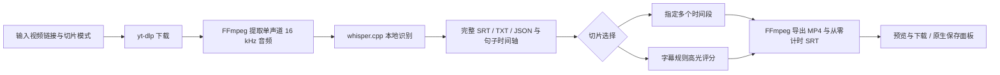

# 历史交接快照 · 2026-10-14

以下完整保留整理前的交接原文，仅用于追溯各阶段观察。当前状态请阅读[当前交接](project-handoff.zh-CN.md)。

---

# Nyaru-Clipper 项目交接

**本轮 Git 提交范围（2026-10-14）**：本次将双语翻译、Key／模型持久配置、App 0.1.4 打包及配对技术验收记录提交到三个既有开发分支。较早段落的未提交／未推送保留其观察日期；准确当前源码及远程 HEAD 以 `git log -1`、`git ls-remote origin` 为准。私密配置、媒体、模型、构建包及 `.omo` 证据留在本机。

**真实翻译验收补充（2026-10-14）**：用户设置 Key 后，App 0.1.4 使用 Flash 完成既有 40c0c9 的 658 条及 7fe886 的 1448 条翻译，生成 2 份完整和 6 份切片双语 SRT。全部时间轴、偏移、输出校验和及 86 个原文件保持不变；八份下载／预览接口、原生完整视频／切片双语播放及两次系统 SRT 导出通过。未重新下载、识别或编码。24 条语义抽查不能替代逐句校对，识别误字与含混句仍需人工复核。见[真实翻译验收](deepseek-real-translation-acceptance-2026-10-14.zh-CN.md)。下文尚未输入 Key／真实翻译待验收为历史状态。

**模型选择补充（2026-10-14）**：App 0.1.4 build 5 新增 Flash／V4 Pro 翻译模型选择，保存到现有配置并在重启加载，保留 Key。已开始的任务恢复时沿用原模型。121 项相关后端、7 项界面测试、冻结后台保存／重启、安装版浏览器实测、签名及 ZIP 通过，86 个原任务文件保持不变。真实翻译仍待 Key，源码未提交／推送。见[模型选择验收](model-selection-acceptance-2026-10-14.zh-CN.md)。

**Key 持久配置补充（2026-10-14）**：按用户新要求，App 0.1.3 build 4 将 Key 保存到 `runs/config.json` 并在重启时加载，替代下文的会话方案。117 项相关后端、6 项界面测试、构建和隔离冻结后台重启验证通过；真实 Key 尚未输入。详见[持久配置验收](persistent-key-acceptance-2026-10-14.zh-CN.md)。源码仍未提交／推送。

**双语字幕补充（2026-10-14）**：App 已升级安装为 0.1.2 build 3，新增 DeepSeek 日译中、完整／切片双语 SRT、预览选择、进度和续传；仅使用现有字幕，Key 仅用于本次会话。111 项 App 后端、155 项共享前端测试及构建／签名／ZIP 通过，86 个原任务文件保持不变。用户稍后设置 Key，真实 API 翻译及原生双语播放／保存尚待验收。本轮修改尚未提交／推送。详见[阶段记录](deepseek-bilingual-acceptance-2026-10-14.zh-CN.md)和[使用指南](deepseek-bilingual.zh-CN.md)；下文首版范围及远程同步为较早快照。

**本轮 Git 提交范围（2026-10-14）**：本次将双语翻译、Key／模型持久配置、App 0.1.4 打包及配对技术验收记录提交到三个既有开发分支。较早段落的未提交／未推送保留其观察日期；准确当前源码及远程 HEAD 以 `git log -1`、`git ls-remote origin` 为准。私密配置、媒体、模型、构建包及 `.omo` 证据留在本机。

**双语字幕补充（2026-10-14）**：共享配套工具已支持 DeepSeek 日译中双语字幕、Key／模型私密持久配置、Flash／V4 Pro 选择、批次续传及完整／切片预览导出。安装版 App 0.1.4 已翻译既有 658 和 1448 条字幕，86 个原文件保持不变；原时间轴、6 个切片偏移、8 份下载／预览、原生完整视频／切片播放及 SRT 导出通过。见[真实验收](deepseek-real-translation-acceptance-2026-10-14.zh-CN.md)和[指南](deepseek-bilingual.zh-CN.md)。较早记录中的真实翻译待验收保留其历史范围；全部译文仍未逐句校对。

**远程同步补充（2026-10-14）**：当前源码及文档已提交并推送至 `origin` 的三个开发分支：`feat/arctime-pro-plugin`（包含原目录工作站改动及完整开发记录）、`codex/local-companion-web`、`codex/local-companion-macos`。本次功能提交已远程核验为 `d4f28f9`、`5baf166`、`1366686`；后续交接文档提交的最新 HEAD 以 `git log -1`／`git ls-remote origin` 为准。下文“未提交／未推送”、旧分支 HEAD 与原目录脏工作区说明均为较早快照，以本段为当前 Git 状态。App 保留网页版的共享修复；`master` 未修改。

本次同步前复核：原目录 143 项所选后台、137 项前端测试和 7 项浏览器端到端测试通过，前端构建通过；网页版 95 项、App 版 99 项后台回归通过，0.1.1 包严格签名及旧适配器 Swift 编译通过。16 个脚本的原有可执行权限已恢复，Shell 语法检查通过。模型、媒体、构建包、私密配置和自动化临时证据留在本机。未重跑真实媒体／原生按钮验收，也不代表已完成公证或正式发布。

更新：**2026-10-14，Asia/Shanghai**。本次整理网页版／App 两个本地分支；原生媒体操作和运行状态快照属于 2026-10-13 的历史验收，未重新操作已安装 App。

## 当前结论与授权范围

后续实际修复（2026-10-14）：当前已下载任务因 2.040 秒末尾越界失败，修复为有界末尾窗口裁剪。从本工作目录构建并安装 0.1.1（build 2），原任务恢复完成，生成 658 条字幕和 2 个切片；App 版 99 项所选回归及原生完成／播放验证通过。详见[Issue #1 复测记录](macos-app-issue1-retest-2026-10-14.zh-CN.md)。源码修改未提交／推送；下方早期分支及运行快照保留其历史范围。

当前交付方向是独立本地配套工具及 macOS App：**只提供视频链接，自动下载、识别字幕文字和句子时间轴，再按指定时间段或字幕规则高光导出切片**。已经提供进度、预览、导出和中断恢复。

用户已选择本地开源路线。当前处理不启动 ArcTime，不调用其付费自动打轴或云服务；`arctime` 仍是代码目录名。macOS 首版只封装当前配套工具，旧 GPU 工作站的翻译、校对、任务库及队列不在本次 App 范围内。后续不能把目录名理解为需要重新接入付费服务。

| 项目 | 状态 | 证据与边界 |
| --- | --- | --- |
| 本地 CLI 流水线 | 已完成，短样例已验收 | 2026-10-12 真实下载／ASR／导出及恢复；80 项所选回归 |
| 浏览器 GUI | 已完成，短样例已验收 | 2026-10-13 两种模式、预览、字幕跳转、下载、历史和窄屏；99 项所选后端、137 项前端回归 |
| macOS App 0.1.0 | 已完成，本机原生流程已验收 | 88 项相关回归；真实原生表单、播放、保存／替换／取消、中断恢复；arm64，最低 macOS 27.0 |
| 旧 GPU 工作站 | 原有代码保留，本轮未重验收 | FastAPI/SQLModel、React、WhisperX、翻译／校对、队列；部署见旧手册 |
| 对外正式发布 | 未完成 | 仅本地 ad-hoc 签名，无 Developer ID、公证或跨机器验收；本次仅整理本地提交，未推送 |

以上测试数字属于对应阶段的历史验收，所选文件不同，不能相加或视作全仓库通过。本次分支划分在独立目录重新运行 App 所选后台回归，**88 passed**；网页版基线重跑 **84 个后台、154 个前端测试（21 files）**及双入口构建通过。后台有 Starlette/httpx 弃用提示，未导致失败。当前构建及冻结运行检查结果记录在下文，不代表重跑真实下载／识别／原生保存验收。

## Git 与当前运行状态

- 原始仓库：`/Users/drm/project/nyaru-clipper`，仍在 `feat/arctime-pro-plugin`／`0bcd8d5`；其未提交快照及旧工作站改动保留。
- 网页版：`codex/local-companion-web`，提交 `74e600b`，工作目录 `/Users/drm/.codex/worktrees/local-companion-web/nyaru-clipper`。
- App 版：`codex/local-companion-macos`，继承网页版提交，仅增加 App 专用源码、打包及对应文档。工作目录 `/Users/drm/.codex/worktrees/local-companion-macos/nyaru-clipper`。共享功能修改先在网页版提交，再合入 App 分支；用 `git log -1 --oneline` 查看当前 App 提交。
- `origin` 已配置为 `https://github.com/damin93381/nyaru-clipper.git`。本次未 fetch，远端最新状态和领先／落后关系未核验。
- 工作区有大量未提交修改和未跟踪文件，包含更早的原工作站改动。不能将这些修改全部归为本地工具或 App，也不能直接 `git add .`、重置或清理。
- 历史 2026-10-13 快照：已安装 App 后台 `ready=true`，四个任务为 `completed`；开发浏览器端口 8787 不可达。本次未核验该已安装 App 的在线状态。
- 本次网页版在隔离端口启动，真实 HTTP 首页、配置（ready）和空历史响应通过，检查后已退出，不占用原用户服务端口。App 使用随机回环端口，不能将开发地址当作 App 地址。

这些运行状态是本次快照；继续任务时需重新检查，不保证服务一直运行。

## 交付物与数据保护

| 内容 | 位置 |
| --- | --- |
| 已安装 App | `/Users/drm/Applications/Nyaru Clipper.app` |
| App 构建 | 项目 `dist/Nyaru Clipper.app` |
| ZIP 构建 | 项目 `dist/Nyaru-Clipper-macOS-arm64.zip`，496480853 字节 |
| App 模型／任务／日志 | `~/Library/Application Support/Nyaru Clipper/` 下的 `models/`、`runs/`、`app.log` |
| CLI／浏览器版任务 | 项目 `data/local-runs/`，不自动迁入 App |
| 独立开发 Python | `~/.cache/nyaru-clipper/companion-venv/bin/python` |
| CLI 默认模型 | `~/.cache/nyaru-clipper/models/ggml-small.bin` |

App 内置 Python、yt-dlp、FFmpeg/ffprobe、whisper.cpp、GGML 动态后端和多语种 small 模型，运行时无需终端或 Homebrew。首次启动将校验过的模型复制到用户数据目录；现有模型校验失败会报错并保留文件，不静默覆盖。

模型 SHA-256：`1be3a9b2063867b937e64e2ec7483364a79917e157fa98c5d94b5c1fffea987b`。上述已安装 App 与 ZIP 属于原目录历史产物；本次从 App 分支重新构建的包位于该工作目录的 `dist/Nyaru Clipper.app`，不覆盖已安装 App／原 ZIP，不提交构建或模型。

保留用户模型、任务清单、转写、已导出视频／字幕和失败日志；不要手改 `data/` 或 App 任务清单，未经明确选择替换，不要覆盖不同内容的导出文件。构建器遇到现有 `dist/Nyaru Clipper.app` 会拒绝覆盖，重建前先移走旧构建。移动 App 不删除数据，但未完成 ASR 的恢复会比较识别配置，当前须保持原 App 安装路径和模型；未完成下载需重新提交链接。

## 处理流程与源码入口



ASR 按五分钟音频块处理，有源文件与配置校验、缓存和时间偏移。高光使用字幕密度、笑声、兴奋词和重复表达，选择达到阈值的非重叠片段；上限不保证一定导出该数量，也可能零片段。没有词级强制对齐、说话人分离、画面理解或大模型语义评分。

| 文件／目录 | 责任 |
| --- | --- |
| `scripts/local_companion.py`、`backend/app/arctime/cli.py` | CLI 的 doctor/run/resume/gui |
| `backend/app/arctime/workflow.py` | 清单、锁、下载与阶段恢复、校验、导出检查点 |
| `backend/app/arctime/local_asr.py` | 本地 whisper.cpp、五分钟块缓存与时间轴 |
| `backend/app/arctime/media.py` | 工具定位、下载、探测、字幕解析／重定位及切片选择 |
| `backend/app/arctime/gui.py` | 独立 FastAPI `/companion-api`、单任务执行、历史、文件白名单、视频 Range 与 WebVTT |
| `web/companion.html`、`web/src/companion/` | 独立 React 图形界面，复用设计令牌／组件 |
| `desktop/macos/App.swift` | AppKit/WebKit 窗口、启动状态、原生下载／保存、进程组退出清理 |
| `scripts/macos_companion.py`、`backend/app/arctime/macos.py` | 冻结后台入口、yt-dlp 自调用、模型校验、随机端口、父进程监控 |
| `scripts/build_macos_app.py`、`desktop/macos/requirements-build.txt` | PyInstaller 打包、原生依赖、Swift 编译、许可证、签名 |
| `backend/app/services/export_encoding.py` | 复用的 CPU H.264/AAC 编码；不要为 App 另造导出器 |
| `backend/app/main.py`、`worker.py`、`web/src/workstation/` | 旧工作站入口；本轮 App 不从这里启动 |

早期 `desktop.py`／`bridge.swift` 仍保留在原目录，没有纳入两个新分支。原工作站代码保持原始基线；原目录的未跟踪 AGENTS 知识库也没有作为产品改动提交。

## 接手运行与验证

2026-10-14 分支整理验证：本工作目录完成前端构建、PyInstaller 冻结、Swift 编译及 `codesign --verify --deep --strict`；新包自调用 yt-dlp 返回 `2026.08.19`。冻结后台在 `PATH=/usr/bin:/bin` 和临时隔离数据目录下实际启动，环境检查返回 `ready=true`，包内首页及空历史响应正常；检查后后台已停止。未替换已安装 App，未重复真实视频流水线或原生按钮验收。

以下从仓库根目录执行。App 可直接双击启动；浏览器 GUI 需要独立环境与已构建前端。

```bash
~/.cache/nyaru-clipper/companion-venv/bin/python scripts/local_companion.py doctor
~/.cache/nyaru-clipper/companion-venv/bin/python scripts/local_companion.py gui
```

GUI 默认监听 8787，支持 `--port`、`--output-dir`、`--model`、`--threads`。关闭浏览器页面不停止服务；App 关闭窗口或 Cmd-Q 则停止后台及子进程。

前端修改后的构建及回归必须在 `web` 目录执行，以匹配锁定的 pnpm 版本：

```bash
cd web
corepack pnpm build
corepack pnpm test --run
```

本轮 App 相关 88 项回归对应命令如下；当前独立环境已安装测试依赖，但 `requirements-build.txt` 不负责安装 pytest/httpx。旧验收中的 `/tmp/nyaru-arctime-tests/bin/python` 已不存在，不要继续依赖。

```bash
PYTHONPATH=backend ~/.cache/nyaru-clipper/companion-venv/bin/python -m pytest \
  backend/tests/test_macos_companion.py backend/tests/test_arctime_media.py \
  backend/tests/test_arctime_workflow.py backend/tests/test_local_asr.py \
  backend/tests/test_local_companion_cli.py backend/tests/test_companion_gui.py -q
```

App 重建前保留旧产物，然后使用含 PyInstaller 的独立构建环境执行：

```bash
~/.cache/nyaru-clipper/companion-venv/bin/python scripts/build_macos_app.py
```

从零准备构建环境及模型参数见 [macOS 使用／构建说明](macos-app.zh-CN.md)。当前编译目标和原生依赖都要求 macOS 27；兼容旧系统须重新选择或构建依赖，不能仅修改 Info.plist。不要将完整 GPU 后端依赖塞入 App。

## 验收证据与已修复问题

- [CLI 验收](local-companion-acceptance-2026-10-12.md)、[浏览器 GUI 验收](local-companion-gui-acceptance-2026-10-13.md)、[macOS 原生验收](macos-app-acceptance-2026-10-13.md)。
- `.omo/evidence/macos-runtime-qa.json`：42 个 Mach-O 无开发机绝对依赖、包内媒体解码、强杀父应用后清理识别组及端口、模型／导出保留。
- `.omo/evidence/macos-native-qa.json` 及 `macos-export.mp4`／`.srt`：原生播放器、保存、同名替换、取消、高光表单、中断恢复。
- `.omo/evidence/macos-app-review.md`：独立审阅 WATCH / APPROVE，阻断项为空。审阅者验证代码／证据，不等于其亲自点击所有原生流程。

已修复首次启动重复 setsid 的 EPERM、WKDownload 不能写入已存在目标（改为同目录临时下载后安全替换）、helper 先退出导致遗漏进程组 SIGKILL、不同模型文件名导致首启缺文件。保留这些失败及修复记录，避免回退。

桌面自动化曾出现 ScreenCaptureKit -3811，重启后恢复并完成主要原生验收；额外退出复查遇到 -3812，未执行退出。不要把工具失败记为成功操作，健康响应也不等于重新验收功能。

## 待办与禁止动作

下面是未实施的后续工作，不是已承诺交付或当前阻塞：

1. 用用户授权的真实平台短视频核验下载访问条件，再覆盖长视频、识别质量、资源使用及实际扬声器输出。合成短样例不能代替这些验收。
2. 确定要支持的最低 macOS 版本，准备对应原生工具和干净机器验收；Intel 支持需独立构建与验证。
3. 如需对外分发，再处理 Developer ID、公证、依赖／模型许可证和源码交付要求；当前包只完成本地签名。
4. 在用户进一步要求语义或画面高光时扩展评分；当前规则筛选的能力边界必须继续说明。
5. 两个版本现已独立提交；共享修复先进入网页版，再同步 App 分支。后续推送按用户指令执行，避免混入原目录旧工作站修改。

不要恢复调用 ArcTime 付费能力，不要删除模型／历史／失败证据，不要改生成的 requirements/API 类型或运行时目录，不要把服务直接暴露公网，不要为此增加 Redis/Celery 或多 worker。历史 `.omo/evidence/` 位于原开发目录，不随 Git 分发；本次不修改用户已安装 App 或其任务数据。
