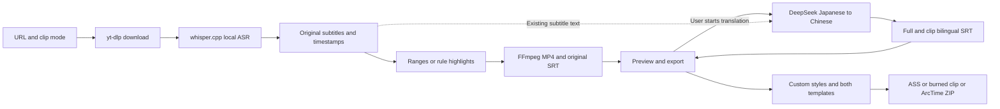

# Nyaru-Clipper macOS App handoff

## 2026-10-15 Web verification and App branch delivery

The user authorized committing/pushing the App changes after browser verification. The target is `codex/local-companion-macos`; this delivery includes Saozi, automatic bilingual output, the ChatGPT subscription provider and App0.1.8 build14 packaging. Earlier uncommitted/unpushed statements below describe their original observation time. Web/main worktree changes are separate.

Real browser task `472c1adbd0d1` completed with ChatGPT semantic decisions, two clips and21/21 translations. Provider switching, network-failure retry, bilingual playback, SRT download and reload persistence passed. Fresh App382/backend Web375/UI41 selected tests and the production build passed. See the [Web acceptance](web-app-acceptance-2026-10-15.md). Developer ID signing/notarization and public release remain outside this delivery.

## 2026-10-15 ChatGPT subscription update (takes precedence)

The **AI provider** setting now offers DeepSeek Flash/ChatGPT subscription. The user completed official authorization; GPT-6-Luna subscribed inference, a new local task and real Bilibili live automatic bilingual output passed. DeepSeek Pro is disabled. Installed0.1.8 build14 corrects active-live translation status; signature/hashes, retained login/model catalog, native playback and system saves are verified.

- Local `73fbcd311737`:150.033333seconds,73/77.033333second clips,21translated cues.
- Real live `68faca68e130`:181.105seconds,107.705/73.4second clips,40translated cues; first bilingual SRT downloadable before recording stopped.
- Each has3pairedSRTs; downloads, cue counts and clip-local timing match.169protectedoriginal files and35existingpairedclip files retain their hashes.
- 382related backend tests,41UI tests and production build passed. Native bilingual playback passed; finalbuild14saved local/live paired SRTs through the system panel into project evidence with matching hashes. The old Downloads request failed without a grant; project-folder saving passed.
- Initial task35b20d's SSE shape failure was diagnosed/fixed and retained. Legacy jobs keep their original provider. No commit/push, notarization or public release.

Guide: [ChatGPT subscription](openai-subscription.md). Evidence/limits: [acceptance](openai-subscription-acceptance-2026-10-15.md). Older versions and Flash failure states below are historical observations.

## 2026-10-15 Saozi update (takes precedence)

**The installed App is 0.1.7 build 11.** Saozi supports replay, local recordings and Bilibili live capture, with DeepSeek paragraph decisions and automatic bilingual SRT output, retained short tails/original subtitles, stop/recovery and preview. Shared source lives in the browser/App worktrees; the main checkout does not contain the complete current App source.

- Bilingual completion: reused658 translations from40c0c9 for35 clips, producing36 bilingual SRTs with zero translation requests.56 original and113 existing target hashes stayed unchanged. Native bilingual preview/system SRT download passed.286 backend/25 frontend tests and build passed; code review APPROVE. New real-provider checks encountered503/timeouts; see the [bilingual acceptance record](saozi-bilingual-acceptance-2026-10-15.md) for the current boundary.

- Full 40c0c9 validation created independent task `1bd089ad75b3`: 3275.299 seconds, 35 clips, 34 real Flash API calls and 56 original-file hashes unchanged.
- Paced live simulation from40c0c9 created `1276274cd22d`: real whisper.cpp and DeepSeek, two outputs before capture stopped, four final clips and recording process exit.
- The installed UI imported seconds300–450 from40c0c9 as `d8ad2ee92663`, completing real recognition, semantic analysis and two clips. Video/SRT are readable. Browser UI and native-window acceptance remain separate.
- Selected backend257 tests, frontend24 tests and build passed; these are not whole-repository coverage. Offline silence handling is fixed; disconnect warnings are visible.
- Previous0.1.5 build9 was backed up; 1498 installed files matched the build, with strict signature checks for the installation and backup. Signing remains ad-hoc; no notarization or publication.
- Native-window acceptance is complete: playback advanced for the first Saozi clip derived from40c0c9, the user confirmed normal audio, and system-save MP4/SRT exports matched task hashes. The first save waited for Downloads permission and completed after the user allowed it.

Guide: [Saozi](saozi.md). Details: [acceptance record](saozi-acceptance-2026-10-15.md). No commit/push; models, settings, history and older exports are preserved. Version0.1.5 statements below describe the pre-update state.

Verified: **2026-10-15, Asia/Shanghai**. This checkout owns the macOS App, inheriting the browser core while retaining frozen tool/downloader dispatch.

The current handoff replaces accumulated snapshots; the exact prior text is retained in the [historical attachment](project-handoff-history-2026-10-14.md). Old versions, hashes, unpushed states and pending-Key statements apply only to their recorded observations. The exact pre-update handoff for this checkout is also retained in the [15October pre-update snapshot](project-handoff-history-2026-10-15.md); earlier attachments are unchanged.

## Current outcome

The product is a standalone local companion and **macOS App 0.1.5 build 9**: URL download, local subtitle text/sentence timestamps, explicit-range or subtitle-rule highlight clips, progress, preview, export and interrupted-task recovery. It includes DeepSeek Japanese-to-Chinese full/clip bilingual subtitles, persistent Key/model settings and model selection.

The current entry does not invoke paid ArcTime alignment/cloud services; `arctime` remains a code directory name. The older WhisperX/GPU workstation and desktop adapters retain separate historical scope.

| Capability | Status and boundary |
| --- | --- |
| Download, local ASR, range/highlight clips | Implemented; two long-video recovery/export workflows accepted historically |
| Bilingual translation | Implemented; real Flash technical acceptance on two existing tasks |
| Key/model configuration | Atomic 0600 saves, updates, invalid-configuration repair and restart loading verified |
| Native bilingual preview/export | Full/clip playback observed; two representative native SRT exports verified |
| V4 Pro | Selection, persistence, mocked requests and checkpoint binding verified; real translation unaccepted |
| Styles/two template types/ASS/burn/handoff | Implemented and exercised; see evidence below. User trial feedback pending |
| Distribution | Subtitle source committed and atomically pushed to browser/App development branches; not merged into primary/master. Build9 installed locally, ad-hoc signed, unnotarized and not publicly released |

## 15October2026 subtitle delivery and local installation

**Implementation and exercised workflows are accepted; user trial feedback is pending.** The current version is **0.1.5 build9**. Feature acceptance, installation checks and historical evidence remain distinct.

| Feature | Observed behavior |
| --- | --- |
| Custom subtitle styles | Separate original/translation font, size, color, outline, background opacity, position and margins; bilingual browser/App preview and subtitle fullscreen/exit exercised |
| Style JSON templates | Built-in/user templates, save/copy/update/delete, import/download and defaults; native App Open-panel import passed |
| ArcTime ATPJ templates | Opaque native bytes preserved for storage/download, optional style-template association and ZIP inclusion; native upload, saved association and byte integrity passed |
| ASS, burn and handoff | Actual-video-resolution ASS; burned clips only; ZIP includes video, ASS, SRT, style.json, instructions and checksum manifest, with optional ATPJ |
| Native ArcTime refinement | Synthetic6s media/nine ASS events imported; text/timing edited and saved, ten styles reused in a fresh project; native bilingual/style playback and timeline seek passed |

Representative App exports covered original size64/background0.4, a48.033s bilingual burn and1280×720 ASS. Seventeen original task-file hashes stayed unchanged. Build9 adds WKWebView native Open-panel wiring while retaining the shared code exercised in build8 exports. Packaging now includes dynamically loaded SDL3 and checks FFmpeg libass. Interrupted exports can retry while preserving older outputs.

The14October native-player acceptance gap was closed by15October verification. ArcTime's Java main window and separate mpv video window have different owners; Java-only capture omits the video plane. Player and actual-display captures show white Japanese with black background, green Chinese and two-line translation. Native Play/Pause, playing captures at3.12/5.52s and a timeline seek to3.04s passed. The same fixture check fails two Java-only captures and passes seven player/display captures. Earlier full-region black evidence is preserved but did not reproduce; ArcTime/system settings were not changed.

**Installation:** the verified package is installed at `~/Applications/Nyaru Clipper.app`. Previous0.1.4 build5 is backed up at `~/Library/Application Support/Nyaru Clipper/app-backups/2026-10-15-0.1.4-build5/Nyaru Clipper.app`. All1498 copied file SHA256 values match; installed/backup strict signatures pass. Installation and this read-only documentation check load seven historical tasks, three style templates and one ArcTime template, with backend readiness, burn and native handoff available. Models, tasks, settings and original exports are retained. The App is running for user trial; feedback is not yet available.

**Build/evidence:** App checkout `dist/subtitle-style-0.1.5-upload-verified/Nyaru Clipper.app`; archive `dist/Nyaru-Clipper-0.1.5-build9-macOS-arm64.zip`, SHA256 `bfb5ee2004afec196644c3114ee1826168879d481ad6f8e33d44d2190c97162e`. Previously recorded checks passed187 selected backend tests,16 API cases after final instruction edits,22 final frontend tests and TypeScript/Vite build. Do not add overlapping selections or call them whole-repository acceptance. This documentation update reruns no tests or exports.

- [Subtitle usage guide](subtitle-styles.md)
- [Feature delivery and acceptance](subtitle-styles-acceptance-2026-10-14.md)
- [Native ArcTime preview follow-up](arctime-native-preview-2026-10-15.md)
- [Local installation receipt](/Users/drm/.codex/worktrees/local-companion-macos/nyaru-clipper/.omo/evidence/local-install-build9-2026-10-15.json)
- [Final code review](/Users/drm/.codex/worktrees/local-companion-web/nyaru-clipper/.omo/evidence/subtitle-final-review.md) (APPROVE, no blockers; its historical preview gap is covered by the follow-up)

**Refinement order and limits:** import video → optionally import ATPJ styles through “从其它工程文件导入样式” → import ASS including styles → inspect resolution/fonts/groups/bilingual layout → save your own ATPJ. This is file handoff, not automatic population of a native project or a paid/cloud integration. Dimensions scale from a1080 reference height; ASS/ZIP use actual video canvas, while burns use reference canvas. ArcTime rounds font sizes, inserts fades and changes layers. Same-name template styles can overwrite dimensions. Native project bytes may include old media paths/account markers; private fixtures/raw captures remain local and require review before sharing. No lossless visual roundtrip, all-font or other-machine/platform acceptance is claimed.

## Publication and validation

Feature source is pushed; the documentation commit adds guides and pre-update snapshots. Native template fixtures, media, screenshots and `.omo` receipts remain local. User trial feedback is still pending.

## Branches and ownership

| Branch | Verified feature HEAD before documentation commits | Checkout |
| --- | --- | --- |
| `feat/arctime-pro-plugin` | `e8ea71085cf5c6ff6f671499872f5c166d31f89b` | `/Users/drm/project/nyaru-clipper` |
| `codex/local-companion-web` | `16a0b60595ca63bf7363df26141bcf4be1905550` | `/Users/drm/.codex/worktrees/local-companion-web/nyaru-clipper` |
| `codex/local-companion-macos` | `6b5c3363a7eca0aa1a0d495bdb277fbc0b37b1db` | `/Users/drm/.codex/worktrees/local-companion-macos/nyaru-clipper` |

Repository: [damin93381/nyaru-clipper](https://github.com/damin93381/nyaru-clipper). User-authorized15October source publication used `git push --atomic` for both development branches. Remote read-back confirmed browser feature `16a0b60595ca63bf7363df26141bcf4be1905550`, App shared feature `2454a557c00f5583ae644cbd09ca8d32bd9d5f6f` and native/packaging fix `6b5c3363a7eca0aa1a0d495bdb277fbc0b37b1db`. Table HEADs are the verified feature commits before documentation commits; final publication refs belong to remote Git/push receipts. Primary's documentation changes remain local and its branch has not merged the feature; master stays `0bcd8d503ac33f89c8e1cd526de5d7a44f6668b6`.

Start shared pipeline/UI changes in the browser worktree, then merge into App. Keep native packaging/lifecycle work in App. Do not replace App `media.py` wholesale with the browser version: frozen tool/downloader dispatch must remain.

## Real translation acceptance

| Existing task | Full bilingual cues | Clip bilingual SRTs | Model/state |
| --- | ---: | ---: | --- |
| `40c0c9a8e93e` | 658 | 2 | Flash/completed, no error |
| `7fe886d15999` | 1448 | 4 | Flash/completed, no error |

Real API processing produced 2106 translations in 54 validated batches without downloading, recognizing or encoding media again. Every cue retains Japanese text, nonempty Chinese and original timestamps; all six clip files match original selections with zero-based offsets. Eight SRT output/download checksums and VTT previews passed. Native full/clip bilingual playback and two SRT save-panel exports passed.

Historical translation acceptance confirmed86 original media/subtitle/manifest/ASR-cache files unchanged; this documentation update did not recheck that86-file list. Only 24 cues were semantically sampled; ambiguous recognition and names can yield awkward or inferred translations. Full sentence-by-sentence proofreading remains incomplete.

Historical14October commit validation (new subtitle checks are recorded above): selected original-backend **121**, browser-backend **117**, shared Companion UI **7** tests and frontend build passed. Selections differ and must not be summed or called a whole-repository pass. No regressions, media stages or provider calls reran during this documentation update.

- [Real translation acceptance](deepseek-real-translation-acceptance-2026-10-14.md)
- [Bilingual guide](deepseek-bilingual.md)
- [Model selection acceptance](model-selection-acceptance-2026-10-14.md)
- [Persistent Key acceptance](persistent-key-acceptance-2026-10-14.md)
- [Implementation checkpoint](deepseek-bilingual-acceptance-2026-10-14.md)
- [macOS use/build guide](macos-app.md)

Earlier short samples, test selections and automation failures remain in the historical attachment and dated records.

## Runtime, settings and protected data

Read-only15October documentation checks: installed0.1.5 build9 passes strict signature verification; backend online/ready, seven tasks, three style templates and one ArcTime template readable, burn/native handoff available. App loopback ports are random: obtain the current URL from startup state or the native page after restart. Do not hard-code old ports or launch a second writer against the same data root.

| Data/artifact | Location |
| --- | --- |
| Installed App | `~/Applications/Nyaru Clipper.app`,0.1.5 build9; previous-version backup above |
| Templates | App `runs/templates/styles/`, `runs/templates/projects/`, defaults in `runs/templates/defaults.json`; no manual editing |
| Models/tasks/log | `~/Library/Application Support/Nyaru Clipper/`: `models/`, `runs/`, `app.log` |
| Private settings | App `runs/config.json`, fields `deepseek_api_key` and `deepseek_model` |
| Bilingual outputs | Task `subtitles.ja-zh.srt` and `clip-NNN.ja-zh.srt` |
| Browser/CLI history | Each checkout's `data/local-runs/`, not automatically imported into App |
| Current App/ZIP | App checkout `dist/subtitle-style-0.1.5-upload-verified/Nyaru Clipper.app`, `dist/Nyaru-Clipper-0.1.5-build9-macOS-arm64.zip`; older builds retained |
| Python/default model | `~/.cache/nyaru-clipper/companion-venv/bin/python`; `~/.cache/nyaru-clipper/models/ggml-small.bin` |
| Private QA evidence | Original `.omo/evidence/`, excluded from Git |

Key and model save independently without clearing each other; legacy Key-only settings default to Flash. Saves are atomic with 0600 and never return the Key through the API. Manual edits require private permissions and restart; an empty Key disables translation. Settings contain plaintext credentials and must not be displayed, shared or committed.

New defaults apply to translations not yet started. Retries retain the task's recorded model and validated batches. Changing defaults does not retranslate completed bilingual outputs. MP4 pixels and burned-in subtitles remain unchanged.

## Flow and source map

Companion source entries below refer to browser/App worktrees: new Python modules are under `backend/app/arctime/` and UI under `web/src/companion/`. Primary has not merged these features.



ASR uses verified five-minute caches; bounded terminal overruns and contiguous zero-duration fragments were fixed. Ordinary subtitle parsing stays strict. Highlights score subtitle density, laughter/excitement and related rules; results may be below the requested limit or empty. There is no visual/LLM semantic scoring.

| Entry | Responsibility |
| --- | --- |
| `scripts/local_companion.py`, `backend/app/arctime/cli.py` | doctor/run/resume/gui |
| `workflow.py`, `media.py`, `local_asr.py` | Download, ASR caches, manifests, clips/recovery |
| `backend/app/arctime/translation.py` | API, 40-cue batches, validation, checkpoints, bilingual outputs |
| Worktree `gui.py`, `companion_manager.py`, `companion_models.py` | GUI routes/execution/models split; configuration/translation/file boundaries retained |
| Worktree `subtitle_style.py`, `subtitle_templates.py` | Styles, ASS rendering, template storage/validation |
| Worktree `subtitle_api.py`, `subtitle_inputs.py`, `subtitle_exports.py`, `subtitle_encoding.py` | Template/export APIs, input validation, serialized exports/receipts, canvas conversion/burn |
| `web/src/companion/` | Shared UI, subtitle-track selection, preview/export |
| `desktop/macos/App.swift`, `backend/app/arctime/macos.py` | Native window/save panel, backend and parent lifecycle |
| App worktree `scripts/build_macos_app.py` | 0.1.5 packaging, SDL3, frozen FFmpeg/libass checks/local signing |

Original `backend/app/main.py`/`worker.py` belong to the older workstation. Browser checkout has no native App sources/build script.

## Continue and verify

Open the installed App to reuse existing tasks. Start the separate browser service only when needed; this documentation run did not start or stop services:

```bash
cd /Users/drm/.codex/worktrees/local-companion-web/nyaru-clipper
~/.cache/nyaru-clipper/companion-venv/bin/python scripts/local_companion.py doctor
~/.cache/nyaru-clipper/companion-venv/bin/python scripts/local_companion.py gui
```

GUI defaults to 8787 and supports `--output-dir`, `--port`, `--model`, `--threads`. Explicitly select history to reuse it; never run two writers against one task root.

Run frontend commands from `web` to respect the pinned pnpm version:

```bash
cd web
corepack pnpm test --run src/companion/Companion.test.tsx \
  src/companion/SubtitleEditor.test.tsx src/companion/SubtitlePreview.test.tsx \
  src/companion/subtitleStyle.test.ts
corepack pnpm build
```

Run App backend regressions in the App worktree; browser checkout omits `test_macos_companion.py` and `test_macos_subtitle_build.py`. These are future verification commands, not executions in this documentation update:

```bash
PYTHONPATH=backend ~/.cache/nyaru-clipper/companion-venv/bin/python -m pytest \
  backend/tests/test_arctime_media.py backend/tests/test_arctime_workflow.py \
  backend/tests/test_local_asr.py backend/tests/test_local_companion_cli.py \
  backend/tests/test_companion_gui.py backend/tests/test_companion_translation.py \
  backend/tests/test_macos_companion.py backend/tests/test_macos_subtitle_build.py \
  backend/tests/test_subtitle_style.py backend/tests/test_subtitle_templates.py \
  backend/tests/test_subtitle_api.py backend/tests/test_subtitle_renderer.py -q
```

Rebuild using App worktree `scripts/build_macos_app.py`. Preserve existing builds first: the builder refuses overwrite. Updating the App keeps user data. Current target is arm64/macOS 27.0 minimum; changing Info.plist alone cannot establish older-system compatibility.

## Remaining work and boundaries

1. Collect user0.1.5 style/template/ArcTime trial feedback. Broader font/roundtrip/speaker/clean-host acceptance remains pending, along with sentence-level translation review, real V4 Pro and broader platform access.
2. The primary14October record reports [Issue #1](https://github.com/damin93381/nyaru-clipper/issues/1) closed at19:20:50 Asia/Shanghai. GitHub was not queried in this update; the stale OPEN action is superseded. Preserve failed-download task `18e794` and original failure logs.
3. Intel/older macOS, Developer ID, notarization and public package distribution are incomplete.
4. Semantic/visual highlights, word alignment, diarization and Nyaru's internal subtitle text/timeline proofreading UI are unimplemented; ArcTime editing uses the file handoff above.

Do not restore paid ArcTime calls, delete models/history/failure evidence, hand-edit task/translation manifests, replace differing outputs without an explicit choice, publish Key/media/private QA, hand-edit generated requirements/API types, expose the service publicly or introduce multiple workers. Further commits/pushes must match user-authorized scope.

This user-authorized publication commits/pushes verified subtitle features and macOS changes, with usage/handoff records in the accompanying documentation commit. Fresh pre-push checks passed180 selected browser backend tests,187 App backend tests,22 frontend tests, TypeScript/Vite build and Swift typecheck; existing Starlette/httpx deprecation warnings remain. The only source difference from the exercised package removes three trailing blank lines in each extracted module; behavior is unchanged and installed App was not rebuilt/replaced. No paid translation/media processing reran or media/native-template fixtures/credentials/private evidence were uploaded. Historical attachments remain unchanged; primary/master have not merged the feature.
