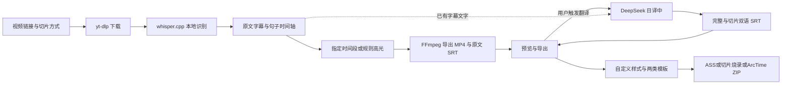

# Nyaru-Clipper 项目交接

## 2026-10-15 ChatGPT订阅接入（以本节为准）

已加入 **AI供应商** 选择：DeepSeek Flash／ChatGPT订阅。官方授权已由用户完成，GPT-6-Luna订阅调用、本地新任务和真实Bilibili实时自动双语均通过；DeepSeek Pro已禁用。当前已安装0.1.8 build14，实时翻译状态提示已修正，签名／哈希、登录保留、模型列表、原生播放及系统保存均已核验。

- 新本地任务 `73fbcd311737`：150.033333秒，73／77.033333秒两片，21条双语字幕。
- 真实直播 `68faca68e130`：181.105秒，107.705／73.4秒两片，40条双语字幕；停止前已可下载首片双语SRT。
- 每任务3份双语SRT；下载字节、条数、切片局部时间轴核对通过。旧169项原文件及已有35份切片双语字幕哈希保持一致。
- 最终相关后端382项、界面41项及生产构建通过。原生双语播放通过；最终build14通过系统保存框将本地与实时双语SRT保存到项目验收目录，哈希一致。旧Downloads请求失败，未授予权限，不影响选择项目目录保存。
- 首次新任务35b20d的SSE格式失败已定位并修复，保留失败证据；旧任务不跟随新默认切换供应商。未提交、未推送，未公证或发布。

使用：[ChatGPT订阅](openai-subscription.zh-CN.md)。实际结果与限制：[订阅接入验收](openai-subscription-acceptance-2026-10-15.zh-CN.md)。下文旧版本和Flash失败状态属于较早观察。

## 2026-10-15 臊子更新（以本节为准）

**当前安装版为 0.1.7 build 11。**「臊子」支持回放、本地录像及Bilibili实时录制，按DeepSeek段落分析连续切片，并自动生成中日双语SRT；保留短尾段与原文字幕，支持停止、恢复和预览。共享源码在网页版与App工作树；本主目录不代表完整App源码。

- 双语补齐：40c0c9已有658条译文复用到35片，生成36份双语SRT，0翻译请求；原任务56项和目标原有113项哈希不变。原生双语预览及系统SRT下载通过。286项后端、25项前端及构建通过，代码复审APPROVE。真实新API验收遇到503／响应超时，当前边界见[双语验收](saozi-bilingual-acceptance-2026-10-15.zh-CN.md)。

- 40c0c9 全片验证生成独立任务 `1bd089ad75b3`：3275.299秒、35片、34次真实 Flash API；56项原文件哈希未变。
- 40c0c9 实时模拟任务 `1276274cd22d`：真实 whisper.cpp 和 DeepSeek，输入停止前已有两个输出，最终4片，录制进程退出。
- 安装版界面从40c0c9的300–450秒局部录像创建 `d8ad2ee92663`，实际导入、识别、语义分析及两片输出通过；SRT与视频可读。浏览器界面验证与原生窗口验收分开记录。
- 所选后端257项、前端24项及构建通过，不能称为全仓库测试。离线静音异常已修复，断流说明已加入界面。
- 旧0.1.5 build9已备份；1498项安装文件哈希匹配，安装版与备份严格签名校验通过。仍为ad-hoc签名，未公证／发布。
- 原生窗口验收已补齐：40c0c9对应臊子首片播放时间正常推进，用户确认声音正常；MP4/SRT通过系统保存对话框导出，哈希与任务文件一致。首次保存等待下载目录权限，用户允许后正常完成。

使用说明：[臊子](saozi.zh-CN.md)。验收细节：[臊子验收记录](saozi-acceptance-2026-10-15.zh-CN.md)。未提交、未推送；模型、配置、历史及旧导出保留。以下0.1.5相关记录为本次更新前事实。

核验日期：**2026-10-15，Asia/Shanghai**。本目录是综合项目和早期工作站源码入口；配套工具的共享修改优先在网页版工作目录完成。

本次整理当前入口，原交接原文完整保存在[历史快照](project-handoff-history-2026-10-14.zh-CN.md)。旧版本、旧哈希、未提交／未推送和待设置 Key 等描述仅适用于历史观察，不作为当前状态。 更新前的本目录交接另完整保存在[2026-10-15更新前快照](project-handoff-history-2026-10-15.zh-CN.md)，历史附件不改写。

## 当前结论

交付方向是独立本地配套工具与 **macOS App 0.1.5 build 9**：输入视频链接，本地下载并识别字幕文字和句子时间轴，按指定时间段或字幕规则高光切片，查看进度、预览、导出及恢复中断任务。已加入 DeepSeek 日译中、完整／切片中日双语字幕、持久 Key 和模型选择。

当前入口不调用 ArcTime 付费自动打轴或云服务；`arctime` 是代码目录名。旧 WhisperX/GPU 工作站与早期桌面适配器保留各自历史范围，不属于当前 App 的运行入口。

| 项目 | 当前状态与边界 |
| --- | --- |
| 链接下载、本地识别、指定／高光切片 | 已实现；两段长视频的历史恢复与导出已验收 |
| 日译中双语字幕 | 已实现，Flash 已在两个既有任务完成真实 API 技术验收 |
| Key／模型配置 | 已实现；保存、更新、无效配置修复、权限 0600、重启加载已验证 |
| 原生双语预览／导出 | 完整视频及切片播放已观察；两个代表性 SRT 系统导出校验通过 |
| V4 Pro | 选择、持久化、模拟请求和缓存模型绑定已验证；真实翻译未验收 |
| 字幕样式／两类模板／ASS／烧录／精修交接 | 已实现并通过实际验证，详情与证据见下一节；用户试用反馈待收集 |
| 发布 | 旧功能已推送三个开发分支；本次字幕功能在两个工作目录未提交／未推送，未合入主目录；0.1.5 build9已本机安装，仍为ad-hoc签名，未公证或发布 |

## 2026-10-15 字幕样式交付与本机安装

**实现及实际流程已验收，用户试用反馈待收集。** 当前版本为 **0.1.5 build 9**；以下记录区分功能验收、安装检查与历史证据。

| 功能 | 已验证行为 |
| --- | --- |
| 自定义字幕样式 | 原文／译文分别设置字体、字号、颜色、描边、背景透明度、位置和边距；浏览器及 App 双语预览、字幕全屏和退出已实际操作 |
| 样式 JSON 模板 | 内置与用户模板、保存／复制／更新／删除、导入／下载及默认样式；App 系统文件面板实际导入成功 |
| ArcTime ATPJ 模板 | 原生文件按字节保存与下载，可关联样式模板并随精修包交付；App 导入、关联保存及包内字节一致性通过 |
| ASS、烧录、精修包 | ASS 使用视频实际尺寸；烧录仅支持切片；ZIP 包含视频、ASS、SRT、style.json、交接说明和校验清单，可附带 ATPJ |
| ArcTime 原生精修 | 合成6秒视频与9个ASS事件实际导入，文字／时间编辑保存、第二新工程复用10个样式通过；双语样式原生播放及时间轴跳转通过 |

代表性 App 导出验证覆盖原文64号、背景0.4、48.033秒双语烧录及1280×720 ASS；17个原任务文件SHA256保持不变。build9补齐 WKWebView 系统文件选择面板；与实测导出 build8 的共享代码一致。打包补齐 FFmpeg 动态加载的 SDL3，并检查 libass 滤镜。中断导出可重试，旧产物保留。

10月14日记录的 ArcTime 黑屏验收项已由10月15日复查关闭：ArcTime 的 Java 主窗口与独立 mpv 播放器分属不同窗口，单独截取主窗口会遗漏视频层。同一时刻播放器／实际屏幕可看到白色日文黑底、绿色中文及两行换行；原生 Play/Pause、3.12／5.52秒播放截图、3.04秒时间轴跳转通过。两张 Java 单窗图在同一像素检查中失败，七张播放器／实际屏幕图通过。旧区域黑图仍保留为历史观察，本次未重现；未修改 ArcTime 播放器或系统配置。

**安装：** 已验证原包安装到 `~/Applications/Nyaru Clipper.app`；旧0.1.4 build5备份到 `~/Library/Application Support/Nyaru Clipper/app-backups/2026-10-15-0.1.4-build5/Nyaru Clipper.app`。1498个复制文件SHA256一致，安装版和备份严格签名校验通过。安装及本次交接只读接口核验均读取7个历史任务、3个样式模板和1个ArcTime模板，后台就绪，烧录与原生交接可用。模型、任务、配置与原导出保留；App已启动供用户试用，尚无试用反馈。

**构建与证据：** App工作目录 `dist/subtitle-style-0.1.5-upload-verified/Nyaru Clipper.app`；ZIP `dist/Nyaru-Clipper-0.1.5-build9-macOS-arm64.zip`，SHA256为 `bfb5ee2004afec196644c3114ee1826168879d481ad6f8e33d44d2190c97162e`。所选后端187项、最后包说明变更后的API16项、前端最终22项及TypeScript/Vite构建通过，属于此前功能验证记录，不相加为全仓库测试；本次文档更新未重跑测试或导出。

- [字幕样式使用指南](/Users/drm/.codex/worktrees/local-companion-macos/nyaru-clipper/docs/subtitle-styles.zh-CN.md)
- [功能交付与验收记录](/Users/drm/.codex/worktrees/local-companion-macos/nyaru-clipper/docs/subtitle-styles-acceptance-2026-10-14.zh-CN.md)
- [ArcTime 原生预览复查](/Users/drm/project/nyaru-clipper/docs/arctime-native-preview-2026-10-15.zh-CN.md)
- [本机安装回执](/Users/drm/.codex/worktrees/local-companion-macos/nyaru-clipper/.omo/evidence/local-install-build9-2026-10-15.json)
- [最终代码审阅](/Users/drm/.codex/worktrees/local-companion-web/nyaru-clipper/.omo/evidence/subtitle-final-review.md)（APPROVE，无阻断；其中原生预览的旧状态由上述复查补齐）

**精修顺序和边界：** 导入视频 → 如需ATPJ，先用「从其它工程文件导入样式」导入工程样式 → 导入带样式的ASS → 检查分辨率、字体、分组与双语排列 → 保存自己的ATPJ。交接采用文件流程，不自动生成填好媒体与时间轴的原生工程，不调用付费／云服务。样式尺寸按1080参考高度换算，ASS／ZIP使用实际视频画布，烧录沿用参考画布。ArcTime会取整字号、添加淡入淡出、重排层；旧模板同名样式可能覆盖尺寸。原生模板可能带旧媒体路径和账户标记，私密测试工程和原始截图仅保留本地，分享前检查。未承诺无损视觉往返、所有字体或其他机器／平台通过。

## 分支与接手入口

| 分支 | 2026-10-15核验本地 HEAD | 工作目录 |
| --- | --- | --- |
| `feat/arctime-pro-plugin` | `e8ea71085cf5c6ff6f671499872f5c166d31f89b` | `/Users/drm/project/nyaru-clipper` |
| `codex/local-companion-web` | `360fd5fe1e541a5fda2288efc06f77b76501094d` | `/Users/drm/.codex/worktrees/local-companion-web/nyaru-clipper` |
| `codex/local-companion-macos` | `43eb1a2ab6acc69a1695b005d4aea1532065ada6` | `/Users/drm/.codex/worktrees/local-companion-macos/nyaru-clipper` |

仓库为 [damin93381/nyaru-clipper](https://github.com/damin93381/nyaru-clipper)。本次只读核验三个本地分支及HEAD，与表中一致；远程一致性属于2026-10-14的历史核验，本轮未查询远程。当前三个目录均有未提交的文档／功能修改，HEAD不能代表0.1.5完整源码。字幕共享代码在网页版工作目录完成并同步App目录；主目录仅记录设计、交接与预览复查，尚未合入新功能代码。不要reset、整文件覆盖或清理这些工作树。未提交、推送或修改master。

共享处理和 UI 先进入网页版，再合入 App；App 专属打包与进程生命周期修改在 App 目录完成。不要用网页版 `media.py` 整文件覆盖 App 的冻结工具定位代码。

## 真实翻译与验收证据

| 既有任务 | 完整双语条数 | 切片双语 SRT | 模型／状态 |
| --- | ---: | ---: | --- |
| `40c0c9a8e93e` | 658 | 2 | Flash／completed，无错误 |
| `7fe886d15999` | 1448 | 4 | Flash／completed，无错误 |

共 2106 条，54 个有效批次。翻译只复用既有字幕，不重新下载、识别或编码视频。逐条确认日语保留、中文非空、完整时间轴一致；六个切片的零起点偏移与选区一致，八份输出／下载校验和及 VTT 预览通过。原生完整视频／切片双语播放与两次 SRT 系统导出通过。

历史翻译验收记录确认86个媒体、字幕、清单及ASR缓存文件保持不变；本次文档更新未重新核验这86项。译文只抽查 24 条；含混识别词和专名可能产生生硬或猜译，不能视作全部逐句校对完成。

2026-10-14旧提交核验记录（本次字幕功能测试另见上节）：原目录所选后端 **121 项**、网页版 **117 项**、共享 Companion UI **7 项**及前端构建通过。测试选择不同，不能相加或称为全仓库通过。本次更新文档未重跑回归、媒体处理或 API 翻译。

- [真实翻译验收](deepseek-real-translation-acceptance-2026-10-14.zh-CN.md)
- [双语使用指南](deepseek-bilingual.zh-CN.md)
- [模型选择验收](model-selection-acceptance-2026-10-14.zh-CN.md)
- [Key 持久配置验收](persistent-key-acceptance-2026-10-14.zh-CN.md)
- [双语实现阶段记录](deepseek-bilingual-acceptance-2026-10-14.zh-CN.md)
- [macOS 使用／构建说明](macos-app.zh-CN.md)

原文保留的短样例、旧测试数量及自动化故障见历史快照和对应阶段记录，均不扩大本轮验收范围。

## Issue #1 验证与关闭（2026-10-14历史记录）

[Issue #1](https://github.com/damin93381/nyaru-clipper/issues/1) 已于 **2026-10-14 19:20:50（Asia/Shanghai）** 验证通过并关闭；2026-10-14关闭后回读确认 `state=closed`、`state_reason=completed`，验证记录已写入Issue正文；本次文档更新未查询GitHub。关闭范围为 ASR 末尾时间轴越界、连续零时长片段及 2.040 秒越界复发。

- 关闭前重新运行网页版 **117 项**、App 版 **121 项**所选后端回归，全部通过；覆盖末尾窗口裁剪、严格异常拒绝、零时长归并和缓存复用。两组范围重叠，不相加为全仓库测试数量；存在既有 Starlette/httpx 弃用提示。
- 三个开发分支的远程 HEAD 与上表一致，ASR 修复及对应测试文件在三个工作目录的 SHA256 一致；修复已提交并推送。当时安装版为 **0.1.4 build 5**，严格签名校验通过；当前0.1.5安装结果见上节。
- 安装版接口及原失败任务产物复核通过：`40c0c9a8e93e` 为 completed，**11 块／658 条字幕／2 个切片**；`7fe886d15999` 为 completed，**17 块／1448 条字幕／4 个切片**，均无错误。完整字幕、缓存与切片的正时长、边界、内容及文件校验和、六个切片的 ffprobe 时长校验通过。
- 两份修复前保护快照中的 **109 项、58 项**文件逐项 SHA256 一致，两份清单不作去重合计；原失败日志与证据保留。

本轮关闭验证复核既有恢复产物，没有重新下载、识别、恢复或编码长视频，也未运行付费翻译。真实长视频恢复与原生播放来自此前记录，本轮检查当前接口状态与产物完整性。关闭不代表逐句字幕／同步／高光质量、其他主机或正式发布已验收；这些事项继续保留。历史附件及 Issue 原文中的 OPEN、未提交／未推送为旧快照。

## 配置、运行状态与受保护数据

2026-10-15文档更新时只读核验：已安装0.1.5 build9严格签名通过，后台在线且ready=true，读取7个任务、3个样式模板和1个ArcTime模板；烧录及原生交接可用。App使用随机回环端口，重启后从当前startup记录或原生页面重新取得；不保存或写死旧端口，不因读取记录而启动另一个同数据根目录实例。

| 数据／产物 | 位置 |
| --- | --- |
| 已安装 App | `~/Applications/Nyaru Clipper.app`，0.1.5 build9；旧版见上节备份 |
| 两类模板 | App的 `runs/templates/styles/`、`runs/templates/projects/`；默认样式在 `runs/templates/defaults.json`，不要手改 |
| 模型、任务、日志 | `~/Library/Application Support/Nyaru Clipper/` 下的 `models/`、`runs/`、`app.log` |
| 私密配置 | App 的 `runs/config.json`；字段 `deepseek_api_key`、`deepseek_model` |
| 双语输出 | 各任务目录的 `subtitles.ja-zh.srt` 和 `clip-NNN.ja-zh.srt` |
| 浏览器／CLI 历史 | 各工作目录的 `data/local-runs/`，不自动迁入 App |
| 当前 App／ZIP | App工作目录的 `dist/subtitle-style-0.1.5-upload-verified/Nyaru Clipper.app`、`dist/Nyaru-Clipper-0.1.5-build9-macOS-arm64.zip`；其他旧构建保留 |
| 独立 Python／默认模型 | `~/.cache/nyaru-clipper/companion-venv/bin/python`；`~/.cache/nyaru-clipper/models/ggml-small.bin` |
| 私密验收证据 | 原目录 `.omo/evidence/`；不随 Git 分发 |

Key 与模型可分别保存，互不清空；旧的仅 Key 配置默认使用 Flash。保存配置采用原子替换及 0600 权限，不通过 API 返回 Key。手工修改需维持权限并重启；Key 空字符串表示禁用。配置含明文凭据，不要展示、分享或提交。

模型选择影响尚未开始翻译的任务；已开始的任务恢复时沿用原模型及已校验批次。已完成双语结果不会因切换默认模型自动重译。原 MP4 不改变，也不移除已有烧录字幕。

## 处理流程与源码

下表配套工具源码以网页版及App工作目录为准；新增Python模块位于 `backend/app/arctime/`，UI位于 `web/src/companion/`，主目录尚未合入这些新功能。



ASR 按五分钟块缓存并校验源文件与配置；末尾有界越界和连续零时长片段已修复。普通字幕解析仍严格校验。高光是字幕密度、笑声、兴奋词等规则评分，可能少于上限或零片段，不是画面理解或大模型语义高光。

| 入口 | 责任 |
| --- | --- |
| `scripts/local_companion.py`、`backend/app/arctime/cli.py` | doctor／run／resume／gui |
| `workflow.py`、`media.py`、`local_asr.py` | 下载、识别缓存、清单、切片与恢复 |
| `backend/app/arctime/translation.py` | API、40 条批次、响应校验、翻译检查点、双语输出 |
| 工作目录 `gui.py`、`companion_manager.py`、`companion_models.py` | GUI路由、执行管理与模型拆分，保留配置／翻译／文件边界 |
| 工作目录 `subtitle_style.py`、`subtitle_templates.py` | 样式、ASS生成、两类模板存储与校验 |
| 工作目录 `subtitle_api.py`、`subtitle_inputs.py`、`subtitle_exports.py`、`subtitle_encoding.py` | 模板／导出API、输入校验、串行导出与校验回执、实际画布／烧录 |
| `web/src/companion/` | 共享图形界面、字幕轨切换、预览与导出 |
| `desktop/macos/App.swift`、`backend/app/arctime/macos.py` | App 窗口、系统保存面板、后台与父进程清理 |
| App工作目录 `scripts/build_macos_app.py` | 0.1.5打包、SDL3依赖、冻结FFmpeg/libass检查与本地签名 |

原目录 `backend/app/main.py`／`worker.py` 是旧工作站入口。网页版不含原生 App 源码和构建脚本。

## 继续开发与验证

打开已安装 App 可复用既有任务。独立浏览器服务按以下入口运行；本次没有启动或停止服务：

```bash
cd /Users/drm/.codex/worktrees/local-companion-web/nyaru-clipper
~/.cache/nyaru-clipper/companion-venv/bin/python scripts/local_companion.py doctor
~/.cache/nyaru-clipper/companion-venv/bin/python scripts/local_companion.py gui
```

GUI 默认 8787，支持 `--output-dir`、`--port`、`--model`、`--threads`。需复用旧 CLI 历史时明确指定目录；不要让两个服务同时写同一个任务根目录。

前端命令在 `web` 目录运行，避免锁定 pnpm 版本的 `--dir` 问题：

```bash
cd web
corepack pnpm test --run src/companion/Companion.test.tsx \
  src/companion/SubtitleEditor.test.tsx src/companion/SubtitlePreview.test.tsx \
  src/companion/subtitleStyle.test.ts
corepack pnpm build
```

App相关后端回归在App工作目录运行；网页版去掉 `test_macos_companion.py` 和 `test_macos_subtitle_build.py`。以下是继续验证入口，不表示本次已执行：

```bash
PYTHONPATH=backend ~/.cache/nyaru-clipper/companion-venv/bin/python -m pytest \
  backend/tests/test_arctime_media.py backend/tests/test_arctime_workflow.py \
  backend/tests/test_local_asr.py backend/tests/test_local_companion_cli.py \
  backend/tests/test_companion_gui.py backend/tests/test_companion_translation.py \
  backend/tests/test_macos_companion.py backend/tests/test_macos_subtitle_build.py \
  backend/tests/test_subtitle_style.py backend/tests/test_subtitle_templates.py \
  backend/tests/test_subtitle_api.py backend/tests/test_subtitle_renderer.py -q
```

重建 App 使用 App 工作目录的 `scripts/build_macos_app.py`。构建器拒绝覆盖已有包，先保留旧产物；更新包不删除用户数据。最低 macOS 27.0、arm64；不应仅改 Info.plist 来宣称支持旧系统。

## 待办、失败证据与操作边界

1. 收集用户对0.1.5的样式、模板及ArcTime精修试用反馈；字体替换、样式往返、扬声器输出和干净主机仍待更广验收。逐句翻译校对、真实V4 Pro及更多平台访问条件仍待验收。
2. 保留历史下载失败任务 `18e794` 的失败证据，以及 Issue #1 的原失败日志和恢复记录。
3. Intel／旧 macOS 与 Developer ID、公证、正式安装包分发尚未完成。
4. 语义／画面高光、词级对齐、说话人分离及Nyaru内置的字幕文字／时间轴校对界面尚未实现；ArcTime内的精修另按上节文件交接完成。

不恢复 ArcTime 付费调用，不删除模型、历史或失败日志，不手改任务／翻译清单或不同内容的导出，不提交 Key、媒体或本地证据，不改生成的 requirements／API 类型，不暴露公网或增加多 worker。继续提交和推送应对应用户授权的范围。

本次仅更新三个工作目录的中英文交接及更新前快照，并只读核验本地HEAD、安装版本／签名和服务。历史Issue关闭、翻译、回归、原文件保护与导出证据按日期保留；未重新运行回归、付费翻译、媒体处理、导出或App构建，未修改用户任务、产品源码、旧历史附件或提交／推送。
