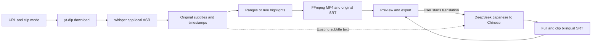

# Nyaru-Clipper project handoff

Verified: **2026-10-14, Asia/Shanghai**. This checkout contains the full project and older workstation. Shared companion changes should start in the browser worktree.

The current handoff replaces accumulated snapshots; the exact prior text is retained in the [historical attachment](project-handoff-history-2026-10-14.md). Old versions, hashes, unpushed states and pending-Key statements apply only to their recorded observations.

## Current outcome

The product is a standalone local companion and **macOS App 0.1.4 build 5**: URL download, local subtitle text/sentence timestamps, explicit-range or subtitle-rule highlight clips, progress, preview, export and interrupted-task recovery. It includes DeepSeek Japanese-to-Chinese full/clip bilingual subtitles, persistent Key/model settings and model selection.

The current entry does not invoke paid ArcTime alignment/cloud services; `arctime` remains a code directory name. The older WhisperX/GPU workstation and desktop adapters retain separate historical scope.

| Capability | Status and boundary |
| --- | --- |
| Download, local ASR, range/highlight clips | Implemented; two long-video recovery/export workflows accepted historically |
| Bilingual translation | Implemented; real Flash technical acceptance on two existing tasks |
| Key/model configuration | Atomic 0600 saves, updates, invalid-configuration repair and restart loading verified |
| Native bilingual preview/export | Full/clip playback observed; two representative native SRT exports verified |
| V4 Pro | Selection, persistence, mocked requests and checkpoint binding verified; real translation unaccepted |
| Distribution | Source pushed to three development branches; App remains locally ad-hoc signed, unnotarized and unpublished |

## Branches and ownership

| Branch | Verified local/remote HEAD | Checkout |
| --- | --- | --- |
| `feat/arctime-pro-plugin` | `e8ea71085cf5c6ff6f671499872f5c166d31f89b` | `/Users/drm/project/nyaru-clipper` |
| `codex/local-companion-web` | `360fd5fe1e541a5fda2288efc06f77b76501094d` | `/Users/drm/.codex/worktrees/local-companion-web/nyaru-clipper` |
| `codex/local-companion-macos` | `43eb1a2ab6acc69a1695b005d4aea1532065ada6` | `/Users/drm/.codex/worktrees/local-companion-macos/nyaru-clipper` |

Repository: [damin93381/nyaru-clipper](https://github.com/damin93381/nyaru-clipper). Heads were rechecked using `git ls-remote origin`; App includes the current browser commit. All three checkouts were clean and synchronized before this documentation edit. This edit changes handoffs/history attachments only and remains uncommitted/unpushed. `master` was not modified.

Start shared pipeline/UI changes in the browser worktree, then merge into App. Keep native packaging/lifecycle work in App. Do not replace App `media.py` wholesale with the browser version: frozen tool/downloader dispatch must remain.

## Real translation acceptance

| Existing task | Full bilingual cues | Clip bilingual SRTs | Model/state |
| --- | ---: | ---: | --- |
| `40c0c9a8e93e` | 658 | 2 | Flash/completed, no error |
| `7fe886d15999` | 1448 | 4 | Flash/completed, no error |

Real API processing produced 2106 translations in 54 validated batches without downloading, recognizing or encoding media again. Every cue retains Japanese text, nonempty Chinese and original timestamps; all six clip files match original selections with zero-based offsets. Eight SRT output/download checksums and VTT previews passed. Native full/clip bilingual playback and two SRT save-panel exports passed.

All 86 original media/subtitle/manifest/ASR-cache files remained unchanged; this documentation run rechecked originals and bilingual output hashes read-only. Only 24 cues were semantically sampled; ambiguous recognition and names can yield awkward or inferred translations. Full sentence-by-sentence proofreading remains incomplete.

Latest commit validation: selected original-backend **121**, browser-backend **117**, shared Companion UI **7** tests and frontend build passed. Selections differ and must not be summed or called a whole-repository pass. No regressions, media stages or provider calls reran during this documentation update.

- [Real translation acceptance](deepseek-real-translation-acceptance-2026-10-14.md)
- [Bilingual guide](deepseek-bilingual.md)
- [Model selection acceptance](model-selection-acceptance-2026-10-14.md)
- [Persistent Key acceptance](persistent-key-acceptance-2026-10-14.md)
- [Implementation checkpoint](deepseek-bilingual-acceptance-2026-10-14.md)
- [macOS use/build guide](macos-app.md)

Earlier short samples, test selections and automation failures remain in the historical attachment and dated records.

## Issue #1 verification and closure

[Issue #1](https://github.com/damin93381/nyaru-clipper/issues/1) passed verification and was closed at **2026-10-14 19:20:50 (Asia/Shanghai)**. Read-back after closure and during this documentation update confirmed `state=closed` and `state_reason=completed`; verification evidence is recorded in the issue body. Closure covers terminal ASR timestamp overruns, contiguous zero-duration fragments and the 2.040-second overrun recurrence.

- Fresh selected backend regressions before closure passed: **117 browser tests** and **121 App tests**, covering terminal-window clipping, strict rejection of invalid timing, zero-duration merging and cache reuse. The selections overlap and must not be summed as a whole-repository count; the existing Starlette/httpx deprecation warning remains.
- Remote HEADs of all three development branches matched the table above. ASR fix and corresponding test SHA256 values matched across the three checkouts; fixes are committed and pushed. Installed App **0.1.4 build 5** passed strict signature verification.
- Installed API and original failed-task artifacts passed rechecking: `40c0c9a8e93e` was completed with **11 chunks / 658 cues / 2 clips**; `7fe886d15999` was completed with **17 chunks / 1448 cues / 4 clips**, both without errors. Full subtitles, caches and clips passed positive-duration, boundary, content/file checksum and six-clip ffprobe duration checks.
- Every entry in the two pre-fix preservation snapshots (**109 and 58 files**) matched its SHA256. These overlapping lists are not combined into a deduplicated total; original failure logs and evidence remain preserved.

Closure verification rechecked existing recovery artifacts without downloading, recognizing, resuming or encoding long videos again, or calling paid translation. Real long-video recovery and native playback belong to earlier records; this round verified current API state and artifact integrity. Closure does not establish sentence-level subtitle/synchronization/highlight quality, other-host acceptance or public release; these remain pending. OPEN and uncommitted/unpushed statements in historical attachments and the original issue text are old snapshots.

## Runtime, settings and protected data

Read-only checks in this run found the installed backend online, `ready=true`, a configured Key and default `deepseek-flash`; both requested tasks and translations were completed. Observed loopback URL: `http://127.0.0.1:51578/`. App ports are random; recheck before continuing rather than hard-coding this address.

| Data/artifact | Location |
| --- | --- |
| Installed App | `~/Applications/Nyaru Clipper.app`, 0.1.4 build 5 |
| Models/tasks/log | `~/Library/Application Support/Nyaru Clipper/`: `models/`, `runs/`, `app.log` |
| Private settings | App `runs/config.json`, fields `deepseek_api_key` and `deepseek_model` |
| Bilingual outputs | Task `subtitles.ja-zh.srt` and `clip-NNN.ja-zh.srt` |
| Browser/CLI history | Each checkout's `data/local-runs/`, not automatically imported into App |
| Local App/ZIP | Original `dist/Nyaru Clipper.app` and `dist/Nyaru-Clipper-macOS-arm64.zip`; current App build also in App worktree |
| Python/default model | `~/.cache/nyaru-clipper/companion-venv/bin/python`; `~/.cache/nyaru-clipper/models/ggml-small.bin` |
| Private QA evidence | Original `.omo/evidence/`, excluded from Git |

Key and model save independently without clearing each other; legacy Key-only settings default to Flash. Saves are atomic with 0600 and never return the Key through the API. Manual edits require private permissions and restart; an empty Key disables translation. Settings contain plaintext credentials and must not be displayed, shared or committed.

New defaults apply to translations not yet started. Retries retain the task's recorded model and validated batches. Changing defaults does not retranslate completed bilingual outputs. MP4 pixels and burned-in subtitles remain unchanged.

## Flow and source map



ASR uses verified five-minute caches; bounded terminal overruns and contiguous zero-duration fragments were fixed. Ordinary subtitle parsing stays strict. Highlights score subtitle density, laughter/excitement and related rules; results may be below the requested limit or empty. There is no visual/LLM semantic scoring.

| Entry | Responsibility |
| --- | --- |
| `scripts/local_companion.py`, `backend/app/arctime/cli.py` | doctor/run/resume/gui |
| `workflow.py`, `media.py`, `local_asr.py` | Download, ASR caches, manifests, clips/recovery |
| `backend/app/arctime/translation.py` | API, 40-cue batches, validation, checkpoints, bilingual outputs |
| `backend/app/arctime/gui.py` | Serialized execution, configuration, translation status, allowlisted files/VTT |
| `web/src/companion/` | Shared UI, subtitle-track selection, preview/export |
| `desktop/macos/App.swift`, `backend/app/arctime/macos.py` | Native window/save panel, backend and parent lifecycle |
| `scripts/build_macos_app.py` | App 0.1.4 build, dependencies/local signing |

Original `backend/app/main.py`/`worker.py` belong to the older workstation. Browser checkout has no native App sources/build script.

## Continue and verify

Open the installed App to reuse existing tasks. Start the separate browser service only when needed; this documentation run did not start or stop services:

```bash
cd /Users/drm/.codex/worktrees/local-companion-web/nyaru-clipper
~/.cache/nyaru-clipper/companion-venv/bin/python scripts/local_companion.py doctor
~/.cache/nyaru-clipper/companion-venv/bin/python scripts/local_companion.py gui
```

GUI defaults to 8787 and supports `--output-dir`, `--port`, `--model`, `--threads`. Explicitly select history to reuse it; never run two writers against one task root.

Run frontend commands from `web` to respect the pinned pnpm version:

```bash
cd web
corepack pnpm test --run src/companion/Companion.test.tsx
corepack pnpm build
```

Run App backend regressions from the App worktree. For browser checkout omit the final macOS test:

```bash
PYTHONPATH=backend ~/.cache/nyaru-clipper/companion-venv/bin/python -m pytest \
  backend/tests/test_arctime_media.py backend/tests/test_arctime_workflow.py \
  backend/tests/test_local_asr.py backend/tests/test_local_companion_cli.py \
  backend/tests/test_companion_gui.py backend/tests/test_companion_translation.py \
  backend/tests/test_macos_companion.py -q
```

Rebuild using App worktree `scripts/build_macos_app.py`. Preserve existing builds first: the builder refuses overwrite. Updating the App keeps user data. Current target is arm64/macOS 27.0 minimum; changing Info.plist alone cannot establish older-system compatibility.

## Remaining work and boundaries

1. Proofread translation/ambiguous recognition; real V4 Pro, broader platform access, speaker output and clean-host acceptance remain pending.
2. Preserve historical failed-download task `18e794` and Issue #1's original failure logs and recovery records.
3. Intel/older macOS, Developer ID, notarization and public package distribution are incomplete.
4. Semantic/visual highlights, word alignment, diarization and a subtitle proofreading/editor UI are unimplemented.

Do not restore paid ArcTime calls, delete models/history/failure evidence, hand-edit task/translation manifests, replace differing outputs without an explicit choice, publish Key/media/private QA, hand-edit generated requirements/API types, expose the service publicly or introduce multiple workers. Further commits/pushes must match user-authorized scope.

The earlier handoff consolidation updated handoffs/history attachments. This update only adds Issue #1 verification and closure to the current English/Chinese handoffs and reads back GitHub state. It changes no historical attachment, product code or user task, and reruns no regressions, paid translation, App build or Git commits/pushes. The regressions and artifact checks above ran before issue closure.
