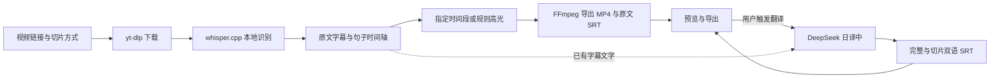

# Nyaru-Clipper App 版交接

核验日期：**2026-10-14，Asia/Shanghai**。本目录负责 macOS App，继承网页版核心并保留冻结工具定位与下载器分派。

本次整理当前入口，原交接原文完整保存在[历史快照](project-handoff-history-2026-10-14.zh-CN.md)。旧版本、旧哈希、未提交／未推送和待设置 Key 等描述仅适用于历史观察，不作为当前状态。

## 当前结论

交付方向是独立本地配套工具与 **macOS App 0.1.4 build 5**：输入视频链接，本地下载并识别字幕文字和句子时间轴，按指定时间段或字幕规则高光切片，查看进度、预览、导出及恢复中断任务。已加入 DeepSeek 日译中、完整／切片中日双语字幕、持久 Key 和模型选择。

当前入口不调用 ArcTime 付费自动打轴或云服务；`arctime` 是代码目录名。旧 WhisperX/GPU 工作站与早期桌面适配器保留各自历史范围，不属于当前 App 的运行入口。

| 项目 | 当前状态与边界 |
| --- | --- |
| 链接下载、本地识别、指定／高光切片 | 已实现；两段长视频的历史恢复与导出已验收 |
| 日译中双语字幕 | 已实现，Flash 已在两个既有任务完成真实 API 技术验收 |
| Key／模型配置 | 已实现；保存、更新、无效配置修复、权限 0600、重启加载已验证 |
| 原生双语预览／导出 | 完整视频及切片播放已观察；两个代表性 SRT 系统导出校验通过 |
| V4 Pro | 选择、持久化、模拟请求和缓存模型绑定已验证；真实翻译未验收 |
| 发布 | 源码已推送三个开发分支；安装包仍为本地 ad-hoc 签名，未公证或发布 |

## 分支与接手入口

| 分支 | 本地及远程已核验 HEAD | 工作目录 |
| --- | --- | --- |
| `feat/arctime-pro-plugin` | `e8ea71085cf5c6ff6f671499872f5c166d31f89b` | `/Users/drm/project/nyaru-clipper` |
| `codex/local-companion-web` | `360fd5fe1e541a5fda2288efc06f77b76501094d` | `/Users/drm/.codex/worktrees/local-companion-web/nyaru-clipper` |
| `codex/local-companion-macos` | `43eb1a2ab6acc69a1695b005d4aea1532065ada6` | `/Users/drm/.codex/worktrees/local-companion-macos/nyaru-clipper` |

仓库为 [damin93381/nyaru-clipper](https://github.com/damin93381/nyaru-clipper)。上述远程头本轮通过 `git ls-remote origin` 再次核对；App 分支包含当前网页版提交。文档更新前，三个工作目录均干净且与上游一致；此次只修改交接及历史附件，尚未新增提交或推送。未修改 `master`。

共享处理和 UI 先进入网页版，再合入 App；App 专属打包与进程生命周期修改在 App 目录完成。不要用网页版 `media.py` 整文件覆盖 App 的冻结工具定位代码。

## 真实翻译与验收证据

| 既有任务 | 完整双语条数 | 切片双语 SRT | 模型／状态 |
| --- | ---: | ---: | --- |
| `40c0c9a8e93e` | 658 | 2 | Flash／completed，无错误 |
| `7fe886d15999` | 1448 | 4 | Flash／completed，无错误 |

共 2106 条，54 个有效批次。翻译只复用既有字幕，不重新下载、识别或编码视频。逐条确认日语保留、中文非空、完整时间轴一致；六个切片的零起点偏移与选区一致，八份输出／下载校验和及 VTT 预览通过。原生完整视频／切片双语播放与两次 SRT 系统导出通过。

原有 86 个媒体、字幕、清单及 ASR 缓存文件在翻译前后保持不变；本次文档更新再次只读核对原文件及双语输出校验和通过。译文只抽查 24 条；含混识别词和专名可能产生生硬或猜译，不能视作全部逐句校对完成。

最新提交核验记录：原目录所选后端 **121 项**、网页版 **117 项**、共享 Companion UI **7 项**及前端构建通过。测试选择不同，不能相加或称为全仓库通过。本次更新文档未重跑回归、媒体处理或 API 翻译。

- [真实翻译验收](deepseek-real-translation-acceptance-2026-10-14.zh-CN.md)
- [双语使用指南](deepseek-bilingual.zh-CN.md)
- [模型选择验收](model-selection-acceptance-2026-10-14.zh-CN.md)
- [Key 持久配置验收](persistent-key-acceptance-2026-10-14.zh-CN.md)
- [双语实现阶段记录](deepseek-bilingual-acceptance-2026-10-14.zh-CN.md)
- [macOS 使用／构建说明](macos-app.zh-CN.md)

原文保留的短样例、旧测试数量及自动化故障见历史快照和对应阶段记录，均不扩大本轮验收范围。

## 配置、运行状态与受保护数据

本次只读接口核验：安装版后台在线，`ready=true`、Key 已配置，默认 `deepseek-flash`，上述两任务及其翻译均为 completed。观察到的回环地址为 `http://127.0.0.1:51578/`；App 使用随机端口，继续工作时须重新核验，不能写死此地址。

| 数据／产物 | 位置 |
| --- | --- |
| 已安装 App | `~/Applications/Nyaru Clipper.app`，0.1.4 build 5 |
| 模型、任务、日志 | `~/Library/Application Support/Nyaru Clipper/` 下的 `models/`、`runs/`、`app.log` |
| 私密配置 | App 的 `runs/config.json`；字段 `deepseek_api_key`、`deepseek_model` |
| 双语输出 | 各任务目录的 `subtitles.ja-zh.srt` 和 `clip-NNN.ja-zh.srt` |
| 浏览器／CLI 历史 | 各工作目录的 `data/local-runs/`，不自动迁入 App |
| 本地 App／ZIP | 原目录 `dist/Nyaru Clipper.app`、`dist/Nyaru-Clipper-macOS-arm64.zip`；App 目录另有当前构建 |
| 独立 Python／默认模型 | `~/.cache/nyaru-clipper/companion-venv/bin/python`；`~/.cache/nyaru-clipper/models/ggml-small.bin` |
| 私密验收证据 | 原目录 `.omo/evidence/`；不随 Git 分发 |

Key 与模型可分别保存，互不清空；旧的仅 Key 配置默认使用 Flash。保存配置采用原子替换及 0600 权限，不通过 API 返回 Key。手工修改需维持权限并重启；Key 空字符串表示禁用。配置含明文凭据，不要展示、分享或提交。

模型选择影响尚未开始翻译的任务；已开始的任务恢复时沿用原模型及已校验批次。已完成双语结果不会因切换默认模型自动重译。原 MP4 不改变，也不移除已有烧录字幕。

## 处理流程与源码



ASR 按五分钟块缓存并校验源文件与配置；末尾有界越界和连续零时长片段已修复。普通字幕解析仍严格校验。高光是字幕密度、笑声、兴奋词等规则评分，可能少于上限或零片段，不是画面理解或大模型语义高光。

| 入口 | 责任 |
| --- | --- |
| `scripts/local_companion.py`、`backend/app/arctime/cli.py` | doctor／run／resume／gui |
| `workflow.py`、`media.py`、`local_asr.py` | 下载、识别缓存、清单、切片与恢复 |
| `backend/app/arctime/translation.py` | API、40 条批次、响应校验、翻译检查点、双语输出 |
| `backend/app/arctime/gui.py` | 单任务执行、配置、翻译入口、状态、文件白名单及 VTT |
| `web/src/companion/` | 共享图形界面、字幕轨切换、预览与导出 |
| `desktop/macos/App.swift`、`backend/app/arctime/macos.py` | App 窗口、系统保存面板、后台与父进程清理 |
| `scripts/build_macos_app.py` | App 0.1.4 打包、依赖与本地签名 |

原目录 `backend/app/main.py`／`worker.py` 是旧工作站入口。网页版不含原生 App 源码和构建脚本。

## 继续开发与验证

打开已安装 App 可复用既有任务。独立浏览器服务按以下入口运行；本次没有启动或停止服务：

```bash
cd /Users/drm/.codex/worktrees/local-companion-web/nyaru-clipper
~/.cache/nyaru-clipper/companion-venv/bin/python scripts/local_companion.py doctor
~/.cache/nyaru-clipper/companion-venv/bin/python scripts/local_companion.py gui
```

GUI 默认 8787，支持 `--output-dir`、`--port`、`--model`、`--threads`。需复用旧 CLI 历史时明确指定目录；不要让两个服务同时写同一个任务根目录。

前端命令在 `web` 目录运行，避免锁定 pnpm 版本的 `--dir` 问题：

```bash
cd web
corepack pnpm test --run src/companion/Companion.test.tsx
corepack pnpm build
```

App 相关后端回归在 App 工作目录运行；网页版去掉最后的 macOS 测试文件：

```bash
PYTHONPATH=backend ~/.cache/nyaru-clipper/companion-venv/bin/python -m pytest \
  backend/tests/test_arctime_media.py backend/tests/test_arctime_workflow.py \
  backend/tests/test_local_asr.py backend/tests/test_local_companion_cli.py \
  backend/tests/test_companion_gui.py backend/tests/test_companion_translation.py \
  backend/tests/test_macos_companion.py -q
```

重建 App 使用 App 工作目录的 `scripts/build_macos_app.py`。构建器拒绝覆盖已有包，先保留旧产物；更新包不删除用户数据。最低 macOS 27.0、arm64；不应仅改 Info.plist 来宣称支持旧系统。

## 待办、失败证据与操作边界

1. 逐句校对译文及含混识别词；真实 V4 Pro、更多平台访问条件、扬声器输出和干净主机尚待验收。
2. [Issue #1](https://github.com/damin93381/nyaru-clipper/issues/1) 的时间轴修复及两段长视频恢复已有证据，GitHub 当前仍为 OPEN；关闭问题需单独执行。历史下载失败任务 `18e794` 的失败证据应保留。
3. Intel／旧 macOS 与 Developer ID、公证、正式安装包分发尚未完成。
4. 语义／画面高光、词级对齐、说话人分离及字幕校对编辑界面尚未实现。

不恢复 ArcTime 付费调用，不删除模型、历史或失败日志，不手改任务／翻译清单或不同内容的导出，不提交 Key、媒体或本地证据，不改生成的 requirements／API 类型，不暴露公网或增加多 worker。继续提交和推送应对应用户授权的范围。

本次仅更新交接与历史附件，并做只读 Git、接口、版本及文件核验；未修改产品代码、运行付费翻译、重建 App、重跑回归或提交／推送。
