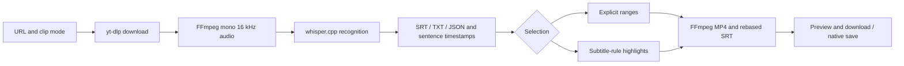

# Current handoff — 27 October 2026 (Asia/Shanghai)

Document updated on 27 October; the live-state snapshot was taken at **23:57 on 26 October (Asia/Shanghai)**.

**The formal App is 0.1.21 build 33, started into Watch Workbench; the queue is paused.** This section supersedes current/installed/candidate-only wording in older sections. Historical versions and Git tables apply only to their original observation dates.

## Current state and entry points

- Installed App: `/Users/drm/Applications/Nyaru Clipper.app`.
- Registered runtime: `/Users/drm/Library/Application Support/Nyaru Clipper/unified/runtime.json`. Reuse the existing model, credentials and settings; do not initialize a replacement data domain.
- Read-only live checks confirmed the App version, running backend and API: four real test tasks remain, the final task and all four operations succeeded, and the queue is paused. The API port changes on launch; do not hardcode a previous test port.
- The user selected **Watch Workbench with highlight review as the core workflow**. Translation readiness, detected language persistence, the unrelated default 30-second preclip, separate/combined output playback, compact layouts, title refresh and null-revision copy were fixed.
- See [the fixes and real-video receipt](watch-workbench-real-fixes-2026-10-26.md). The [earlier 0.1.20 installation receipt](watch-workbench-install-2026-10-26.md) remains historical.

## Confirmed real-video validation

Final task: `7a69c98888d15620b3aa11e9fba5dbc9`, titled `真实高光完整复测 · build30 · 自动日语`. The title's build30 is the original test label; **the installed build is 33**.

The same 328.300-second real recording completed native import, automatic Japanese recognition with 50 cues, native-button admission of actual DeepSeek translation for 50/50 cues, four highlight candidates covering 40.15%, reversed `[2,0]` reviewed ranges and bilingual export. The two clips are 42.100 and 63.300 seconds; the combined output is **105.421333 seconds**. All three downloaded files fully decoded. Web playback naturally reached the end. The user directly confirmed native visible playback; native capture limitations are not presented as an automatic pixel pass.

The full processing run used build30. Builds31–33 changed CSS/build metadata only, with identical backend Python and frontend JS content hashes; final build33 layout and Web playback were checked separately. Earlier receipts record 365 frontend tests, 139 related backend tests and 32 native/translation integration checks, plus 62 focused boundary checks after calibration. This handoff refresh did not repeat those tests, recognition, translation or export.

Primary evidence directory: `/Users/drm/.codex/worktrees/highlight-subtitle-macos/nyaru-clipper/.omo/evidence/watch-workbench-fixes-20261026/`. Start with `final-install-runtime.json`, `final-media-validation.json`, `final-web-playback-later.json`, `native-human-acceptance.json`, `data-preservation.json` and `review.md`. The current startup/API snapshot is `/Users/drm/project/nyaru-clipper/.omo/evidence/handoff-refresh-20261026-workbench/before.json`.

## Source checkouts and version control

On 27 October the user authorized the complete commit and push. Source, regression tests, generated contracts, packaging and bilingual handoffs are grouped into commits; the primary checkout publishes documentation only. Shared frontend/contracts are synchronized, with existing Windows-specific Web backend differences preserved.

| Checkout | Local branch | Publication target | Implementation milestone (before documentation commit) |
|---|---|---|---|
| Primary | `codex/code-improvement-2026-10-21` | `origin/codex/code-improvement-2026-10-21` | Documentation only; prior HEAD `da11831cdf976560f642370790847bba647f7ff9` |
| macOS | `codex/highlight-subtitle-macos-2026-10-25` | `origin/codex/local-companion-macos` | `5ffd9a826261e9fb0b405486cde6aae843fcdc79` |
| Web | `codex/highlight-subtitle-web-2026-10-25` | `origin/codex/local-companion-web` | `59688e2b45014c02f79b04c1f36213899824dfc0` |

Publication uses explicit refs and an atomic fast-forward push to these three existing remote branches. No merge, force push or update to master/collaborator branches is included. Exact final documentation heads and remote comparison are recorded in `/Users/drm/project/nyaru-clipper/.omo/evidence/git-publication-20261027/receipt.json`; milestone IDs above deliberately exclude the later documentation commits.

Fresh publication checks: each frontend passed **365 tests in 45 files**, TypeScript and production build; macOS backend/native checks passed **171**, with one actual-desktop case deselected, and Web backend checks passed **139**. Initial concurrent backend runs conflicted on the shared execution lock; sequential full reruns passed. The Web review test now clears persisted localStorage between cases and includes the same reload/null-revision regressions. Real recognition, provider calls, export and native UI were not repeated for publication; their acceptance remains the dated evidence above.

Untracked media/template outputs, `.DS_Store`, temporary pnpm workspace configuration, test caches, runtime state and private evidence stay outside Git and are preserved. Continue from the appropriate platform checkout; do not reset, clean or overwrite the original worktrees.

## Protection, rollback and remaining work

- The installation receipt verified preservation of 21 original active files, two prior task contexts, source media and original settings. Continue protecting original media, sealed roots, reader/epoch pins, tasks and failed records. This Git publication does not replace the installed App or mutate production data.
- Backup: `/Users/drm/Library/Application Support/Nyaru Clipper Backups/workbench-fixes-20261026-1723/`. It retains the original 0.1.20 App, real-tested build30 and pre-update unified snapshot. Quit normally and preserve the current runtime before switching Apps; never overwrite newer data with the older snapshot.
- Review drafts survive same-origin reload, **not a native App restart**. Exported videos and frozen ranges remain durable. Historical auto-language jobs without actual language metadata must be re-recognized, not guessed or rewritten.
- One interim analysis failure on `f98b6a7d...` remains as evidence; do not confuse it with the successful final run or delete it to hide the failure. All four final-task operations succeeded.
- Remaining work is bounded to known gaps: restart-persistent drafts if needed, human caption/candidate review, and separate long-VOD/live, Windows/GPU, dark-system, recovery and notarization validation. The short-video result grants no acceptance for those scenarios.

## Historical handoff text

The body below is unchanged; its uses of “current” refer only to the associated historical date.

# 2026-10-26: Watch Workbench installed

Formal App is now **0.1.20 build 28**. Original active data/configuration were backed up and verified unchanged; normal reopen selects the registered formal runtime. [Installation, preservation and rollback](watch-workbench-install-2026-10-26.md). Older candidate-only statements below are historical.

---

# Nyaru-Clipper project handoff

Latest integration: [2026-10-26 selective highlight and subtitle integration](highlight-subtitle-integration-2026-10-26.md). Unified topic analysis/export, font search/favorites and three outline layers; formal App and data were not replaced.

## Current handoff: 26 October 2026 (Asia/Shanghai)

The selective highlight/subtitle integration was published by fast-forward to both owned remote branches: Web `9137d8cc983b3b1e06a9f92614efdb65a84f9704`, macOS `54b2a4f63a965b3ab107d821ab690a3e5bd7ee84`. The collaborator branch remains at `69d3fa0dea30a73ef0f0ef27591bc1abda9080f1`; master was unchanged. This is the completed publication record. Original dirty worktrees remain preserved; candidate worktrees hold this implementation.

The user requested the compiled App, inspected it and replied “可以了”; this candidate's manual inspection is accepted. The current App is `/Users/drm/.cache/nyaru-clipper/highlight-subtitle-macos-20261026-04/Nyaru Clipper.app`, launched with the explicit isolated runtime `/Users/drm/.cache/nyaru-clipper/highlight-subtitle-native-20261025-01/runtime.json`. A process check during this update confirms it is still running; the window is retained for the user. The earlier publication receipt's “quit” state is a historical snapshot.

See the [integration handoff](highlight-subtitle-integration-2026-10-26.md) for exact entry points, reopening command, automated evidence and limits. No formal App/data replacement or migration occurred. This inspection does not qualify real long-VOD/external-AI quality or other platforms. Preserve old App02, sealed domains and reader pins under their historical restrictions below. Actual-material quality testing with separately authorized provider calls is a possible next step; formal installation/data cutover still requires explicit instruction.

## Unified architecture merge: 23 October 2026 (Asia/Shanghai)

This branch merges unified architecture `eda736bd905fffcf321642cbd94823e4aacd7be5` into remote Web base `13f7f6c27b7f506529c899691de83393de0ec5a4`. It retains the Windows PowerShell launcher, CUDA whisper.cpp deployment, locking, JSON publication/reading, `.exe` discovery and the unavailable private-credential boundary for ChatGPT. Windows terminal publication follows OwnedUpload cleanup; regressions cover execution-slot exclusion, body-error propagation and cleanup order. Local simulation does not replace Windows-native tests.

The original Web/macOS worktrees retain 53/56 dirty paths, checked against content hashes, modes, staged diffs and HEAD. This publication uses isolated integration worktrees and updates the remote targets; original local branches/worktrees stay at their prior bases to preserve existing edits. See the [merge receipt](/Users/drm/project/nyaru-clipper/.omo/evidence/unified-merge-20261023/receipt.json) for final tests, merge IDs and remote verification. Earlier no-merge/no-push statements retain their historical dates and are superseded by explicit authorization for this merge. Formal App/data, sealed domains, old reader pins and pending platform gates retain their boundaries.

## Version-control update: 23 October 2026 (Asia/Shanghai)

Unified implementation, recovery tools, direct tests and App02 fixes are committed as `f8484d5560e971fb4a736e6296d876333cb5b7c6` (`feat: unify task execution, migration and recovery`) on `codex/unified-architecture-2026-10-22`. Primary-checkout documentation belongs to `codex/code-improvement-2026-10-21`; these are the two explicit push targets for this publication. Master and other development branches remain unchanged. Statements below about uncommitted or unpushed work retain their original observation dates; use the [Git publication receipt](/Users/drm/project/nyaru-clipper/.omo/evidence/git-publication-20261023.json) and remote branch IDs for the publication result.

Fresh checks in the unified candidate before committing: backend **1551 passed**, frontend **332 passed across 40 files**, TypeScript/Vite build and all three requirements export checks passed. Program sources match the App02 build-input manifest; only indexes/handoffs changed after packaging. Four existing end-of-file blank-line notices remain. This publication only changes version-control state: no repackaging, installation, formal-data cutover or additional platform qualification. Retain sealed domains, old epoch/reader pins, original media and private evidence.

## Current handoff: 23 October 2026 (Asia/Shanghai)

### Handoff refresh: 23 October 2026,13:36 Asia/Shanghai

This refresh only updates handoffs and performs read-only checks. Both App02 ZIPs, the native/frozen executables and fixed recovery bundle retain their recorded SHA256 hashes; all six real-test roots remain immutable and no matching candidate App/backend process was found. [Refresh receipt](/Users/drm/project/nyaru-clipper/.omo/evidence/handoff-refresh-20261023-app02.json). Functional results below come from the previous actual runs. No App launch, rebuild, functional rerun, remote connection or fresh full formal-data audit occurred.

| Handoff item | Current location and boundary |
| --- | --- |
| Latest candidate App02 | [App ZIP](/Users/drm/.cache/nyaru-clipper/unified-native-build-20261023-02/Nyaru-Clipper-unified-candidate-20261023-02.zip); extracted App at `/Users/drm/.cache/nyaru-clipper/unified-native-build-20261023-02/Nyaru Clipper.app`. Display0.1.19/build27: use recorded hashes, do not double-click. |
| Pinned independent recovery | [Recovery ZIP](/Users/drm/.cache/nyaru-clipper/unified-recovery-20261023-02.zip); fixed reader directory `/Users/drm/.cache/nyaru-clipper/unified-recovery-20261023-02`. Do not move it or rebind an existing epoch. |
| Latest real task/recovery evidence | Task `ad3ad70afddf5287b5d1b4f797665a2a`:21 cues,two manual translations,revision2. [R2 manifest](/Users/drm/.cache/nyaru-clipper/historical-fixed-native-20261023-01/R2/complete.json) / [independent recovery verification](/Users/drm/.cache/nyaru-clipper/historical-fixed-native-20261023-01/recovered-readonly/verification.json):3 documents,no errors. The saved receipts were checked; recovery was not rerun. |
| Test entry points to retain | Six roots under `historical-fixed-native-20261023-01/runtime` are sealed; do not reuse the old launch argv. Retain API domain `historical-fixed-api-20261023-01`, all old R2 snapshots and reader pins. The old App01 empty root is not an App02 default. |
| Formal environment | Candidate has not replaced the formal App or switched formal data. Previous formal App content/metadata, formal-data metadata and selected original task/media protection checks are in the [final audit](/Users/drm/project/nyaru-clipper/.omo/evidence/historical-fixes-20261023/final-audit.json). This refresh did not repeat formal-data body verification. |

**Next sequence**: first use fresh independent data domains and the pinned App02 reader to repeat R0/R1 takeover, rollback and reopen, checking document versions/full contents and explicit-retry boundaries. Then qualify M24 OS restart/boot protection on an authorized isolated platform. Missing CUDA/WSL ROCm/Windows AMF hardware, external translation and real live capture remain pending; old-package or local results cannot substitute. Historical Workstation preparation failure on old Linux absolute paths was not repaired this round; protect the five unknown directories. P6,formal installation and data cutover have not started; a handoff update does not authorize them.

### Historical-task repair candidate App02 (latest)

F01/F02 are repaired and revalidated against the **new frozen package**:25/25 historical-copy scenario groups passed. A real150-second replay yielded21 cues with manual translations correctly partial2/21. Native playback, revision2 save, CmdQ/reopen, real15-second burn and system saving passed. Adjacent backend regressions82 passed (including8 focused cases); frontend332 passed. Both new archives verified. Display remains0.1.19/build27: use hashes for identity.

[App02 packages and bilingual report](candidate-fixes-2026-10-23.md) · [authoritative receipt](/Users/drm/project/nyaru-clipper/.omo/evidence/historical-fixes-20261023/receipt.md). App ZIP SHA256 `914e36a0b7cf97ad864cedf9d87abfcfcb1b0ae76248b5ec5da2eb7272eff14b`; recovery ZIP `31e364935d925993b6a849d8c1f7df21b325731c29a39e3e298774153a339c42`; new epoch bundle `52342c6a998c6241a5381db6a778bb792ae38a0e197989d166da79da73016b54`. Old pins are unchanged.

Formal App content/metadata, formal data metadata and selected original tasks/media match baselines; no replacement, cutover or commit. All created App/helpers/servers stopped; queues paused. Real-test domain `historical-fixed-native-20261023-01` has six immutable roots and a sealed new R2; independent recovery exported all3 documents, preserving real revision2. Do not double-click, directly reopen/unseal R2, or replace old epoch pins. New-package R0/R1, M24 OS-restart/boot protection and missing-hardware/provider gates remain pending; P6/formal cutover have not started.

### Historical task functional acceptance (App01 failure snapshot; closed by the new package above)

Isolated historical-task copies were tested at the user's request: **19 passing / 2 failing groups** in the21-group frozen API matrix. A retained150-second real recording was processed as a new replay:21 cues,15-second clip/burn passed; browser editing reached revision5 and persisted on reload. Two unfixed defects are **partial translation reported complete** and **lost migrated highlight mode/score/reasons**, so overall acceptance failed. Historical workstation preparation rejected old Linux absolute artifact paths with zero activation; five unknown directories remain preserved.

macOS lock screen blocked native UI, CmdQ, system save panel and continuous playback; browser results do not qualify WKWebView. Remote ROCm checks only read the historical1-cue task,4 publication groups,30-second product, models and device visibility; inference was not rerun. Formal data metadata, five original historical tasks and14 archived sources remain unchanged, and all created candidate/helper processes are stopped. No product edit, rebuild, install or formal cutover occurred. See the [bilingual acceptance report](/Users/drm/.codex/worktrees/unified-architecture/nyaru-clipper/docs/historical-task-acceptance-2026-10-23.md) and [authoritative evidence](/Users/drm/project/nyaru-clipper/.omo/evidence/historical-task-acceptance-20261023/receipt.md) for defects and next gates.

### Post-packaging handoff checks (earlier snapshot)

The earlier handoff refresh only edited docs and performed read-only checks: archives existed, both bundle hashes matched, both R2 databases remained immutable, and no matching candidate process was found. That refresh did not rerun application tests, start the App, rebuild or connect remotely. Packaging results below come from the retained [packaging receipt](/Users/drm/project/nyaru-clipper/.omo/evidence/candidate-package-20261023-receipt.md); subsequent functional checks are recorded in the latest section above.

| Handoff item | Latest record |
| --- | --- |
| [Candidate App ZIP](/Users/drm/.cache/nyaru-clipper/unified-native-build-20261023-01/Nyaru-Clipper-unified-candidate-20261023-01.zip) | SHA256 `7a5c3cad144c57dc74bda2391e157452b69418d1476fdd40e2895f3b310ad6a9`; 5406 extracted files/modes identical, strict signing passed |
| [Independent recovery ZIP](/Users/drm/.cache/nyaru-clipper/unified-recovery-20261023-01.zip) | SHA256 `47f34e5b0d577b20be6d4990bdfd6e093c946159581b4cd1a6035b548b969082`; do not move pinned directory `/Users/drm/.cache/nyaru-clipper/unified-recovery-20261023-01` |
| Bundle rechecked now | Both App/standalone manifests hash to `1ce64b4effcc38a592d90b12e879dcc02a990a62316af8fbdc8e23e16b31ff12`; the complete 3619-resource check belongs to packaging acceptance |
| Qualified local workflow | Frozen takeover, R0/R1 thaw, R1 kill/resume, old-helper reopen, native r3 save/quit/reopen identical to independent export; R2 thaw correctly refused |
| Review and formal environment | [Independent review](/Users/drm/project/nyaru-clipper/.omo/evidence/candidate-package-20261023-review.md) CLEAR/APPROVE/no blockers; packaging before/after records match 1496 installed-App file hashes and 6815 data metadata entries, without claiming full data-body hashing |
| Remaining gates | M03 local_passed within local scope, M24 partial; matrix 22 local_passed/3 partial/3 blocked, P6 planned; not full-platform accepted |
| Historical regression limits | 23 October full backend 1538 passed, final focused run 46 passed; the final five terminal negatives are covered by the focused run, counts are not added; neither packaging nor this refresh reran the full suite |

These are historical App01 entry points: the [earlier startup/acceptance document](/Users/drm/.codex/worktrees/unified-architecture/nyaru-clipper/docs/candidate-package-2026-10-23.md) and empty root `/Users/drm/.cache/nyaru-clipper/packaged-native-empty-20261023-01/runtime.json` are retained records, not App02 startup instructions. Any new trial requires a fresh independent domain within the App02 boundaries above, explicit absolute `--unified-runtime` and matching `--migration-guard`. Do not double-click, reuse old ports/PIDs, or rebind reader pins.

The new sealed domains `/Users/drm/.cache/nyaru-clipper/candidate-package-20261023-recovery-03/R2` and `/Users/drm/.cache/nyaru-clipper/candidate-package-20261023-native-guarded-01/R2` are recovery evidence: do not start against or unseal them. Retain the old build-04 sample seal too. Next work remains M24 OS reboot/boot-time protection on an authorized isolated platform, plus missing-environment CUDA/WSL ROCm, Windows AMF and real live qualification; this does not authorize formal cutover or P6.


**The Option B unified candidate is implemented, with scoped local and native Linux ROCm workflows verified; cross-platform qualification and production cutover remain incomplete.** On 23 October, authorized M03/M24 qualification added real takeover/recovery kills and fixed interrupted independent thaw; see [execution record §9](unified-architecture-execution-2026-10-22.md#9-2026-10-23-additional-m03m24-takeover-and-crash-recovery-qualification). No formal-data cutover, installed-App replacement or host reboot occurred. Historical entries retain their observation dates.

### 1. Working directories and phase state

**The latest candidate is App02 above:** [repair package and acceptance](candidate-fixes-2026-10-23.md). [App01 package](candidate-package-2026-10-23.md) takeover,R0/R1 rollback,R2 thaw refusal and native r3 evidence belongs to that old package and does not automatically qualify App02. The installed App remains unchanged.

| Item | Current boundary |
| --- | --- |
| Candidate source | `/Users/drm/.codex/worktrees/unified-architecture/nyaru-clipper`, branch `codex/unified-architecture-2026-10-22`; continue implementation and qualification here |
| Base HEAD | `428ba833193db888c6b049ac2983abe1b2ecae17`; unified implementation remains uncommitted, so HEAD alone cannot reconstruct the candidate |
| Primary checkout | `/Users/drm/project/nyaru-clipper`, branch `codex/code-improvement-2026-10-21`, same HEAD; contains existing dirty changes and is not the unified implementation directory |
| P0/P1 | `completed`: local evidence covers isolated baseline and workstation artifacts entering the shared editor/product export workflow |
| P2–P4 | Implementation and local candidate verification complete; cumulative platform qualification remains pending |
| P5 | Local migration, group rollback and independent recovery verified; target-platform and crash/reboot qualification remain open |
| P6 | `planned`; old writers and compatibility entry points remain until acceptance, rather than treating deletion as proof |
| Production | No installed-App replacement, formal-task migration, commit/push/merge; historical installed-source details are in the 21 October section of the [primary handoff](/Users/drm/project/nyaru-clipper/docs/project-handoff.md) |

The [design](superpowers/specs/2026-10-22-unified-architecture-design.md) and [phased plan](superpowers/plans/2026-10-22-unified-architecture.md) define gates; [execution record §8](unified-architecture-execution-2026-10-22.md#8-complete-candidate-implementation-and-current-acceptance-ledger) holds observed evidence; the [runtime/rollback guide](unified-runtime-guide.md) provides executable commands. Historical phase entries and passing tests do not establish full `accepted` status.

### 2. Implemented architecture and migration boundaries

- **Shared state and execution:** SQLite tasks/operations/documents/publications are the common source of truth through `models_unified.py`, `models_migration.py` and additive revision `20261022_01`. `unified_host.py`, `unified_cli.py` and `unified_dispatch.py` provide one executor and four operations: `process_recording/process_live/translate/export`. CPP and WhisperX remain available, sharing queue, priority/order, pause, cancellation, retry, attempt/token and process-group contracts.
- **Editing and publication:** immutable bodies plus CAS, version history and configuration/template snapshots; durable staging and receipts precede non-overwriting member publication and final group commit. A usable first clip does not make the parent successful. Reopen reconciles through the exclusive decision table, rejecting orphan bodies and old attempts.
- **Takeover and locks:** `migration_*` and `source_seal.py` use externally registered source UUIDs, complete multi-root registration and generation checks. `prepare/verify` grant no execution authority. One Supervisor continuously holds locks, seals old roots, rechecks and commits takeover, then continues hosting the API; do not exit it and start an unguarded service. Linux protection requires separately verified read-only mounts; successful ROCm inference does not qualify takeover protection.
- **Rollback:** classify the whole group as R0/R1/R2. Any new task or global settings/template/project write makes the group sticky R2; cancellation of another batch cannot downgrade it. R0/R1 commit group withdrawal receipts before restoring old permissions. R2 keeps seals and uses same-epoch multi-root snapshots, read-only export or an independent old-format working copy. Never downgrade the new DB, overwrite newer drafts or pass unified roots directly to old entry points.
- **When the new version cannot start:** a pinned independent Python/reader/guard/old helper/media tool bundle provides recovery without candidate imports, its virtualenv, models or network. Credentials remain external references. Partial sealing/thaw failures retain original permission journals and `controls-resealed.json`; resume into new output directories as documented, without inferring original modes from current read-only permissions.

### 3. Acceptance evidence and remaining gates

The complete M01–M28 table remains in execution record §8.3: **22 `local_passed`, 3 `partial`, 3 `blocked`**. M03 closes within its local scope; M24 retains platform gates. These states do not establish full cross-platform acceptance. The table below retains 22 October results; this run's regressions/kills/actual HTTP evidence are in §9.

| Observed result | Evidence and limits |
| --- | --- |
| Backend/frontend/build | Backend **1512 passed, 0 failed/skipped**, with 17 existing JUnit warnings; frontend **332 passed/40 files**, TypeScript/Vite passed. Backend receipt [r5.xml](/Users/drm/.cache/nyaru-clipper/unified-backend-20261022-r5.xml) was reread, not rerun, during this refresh |
| Real browser | Chrome **2 passed**: keyboard/touch queue ordering, priority/pause, CAS 409 draft retention, real ASS downloads, SSE failures falling back to polling and cursor reconnect; [browser-r7 evidence](/Users/drm/.cache/nyaru-clipper/unified-queue-20261022-1_md6l57/browser-r7) |
| Real macOS media | whisper.cpp processed 150.033333 seconds into 6 cues; revision 1 editing, 0–30-second burn, normal quit/same-build reopen retained selection and pause state. A bad-media test remains failed. Final build-05 separately verified empty-root initialization/start/quit and did not repeat the complete media acceptance |
| Real product export | A 5000-cue edit preserved the other 4999 cues; product API MP4 download, fixed parameters and original hashes passed. Frozen V maximum RMSE **0.356518**, bbox **1 px**; [product evidence](/Users/drm/.cache/nyaru-clipper/unified-p1-product-20261022-final) |
| Native Linux ROCm | Rocky 9.8/ROCm 7.2.4/RX 7900 GRE: real WhisperX GPU float16→Japanese alignment→revision 1 edit→PNG→30-second CPU burn/browser download/full decode; reopen retained operations and product. [Receipts](/Users/drm/.cache/nyaru-clipper/unified-gpu-result-20261022-r4). One recognized cue is not semantic transcription-quality acceptance |
| Independent recovery | Frozen `-I -S -B` entry completed six-root snapshot/read-only export; 1 document, 6 cues and 4 registered publications matched, `complete=true`, zero errors; seven thaw combinations and interrupted-recovery evidence also exist |

Open gates: M12 additional real live evidence, M22 Windows AMF and M24 controlled OS reboot/boot-time protection ordering/other platform profiles remain `partial`; finite SIGKILL boundaries do not qualify every timing. M18 lacks Linux CUDA and WSL ROCm environments, M19 lacks a controlled real live source, and M21 lacks P6 prerequisites, so they remain `blocked`. Native Linux ROCm cannot substitute for CUDA/WSL. Its Noto font substitution and different FFmpeg cannot substitute for macOS frozen V same-font image metrics; HTTPX compatibility with inherited SOCKS proxies remains unqualified. External-provider/paid calls, notarization and formal release gained no new acceptance.

### 4. Builds, recovery bundles and protected data

The following caches are private local evidence, absent from clones. Preserve them and keep credentials out of Git. Paths below are relative to `/Users/drm/.cache/nyaru-clipper/`:

| Purpose | Exact location and handling |
| --- | --- |
| Latest candidate App02 | `unified-native-build-20261023-02/Nyaru Clipper.app`;5407 files and package identity above. Run only in fresh independent domains with explicit runtime/guard; real-test roots are sealed. |
| Latest App02 independent recovery | `unified-recovery-20261023-02/bundle.json`,SHA `52342c6a998c6241a5381db6a778bb792ae38a0e197989d166da79da73016b54`;3620 resources checked. Do not relocate pinned paths. |
| Historical App01 and pinned recovery | `unified-native-build-20261023-01/Nyaru Clipper.app` and `unified-recovery-20261023-01/bundle.json`,old bundle SHA `1ce64b4effcc38a592d90b12e879dcc02a990a62316af8fbdc8e23e16b31ff12`. Counts5406/3619 belong to that old package; empty root `packaged-native-empty-20261023-01/runtime.json` is not an App02 entry. Preserve existing epoch paths. |
| Older candidate App | `unified-native-build-20261022-05/Nyaru Clipper.app` retains historical identity without this recovery fix; do not overwrite/upgrade it in place |
| Real CPP sample root | `unified-native-runtime-20261022-01`, task `8cb8f1980a815e9696728c36545ebfd6`; six roots have read-only/immutable seals: do not start against them or casually unseal |
| Sample's pinned reader | **`unified-native-build-20261022-04/Nyaru Clipper.app/Contents/Resources/recovery/bundle.json`**, SHA `1fbeb3c8f87145d1c78e1d41b4ac5670d24fbc8f9b6f22038389eab69fbe7731`; do not substitute the build-05 bundle |
| Recipe/complete snapshot | `unified-native-recovery-recipe-20261022-04.json`; `unified-native-snapshot-20261022-04/complete.json`, SHA `8859a044a485b6dec4476c2809b96c1ffda7cc77af16459844aa8b5092ab18a7` |
| Independent recovery verification | `unified-native-recovered-20261022-04/verification.json`, SHA `e74d5f452b633034f4c126228e6e9e65441f3372ecf108ecaa1ef0fe2ba54b2a` |
| App02 build inputs | [Exact input inventory](/Users/drm/project/nyaru-clipper/.omo/evidence/historical-fixes-20261023/source-input.json) and [post-build audit](/Users/drm/project/nyaru-clipper/.omo/evidence/historical-fixes-20261023/final-audit.json); subsequent handoff edits are outside package input identity. |
| Historical App01 build inputs | [202-file manifest](/Users/drm/project/nyaru-clipper/.omo/evidence/m03-m24-20261023-source.json),digest `1e10e6b3d72ea396b8b0223c1dea3251cfbbf807c51062407b1e31e2078df7ba`; identifies the earlier package,not App02. |
| Historical 22 October seal | `unified-source-manifest-20261022-final.json`, 197-file digest `6ba9d792c80b08523b1ab1beb3d2497a46b2346072778502cf321abfb1e8e002`; predates subsequent recovery fixes and does not identify current source or the new package |

The GPU workstation uses the user-authorized SSH alias `server-194`. Its isolated root `/home/drm/nyaru-unified-20261022-4eE6Qm` retains `repo`, `models/faster-whisper-small`, `models/alignment-ja`, `gpu-runtime/runtime.json`, `gpu-env.sh`, failed attempts and all download receipts. Qualification scoped device selection, offline models, NLTK, fonts and proxy variables to its process. Read the environment recipe and execution record §8.4 before retesting; a bare environment is not equivalent. Task `8333059829bd563b9094d3065a87355c` processed on attempt 2 (first lacked punkt_tab) and exported on attempt 1. Product SHA `a88627da42b28bad83af40a2d2c1e16330d4fc8458e0e4f3cbb3d3f7777a5866` belongs to the earlier GPU qualification/local receipt check; this documentation refresh did not repeat GPU or product-hash acceptance.

At qualification end, owned temporary App/API/SSH forwards were stopped; an unrelated remote `uv` process was left alone. **This refresh did not recheck remote or current service state; old PIDs/ports are not evidence of current availability.** Protect formal DBs, original media, credentials, App backups and the five unowned directories in the historical inventory; that count is dated, not a current count. Automation once accidentally launched the default compatibility entry, adding formal-root `startup-*.json`; no business-file rewrite was observed then. Do not claim absolutely zero formal-root writes.

### 5. Next operator's execution order

1. Read-only verify candidate branch/HEAD/dirty state and these receipts, preserving primary-checkout changes. Use new independent roots and follow the runtime guide. Native startup/reopen must explicitly pass `--unified-runtime /absolute/runtime.json`; omission enters the compatibility default path. Taken-over runtimes also require the same pinned runtime and `--migration-guard`/`serve-guarded`.
2. First repeat App02 R0/R1 takeover,rollback and reopen in fresh independent copies with this package's pinned reader; verify document versions/full contents and explicit-retry boundaries. Then qualify P5 M24 controlled reboot/boot protection and target-platform profiles. Earlier local M03 takeover/reopen evidence belongs to the original package and cannot substitute for App02 revalidation. Use multi-root recipes and paused queues; retain the original `thaw-intent.json` for SIGKILL retry. Sealed real/CPP samples are read-only evidence,not new test roots.
3. Obtain separate CUDA, WSL ROCm, Windows AMF and authorized real live environments/sources, retaining actual receipts against the original matrix. Keep status unchanged when environments are unavailable. Maintain dependency artifacts through their generator; qualification is not a reason to repin existing GPU requirements.
4. Only after required qualification passes, review commit scope and a formal cutover proposal. Production install/migration requires separate explicit authorization. P6 also requires a cleared caller inventory and reviewed deletion scope. Until then preserve compatibility entry points, old data and failed evidence; no reset/clean/bulk staging/push/merge or overwriting newer data with old snapshots.

---

## Historical handoff: 14 October 2026 (original observation dates retained)

**Git submission scope (2026-10-14):** This update submits the bilingual translation, persistent Key/model settings, App 0.1.4 packaging and paired technical acceptance records to the three existing development branches. Earlier uncommitted/unpushed statements describe their dated snapshots. Use `git log -1` and `git ls-remote origin` for exact current source and remote heads; private configuration, media, models, build bundles and `.omo` evidence remain local.

**Real translation acceptance (2026-10-14):** After user Key entry, App 0.1.4 Flash translated existing 40c0c9 (658 cues) and 7fe886 (1448 cues), producing two full and six clip bilingual SRTs. All timing/offset/output checks passed and 86 originals stayed unchanged; eight download/preview interfaces, native full/clip bilingual playback and two native SRT exports passed. No download, recognition or encoding was repeated. Sampling 24 cues is not full proofreading; recognition errors and ambiguous phrases require review. See [acceptance](deepseek-real-translation-acceptance-2026-10-14.md). Pending-Key/provider statements below are historical.

**Model selection update (2026-10-14):** App 0.1.4 build 5 adds Flash/V4 Pro selection, saved with the existing Key and loaded on restart. Started tasks retain their model for retries. Selected backend tests (121), UI tests (7), frozen persistence/restart, installed browser interaction, signature and ZIP checks passed; 86 original task files are unchanged. Real translation awaits the Key; source remains uncommitted/unpushed. See [acceptance](model-selection-acceptance-2026-10-14.md).

**Persistent Key update (2026-10-14):** Per the user's new request, App 0.1.3 build 4 saves the Key in `runs/config.json` and loads it on restart, replacing the session behavior below. Selected backend tests (117), UI tests (6), build and isolated frozen-backend restart verification passed; no real Key has been entered. See the [acceptance record](persistent-key-acceptance-2026-10-14.md). Source remains uncommitted/unpushed.

**Bilingual update (2026-10-14):** Installed App 0.1.2 build 3 adds DeepSeek Japanese-to-Chinese translation using existing timestamps, full/clip bilingual SRT, preview switching, progress and resumable batches. The Key is session-only. Selected App backend tests (111), shared frontend tests (155), build/signature/ZIP checks passed; 86 original files across two existing tasks remain unchanged. The user chose to enter the Key later; real translation and native bilingual playback/save remain pending. This feature is uncommitted/unpushed. See the [checkpoint](deepseek-bilingual-acceptance-2026-10-14.md) and [guide](deepseek-bilingual.md). Remote synchronization and first-version scope below describe earlier snapshots.

**Remote synchronization addendum (2026-10-14)**: Current source and documentation were committed and pushed to three `origin` development branches: `feat/arctime-pro-plugin` (original workstation edits and complete development history), `codex/local-companion-web`, and `codex/local-companion-macos`. Verified remote feature commits were `d4f28f9`, `5baf166`, and `1366686`; use `git log -1` / `git ls-remote origin` for the latest subsequent handoff commit. Uncommitted/unpushed statements, older HEADs and dirty-original-checkout notes below describe earlier snapshots; this addendum supersedes their current Git status. The app retains shared browser fixes; `master` was unchanged.

Before synchronization, the original checkout passed 143 selected backend tests, 137 frontend tests, seven browser E2E tests and the frontend build. Browser passed 95 backend tests; app passed 99. Strict signing of the 0.1.1 package and legacy adapter Swift compilation passed. Original executable permissions were restored on 16 scripts and shell syntax checks passed. Models, media, app builds, private configuration and temporary automation evidence stay local. Real media/native-button acceptance was not repeated; notarization and a public release remain incomplete.

Updated and Git/docs checked: **2026-10-14, Asia/Shanghai**. This is the original
checkout's consolidated handoff, now including the browser/app branch split.
Historical media acceptance and service observations retain their dates; this
documentation update ran no functional tests and started no services.

## Direction and status

Latest retest: a second task failed with a 2.040-second overrun, showing the initial two-second cap was incomplete. Bounded terminal-window handling replaces it; the App worktree built installed 0.1.1 (build 2). Recovery reused the downloaded source and completed 658 cues and two clips. Web passed 95 selected tests and macOS passed 99. See [Issue #1 retest](macos-app-issue1-retest-2026-10-14.md). Source remains uncommitted/unpushed; historical two-second behavior below is superseded.

Subsequent repair on 2026-10-14: the installed App recovered its failed 81-minute task and produced 1448 cues and four highlight clips. 94 selected regressions, native completion/playback and output checks passed. The original build/ZIP was updated; both independent worktrees contain corresponding uncommitted fixes, while their earlier artifacts were not rebuilt. See [recovery evidence](macos-app-recovery-2026-10-14.md). Historical snapshots below retain their original scope; both independent worktrees now contain these uncommitted changes.

The approved route is a standalone local companion and macOS app: URL download,
offline text and sentence timestamps, explicit ranges or subtitle-rule highlights,
progress, preview, export and interrupted-run recovery. It does not launch ArcTime
or submit to paid/cloud services; `arctime` remains a directory name. The macOS
scope excludes the original GPU workstation's translation, proofreading, library
and queue. Do not infer a requirement to restore paid integrations from that name.

| Area | Status and evidence |
| --- | --- |
| CLI | Completed; real short-video acceptance on 2026-10-12; 80 selected regressions |
| Browser GUI | Completed; both modes, preview, seeking, downloads/history/narrow layout accepted; 99 selected backend and 137 frontend tests |
| macOS 0.1.0 | Completed; bounded native workflows accepted locally; 88 focused regressions; arm64, macOS 27.0 minimum |
| Original workstation | Existing code retained; GPU/translation/queue flows not reaccepted in this iteration |
| Branch split | Completed and locally committed; browser `74e600b`, app `ca0e413` inherits browser; both checkouts currently clean |
| Public release | Incomplete; local commits exist, no remote push; ad-hoc signing only, no Developer ID/notarization or cross-machine acceptance |

Test counts belong to different historical selections, are not additive and do
not establish whole-repository success. During the 2026-10-14 split, the browser
checkout passed **84 backend tests, 154 frontend tests (21 files)** and the dual-entry
build; the app checkout passed **88 backend tests**, full packaging, strict signing
and frozen-helper HTTP checks. The frontend count differs because earlier dirty
workstation edits were excluded; a Starlette/httpx deprecation warning did not fail
tests. This documentation update checked Git/files without repeating those checks.

## Version entrypoints

| Version | Branch / commit | Checkout and scope |
| --- | --- | --- |
| Browser | `codex/local-companion-web` / `74e600ba16f1890e27cb09bddd4a1585321d91d8` | `/Users/drm/.codex/worktrees/local-companion-web/nyaru-clipper`; local CLI, download, transcript/timestamps, range/highlight clips, browser progress/preview/export/recovery |
| App | `codex/local-companion-macos` / `ca0e41341dfd939816d498116b8b790083c86c6f` | `/Users/drm/.codex/worktrees/local-companion-macos/nyaru-clipper`; inherits browser core, adds native window/save, process cleanup, bundled tools/model and packaging |

The original common base is `0bcd8d5`. The app retains the shared React UI and
processing core. Commit shared fixes to the browser branch first, then merge into
the app branch; make app-specific changes there. Continue in the corresponding
checkout instead of switching branches over the original dirty directory.

Version handoffs: [browser](../../../.codex/worktrees/local-companion-web/nyaru-clipper/docs/project-handoff.md),
[app](../../../.codex/worktrees/local-companion-macos/nyaru-clipper/docs/project-handoff.md).
The [split receipt](../.omo/evidence/branch-split-2026-10-14.json) is local evidence
in the original checkout, not distributed through Git. Models, media, tasks,
configuration, builds, earlier dirty workstation edits and early paid-service
desktop adapters were excluded from this batch of new commits.

## Git and live snapshot

- Checkout: `/Users/drm/project/nyaru-clipper`.
- Branch: `feat/arctime-pro-plugin`; HEAD `0bcd8d5`, `chore: adopt GPL-3.0-only license`.
- Those describe the preserved original checkout. The table above identifies
  the new branches. This update verified their HEADs, app ancestry and clean
  status; no additional commit, fetch or push was performed.
- Configured origin: `https://github.com/damin93381/nyaru-clipper.git`. No fetch was
  performed; remote freshness and ahead/behind status are unknown.
- Many dirty and untracked files include earlier workstation changes. Do not
  attribute them all to packaging, stage everything, reset or clean the checkout.
- Historical 2026-10-13 snapshot: installed helper ready, four completed jobs,
  browser port 8787 unreachable. Current online status was not checked. The app's
  ephemeral loopback port is separate; an open browser tab does not prove uptime.
- During 2026-10-14 split acceptance, an isolated browser port served the page,
  ready configuration and empty history. The fresh frozen helper did likewise
  with `PATH=/usr/bin:/bin` and temporary data. Both stopped after checks. These
  establish startup checks, not another real-media acceptance.

These observations are dated; current uptime remains unverified and must be rechecked when continuing.

## Artifacts and protected data

| Artifact | Location |
| --- | --- |
| Installed app | `/Users/drm/Applications/Nyaru Clipper.app` |
| Original build | Original checkout `dist/Nyaru Clipper.app`; historical accepted artifact |
| New app-branch build | `/Users/drm/.codex/worktrees/local-companion-macos/nyaru-clipper/dist/Nyaru Clipper.app`; existence checked, installed app preserved |
| Original ZIP | Original checkout `dist/Nyaru-Clipper-macOS-arm64.zip`, 496480853 bytes recorded on 2026-10-13; the branch builder produces `.app`, not an automatic ZIP |
| App model/runs/log | `~/Library/Application Support/Nyaru Clipper/`: `models/`, `runs/`, `app.log` |
| CLI/browser runs | `data/local-runs/`; not automatically imported into the app |
| Development Python | `~/.cache/nyaru-clipper/companion-venv/bin/python` |
| Default CLI model | `~/.cache/nyaru-clipper/models/ggml-small.bin` |

Python, yt-dlp, FFmpeg/ffprobe, whisper.cpp, GGML backends and the multilingual small
model are bundled. Runtime use needs no terminal/Homebrew. First launch verifies
and provisions the model; a differing existing model is preserved with an error.
Model SHA-256 is
`1be3a9b2063867b937e64e2ec7483364a79917e157fa98c5d94b5c1fffea987b`.
Original signing/ZIP integrity are historical observations. On 2026-10-14 the new
app-branch build passed `codesign --verify --deep --strict`; bundled yt-dlp returned
`2026.08.19`. This docs update did not repeat signature, model-hash or ZIP checks.

Protect models, manifests, transcripts, exports and failure logs. Do not hand-edit
runtime data or overwrite a differing export without an explicit replacement choice. The builder preserves an existing
app: move the old build aside before rebuilding. Moving the app keeps data, but
resuming incomplete ASR currently requires the original app installation path
and model because its identity is compared. Incomplete downloads require a new URL
submission.

## Pipeline and source map



ASR uses five-minute chunks, source/config validation, caching and rebasing.
Highlights score subtitle density, laughter, excitement and repetition, then
select qualifying non-overlapping windows. A maximum is not a guaranteed count;
zero clips is valid. Word alignment, diarization, visual understanding and LLM
semantic scoring are not provided.

| Path | Responsibility |
| --- | --- |
| `scripts/local_companion.py`, `backend/app/arctime/cli.py` | doctor/run/resume/gui entrypoints |
| `backend/app/arctime/workflow.py` | Manifests, locks, stage recovery and export checkpoints |
| `backend/app/arctime/local_asr.py` | Local recognition, chunk cache and timestamps |
| `backend/app/arctime/media.py` | Tool resolution, download/probe, subtitles and clip selection |
| `backend/app/arctime/gui.py` | Standalone `/companion-api`, one task, history, file allowlist, Range/VTT |
| `web/companion.html`, `web/src/companion/` | Separate React entry using shared design primitives |
| `desktop/macos/App.swift` | AppKit/WebKit window, startup, native save and process-group shutdown |
| `scripts/macos_companion.py`, `backend/app/arctime/macos.py` | Frozen helper, downloader dispatch, model, port and parent watchdog |
| `scripts/build_macos_app.py`, `desktop/macos/requirements-build.txt` | Freeze/compile, native libraries, licenses and signing |
| `backend/app/services/export_encoding.py` | Shared CPU H.264/AAC exporter; reuse it |
| `backend/app/main.py`, `worker.py`, `web/src/workstation/` | Original workstation; not the app startup path |

Early ArcTime desktop adapters in `backend/app/arctime/desktop.py` and
`bridge.swift` are retained but unused by the local entrypoint. Original uv/pnpm,
single-GPU-worker and trusted-LAN rules remain in root/child `AGENTS.md` files.

These adapters and untracked AGENTS knowledge files remain only in the original
checkout and were not added as product source. The browser branch excludes
`macos.py`, `desktop/macos/` and app build scripts. The app's only processing-core
delta is frozen tool resolution/downloader dispatch in `media.py`; other core files match.

## Continue and validate

Enter the browser checkout below. The installed app is directly launchable;
the browser uses the independent environment and built frontend:

```bash
cd /Users/drm/.codex/worktrees/local-companion-web/nyaru-clipper
~/.cache/nyaru-clipper/companion-venv/bin/python scripts/local_companion.py doctor
~/.cache/nyaru-clipper/companion-venv/bin/python scripts/local_companion.py gui
```

GUI options include `--port`, `--output-dir`, `--model`, `--threads`; default port
is 8787. Closing a browser tab leaves the helper running. Closing the native
window or Cmd-Q stops its helper/tools.

Each checkout defaults to its own `data/local-runs/`, with no automatic history
copy. To reuse original history, specify `gui --output-dir
/Users/drm/project/nyaru-clipper/data/local-runs`; do not run two services writing
the same job. App data remains separately in Application Support.

Use Corepack inside `web` to honor its pinned pnpm version:

```bash
cd web
corepack pnpm build
corepack pnpm test --run
```

Run this 88-test selection in the app checkout. For the browser, omit
`test_macos_companion.py` for 84 tests. Test dependencies exist in
the current development environment, but build requirements do not install
pytest/httpx. Historical `/tmp/nyaru-arctime-tests/bin/python` no longer exists.

```bash
cd /Users/drm/.codex/worktrees/local-companion-macos/nyaru-clipper
PYTHONPATH=backend ~/.cache/nyaru-clipper/companion-venv/bin/python -m pytest \
  backend/tests/test_macos_companion.py backend/tests/test_arctime_media.py \
  backend/tests/test_arctime_workflow.py backend/tests/test_local_asr.py \
  backend/tests/test_local_companion_cli.py backend/tests/test_companion_gui.py -q
```

Move the old build aside before rebuilding with the PyInstaller-capable environment:

```bash
cd /Users/drm/.codex/worktrees/local-companion-macos/nyaru-clipper
~/.cache/nyaru-clipper/companion-venv/bin/python scripts/build_macos_app.py
```

Clean environment setup/model parameters are in [the app guide](macos-app.md).
Current compiler/native dependencies require macOS 27. Supporting older systems
requires rebuilding/reselecting those tools, not just changing Info.plist. Do not
bundle the full GPU workstation dependency set.

## Evidence and resolved failures

- [CLI acceptance](local-companion-acceptance-2026-10-12.md),
  [browser acceptance](local-companion-gui-acceptance-2026-10-13.md),
  [native acceptance](macos-app-acceptance-2026-10-13.md).
- [2026-10-14 split receipt](../.omo/evidence/branch-split-2026-10-14.json): commits,
  selected tests, new build and isolated HTTP checks; native button/media acceptance
  was not repeated during the split.
- `.omo/evidence/macos-runtime-qa.json`: 42 Mach-O files without development-host
  absolute links, bundled media decode, parent-loss group/port cleanup and data
  preservation.
- `.omo/evidence/macos-native-qa.json` and `macos-export.mp4`/`.srt`: playback,
  save/replace/cancel, native highlights and interrupted-run recovery.
- `.omo/evidence/macos-app-review.md`: WATCH / APPROVE, no blockers. Independent
  code/evidence review does not imply the reviewer personally clicked every flow.

Resolved: duplicate setsid EPERM; WKDownload existing-destination failure (temporary
sibling and safe publication); skipped SIGKILL when the helper exited early;
renamed model files missing on startup. Retain failure evidence and these fixes.
CUA ScreenCaptureKit -3811 recovered after restart and main UI acceptance finished.
A later extra quit check hit -3812 without executing quit. Failed automation and
health responses are not acceptance evidence.

## Remaining work and boundaries

These are unimplemented follow-ups, not current delivery promises or blockers:

1. Authorized real-platform short-video access, then long-video quality/resource
   tests and speaker output. Generated short media does not cover these.
2. Decide the supported macOS floor, obtain compatible native dependencies and
   test a clean machine. Intel needs its own build and acceptance.
3. For external distribution, handle Developer ID/notarization and dependency,
   model-license/source-delivery requirements. Current signing is local only.
4. Extend semantic/visual highlights only on a further request; continue stating
   the current heuristic limit.
5. Branch separation is complete. Apply shared fixes to browser first, then
   synchronize the app; push only when requested and preserve old workstation edits.

Do not restore paid ArcTime calls, delete models/history/failure evidence, edit
generated requirements/API types or runtime state, expose the service publicly,
or add Redis/Celery/multiple workers. This documentation update changed no product
code, service lifecycle or Git publication state.
