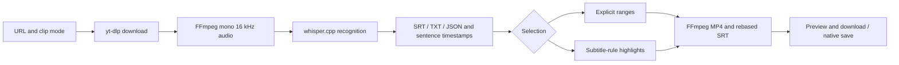

# Nyaru-Clipper project handoff

**Remote synchronization addendum (2026-10-14)**: Current source and documentation were committed and pushed to three `origin` development branches: `feat/arctime-pro-plugin` (original workstation edits and complete development history), `codex/local-companion-web`, and `codex/local-companion-macos`. Verified remote feature commits were `d4f28f9`, `5baf166`, and `1366686`; use `git log -1` / `git ls-remote origin` for the latest subsequent handoff commit. Uncommitted/unpushed statements, older HEADs and dirty-original-checkout notes below describe earlier snapshots; this addendum supersedes their current Git status. The app retains shared browser fixes; `master` was unchanged.

Before synchronization, the original checkout passed 143 selected backend tests, 137 frontend tests, seven browser E2E tests and the frontend build. Browser passed 95 backend tests; app passed 99. Strict signing of the 0.1.1 package and legacy adapter Swift compilation passed. Original executable permissions were restored on 16 scripts and shell syntax checks passed. Models, media, app builds, private configuration and temporary automation evidence stay local. Real media/native-button acceptance was not repeated; notarization and a public release remain incomplete.

Updated and Git/docs checked: **2026-10-14, Asia/Shanghai**. This is the original
checkout's consolidated handoff, now including the browser/app branch split.
Historical media acceptance and service observations retain their dates; this
documentation update ran no functional tests and started no services.

## Direction and status

Latest retest: a second task failed with a 2.040-second overrun, showing the initial two-second cap was incomplete. Bounded terminal-window handling replaces it; the App worktree built installed 0.1.1 (build 2). Recovery reused the downloaded source and completed 658 cues and two clips. Web passed 95 selected tests and macOS passed 99. See [Issue #1 retest](macos-app-issue1-retest-2026-10-14.md). Source remains uncommitted/unpushed; historical two-second behavior below is superseded.

Subsequent repair on 2026-10-14: the installed App recovered its failed 81-minute task and produced 1448 cues and four highlight clips. 94 selected regressions, native completion/playback and output checks passed. The original build/ZIP was updated; both independent worktrees contain corresponding uncommitted fixes, while their earlier artifacts were not rebuilt. See [recovery evidence](macos-app-recovery-2026-10-14.md). Historical snapshots below retain their original scope; both independent worktrees now contain these uncommitted changes.

The approved route is a standalone local companion and macOS app: URL download,
offline text and sentence timestamps, explicit ranges or subtitle-rule highlights,
progress, preview, export and interrupted-run recovery. It does not launch ArcTime
or submit to paid/cloud services; `arctime` remains a directory name. The macOS
scope excludes the original GPU workstation's translation, proofreading, library
and queue. Do not infer a requirement to restore paid integrations from that name.

| Area | Status and evidence |
| --- | --- |
| CLI | Completed; real short-video acceptance on 2026-10-12; 80 selected regressions |
| Browser GUI | Completed; both modes, preview, seeking, downloads/history/narrow layout accepted; 99 selected backend and 137 frontend tests |
| macOS 0.1.0 | Completed; bounded native workflows accepted locally; 88 focused regressions; arm64, macOS 27.0 minimum |
| Original workstation | Existing code retained; GPU/translation/queue flows not reaccepted in this iteration |
| Branch split | Completed and locally committed; browser `74e600b`, app `ca0e413` inherits browser; both checkouts currently clean |
| Public release | Incomplete; local commits exist, no remote push; ad-hoc signing only, no Developer ID/notarization or cross-machine acceptance |

Test counts belong to different historical selections, are not additive and do
not establish whole-repository success. During the 2026-10-14 split, the browser
checkout passed **84 backend tests, 154 frontend tests (21 files)** and the dual-entry
build; the app checkout passed **88 backend tests**, full packaging, strict signing
and frozen-helper HTTP checks. The frontend count differs because earlier dirty
workstation edits were excluded; a Starlette/httpx deprecation warning did not fail
tests. This documentation update checked Git/files without repeating those checks.

## Version entrypoints

| Version | Branch / commit | Checkout and scope |
| --- | --- | --- |
| Browser | `codex/local-companion-web` / `74e600ba16f1890e27cb09bddd4a1585321d91d8` | `/Users/drm/.codex/worktrees/local-companion-web/nyaru-clipper`; local CLI, download, transcript/timestamps, range/highlight clips, browser progress/preview/export/recovery |
| App | `codex/local-companion-macos` / `ca0e41341dfd939816d498116b8b790083c86c6f` | `/Users/drm/.codex/worktrees/local-companion-macos/nyaru-clipper`; inherits browser core, adds native window/save, process cleanup, bundled tools/model and packaging |

The original common base is `0bcd8d5`. The app retains the shared React UI and
processing core. Commit shared fixes to the browser branch first, then merge into
the app branch; make app-specific changes there. Continue in the corresponding
checkout instead of switching branches over the original dirty directory.

Version handoffs: [browser](../../../.codex/worktrees/local-companion-web/nyaru-clipper/docs/project-handoff.md),
[app](../../../.codex/worktrees/local-companion-macos/nyaru-clipper/docs/project-handoff.md).
The [split receipt](../.omo/evidence/branch-split-2026-10-14.json) is local evidence
in the original checkout, not distributed through Git. Models, media, tasks,
configuration, builds, earlier dirty workstation edits and early paid-service
desktop adapters were excluded from this batch of new commits.

## Git and live snapshot

- Checkout: `/Users/drm/project/nyaru-clipper`.
- Branch: `feat/arctime-pro-plugin`; HEAD `0bcd8d5`, `chore: adopt GPL-3.0-only license`.
- Those describe the preserved original checkout. The table above identifies
  the new branches. This update verified their HEADs, app ancestry and clean
  status; no additional commit, fetch or push was performed.
- Configured origin: `https://github.com/damin93381/nyaru-clipper.git`. No fetch was
  performed; remote freshness and ahead/behind status are unknown.
- Many dirty and untracked files include earlier workstation changes. Do not
  attribute them all to packaging, stage everything, reset or clean the checkout.
- Historical 2026-10-13 snapshot: installed helper ready, four completed jobs,
  browser port 8787 unreachable. Current online status was not checked. The app's
  ephemeral loopback port is separate; an open browser tab does not prove uptime.
- During 2026-10-14 split acceptance, an isolated browser port served the page,
  ready configuration and empty history. The fresh frozen helper did likewise
  with `PATH=/usr/bin:/bin` and temporary data. Both stopped after checks. These
  establish startup checks, not another real-media acceptance.

These observations are dated; current uptime remains unverified and must be rechecked when continuing.

## Artifacts and protected data

| Artifact | Location |
| --- | --- |
| Installed app | `/Users/drm/Applications/Nyaru Clipper.app` |
| Original build | Original checkout `dist/Nyaru Clipper.app`; historical accepted artifact |
| New app-branch build | `/Users/drm/.codex/worktrees/local-companion-macos/nyaru-clipper/dist/Nyaru Clipper.app`; existence checked, installed app preserved |
| Original ZIP | Original checkout `dist/Nyaru-Clipper-macOS-arm64.zip`, 496480853 bytes recorded on 2026-10-13; the branch builder produces `.app`, not an automatic ZIP |
| App model/runs/log | `~/Library/Application Support/Nyaru Clipper/`: `models/`, `runs/`, `app.log` |
| CLI/browser runs | `data/local-runs/`; not automatically imported into the app |
| Development Python | `~/.cache/nyaru-clipper/companion-venv/bin/python` |
| Default CLI model | `~/.cache/nyaru-clipper/models/ggml-small.bin` |

Python, yt-dlp, FFmpeg/ffprobe, whisper.cpp, GGML backends and the multilingual small
model are bundled. Runtime use needs no terminal/Homebrew. First launch verifies
and provisions the model; a differing existing model is preserved with an error.
Model SHA-256 is
`1be3a9b2063867b937e64e2ec7483364a79917e157fa98c5d94b5c1fffea987b`.
Original signing/ZIP integrity are historical observations. On 2026-10-14 the new
app-branch build passed `codesign --verify --deep --strict`; bundled yt-dlp returned
`2026.08.19`. This docs update did not repeat signature, model-hash or ZIP checks.

Protect models, manifests, transcripts, exports and failure logs. Do not hand-edit
runtime data or overwrite a differing export without an explicit replacement choice. The builder preserves an existing
app: move the old build aside before rebuilding. Moving the app keeps data, but
resuming incomplete ASR currently requires the original app installation path
and model because its identity is compared. Incomplete downloads require a new URL
submission.

## Pipeline and source map



ASR uses five-minute chunks, source/config validation, caching and rebasing.
Highlights score subtitle density, laughter, excitement and repetition, then
select qualifying non-overlapping windows. A maximum is not a guaranteed count;
zero clips is valid. Word alignment, diarization, visual understanding and LLM
semantic scoring are not provided.

| Path | Responsibility |
| --- | --- |
| `scripts/local_companion.py`, `backend/app/arctime/cli.py` | doctor/run/resume/gui entrypoints |
| `backend/app/arctime/workflow.py` | Manifests, locks, stage recovery and export checkpoints |
| `backend/app/arctime/local_asr.py` | Local recognition, chunk cache and timestamps |
| `backend/app/arctime/media.py` | Tool resolution, download/probe, subtitles and clip selection |
| `backend/app/arctime/gui.py` | Standalone `/companion-api`, one task, history, file allowlist, Range/VTT |
| `web/companion.html`, `web/src/companion/` | Separate React entry using shared design primitives |
| `desktop/macos/App.swift` | AppKit/WebKit window, startup, native save and process-group shutdown |
| `scripts/macos_companion.py`, `backend/app/arctime/macos.py` | Frozen helper, downloader dispatch, model, port and parent watchdog |
| `scripts/build_macos_app.py`, `desktop/macos/requirements-build.txt` | Freeze/compile, native libraries, licenses and signing |
| `backend/app/services/export_encoding.py` | Shared CPU H.264/AAC exporter; reuse it |
| `backend/app/main.py`, `worker.py`, `web/src/workstation/` | Original workstation; not the app startup path |

Early ArcTime desktop adapters in `backend/app/arctime/desktop.py` and
`bridge.swift` are retained but unused by the local entrypoint. Original uv/pnpm,
single-GPU-worker and trusted-LAN rules remain in root/child `AGENTS.md` files.

These adapters and untracked AGENTS knowledge files remain only in the original
checkout and were not added as product source. The browser branch excludes
`macos.py`, `desktop/macos/` and app build scripts. The app's only processing-core
delta is frozen tool resolution/downloader dispatch in `media.py`; other core files match.

## Continue and validate

Enter the browser checkout below. The installed app is directly launchable;
the browser uses the independent environment and built frontend:

```bash
cd /Users/drm/.codex/worktrees/local-companion-web/nyaru-clipper
~/.cache/nyaru-clipper/companion-venv/bin/python scripts/local_companion.py doctor
~/.cache/nyaru-clipper/companion-venv/bin/python scripts/local_companion.py gui
```

GUI options include `--port`, `--output-dir`, `--model`, `--threads`; default port
is 8787. Closing a browser tab leaves the helper running. Closing the native
window or Cmd-Q stops its helper/tools.

Each checkout defaults to its own `data/local-runs/`, with no automatic history
copy. To reuse original history, specify `gui --output-dir
/Users/drm/project/nyaru-clipper/data/local-runs`; do not run two services writing
the same job. App data remains separately in Application Support.

Use Corepack inside `web` to honor its pinned pnpm version:

```bash
cd web
corepack pnpm build
corepack pnpm test --run
```

Run this 88-test selection in the app checkout. For the browser, omit
`test_macos_companion.py` for 84 tests. Test dependencies exist in
the current development environment, but build requirements do not install
pytest/httpx. Historical `/tmp/nyaru-arctime-tests/bin/python` no longer exists.

```bash
cd /Users/drm/.codex/worktrees/local-companion-macos/nyaru-clipper
PYTHONPATH=backend ~/.cache/nyaru-clipper/companion-venv/bin/python -m pytest \
  backend/tests/test_macos_companion.py backend/tests/test_arctime_media.py \
  backend/tests/test_arctime_workflow.py backend/tests/test_local_asr.py \
  backend/tests/test_local_companion_cli.py backend/tests/test_companion_gui.py -q
```

Move the old build aside before rebuilding with the PyInstaller-capable environment:

```bash
cd /Users/drm/.codex/worktrees/local-companion-macos/nyaru-clipper
~/.cache/nyaru-clipper/companion-venv/bin/python scripts/build_macos_app.py
```

Clean environment setup/model parameters are in [the app guide](macos-app.md).
Current compiler/native dependencies require macOS 27. Supporting older systems
requires rebuilding/reselecting those tools, not just changing Info.plist. Do not
bundle the full GPU workstation dependency set.

## Evidence and resolved failures

- [CLI acceptance](local-companion-acceptance-2026-10-12.md),
  [browser acceptance](local-companion-gui-acceptance-2026-10-13.md),
  [native acceptance](macos-app-acceptance-2026-10-13.md).
- [2026-10-14 split receipt](../.omo/evidence/branch-split-2026-10-14.json): commits,
  selected tests, new build and isolated HTTP checks; native button/media acceptance
  was not repeated during the split.
- `.omo/evidence/macos-runtime-qa.json`: 42 Mach-O files without development-host
  absolute links, bundled media decode, parent-loss group/port cleanup and data
  preservation.
- `.omo/evidence/macos-native-qa.json` and `macos-export.mp4`/`.srt`: playback,
  save/replace/cancel, native highlights and interrupted-run recovery.
- `.omo/evidence/macos-app-review.md`: WATCH / APPROVE, no blockers. Independent
  code/evidence review does not imply the reviewer personally clicked every flow.

Resolved: duplicate setsid EPERM; WKDownload existing-destination failure (temporary
sibling and safe publication); skipped SIGKILL when the helper exited early;
renamed model files missing on startup. Retain failure evidence and these fixes.
CUA ScreenCaptureKit -3811 recovered after restart and main UI acceptance finished.
A later extra quit check hit -3812 without executing quit. Failed automation and
health responses are not acceptance evidence.

## Remaining work and boundaries

These are unimplemented follow-ups, not current delivery promises or blockers:

1. Authorized real-platform short-video access, then long-video quality/resource
   tests and speaker output. Generated short media does not cover these.
2. Decide the supported macOS floor, obtain compatible native dependencies and
   test a clean machine. Intel needs its own build and acceptance.
3. For external distribution, handle Developer ID/notarization and dependency,
   model-license/source-delivery requirements. Current signing is local only.
4. Extend semantic/visual highlights only on a further request; continue stating
   the current heuristic limit.
5. Branch separation is complete. Apply shared fixes to browser first, then
   synchronize the app; push only when requested and preserve old workstation edits.

Do not restore paid ArcTime calls, delete models/history/failure evidence, edit
generated requirements/API types or runtime state, expose the service publicly,
or add Redis/Celery/multiple workers. This documentation update changed no product
code, service lifecycle or Git publication state.
