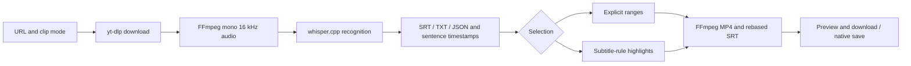

# Nyaru-Clipper project handoff

**Remote synchronization addendum (2026-10-14)**: Current source and documentation were committed and pushed to three `origin` development branches: `feat/arctime-pro-plugin` (original workstation edits and complete development history), `codex/local-companion-web`, and `codex/local-companion-macos`. Verified remote feature commits were `d4f28f9`, `5baf166`, and `1366686`; use `git log -1` / `git ls-remote origin` for the latest subsequent handoff commit. Uncommitted/unpushed statements, older HEADs and dirty-original-checkout notes below describe earlier snapshots; this addendum supersedes their current Git status. The app retains shared browser fixes; `master` was unchanged.

Before synchronization, the original checkout passed 143 selected backend tests, 137 frontend tests, seven browser E2E tests and the frontend build. Browser passed 95 backend tests; app passed 99. Strict signing of the 0.1.1 package and legacy adapter Swift compilation passed. Original executable permissions were restored on 16 scripts and shell syntax checks passed. Models, media, app builds, private configuration and temporary automation evidence stay local. Real media/native-button acceptance was not repeated; notarization and a public release remain incomplete.

Updated: **2026-10-14, Asia/Shanghai**. This update splits browser/app development
into local branches. Native media acceptance and installed-service snapshots below
belong to 2026-10-13; the installed app was not operated again.

## Direction and status

Subsequent live repair (2026-10-14): the current downloaded-video task failed with a 2.040-second terminal overrun. Bounded terminal-window handling repaired it; this worktree built installed 0.1.1 (build 2), and recovery produced 658 cues and two clips. 99 selected macOS tests and native completion/playback checks passed. See [Issue #1 retest](macos-app-issue1-retest-2026-10-14.md). Changes remain uncommitted/unpushed; earlier branch/runtime snapshots below retain their historical scope.

The approved route is a standalone local companion and macOS app: URL download,
offline text and sentence timestamps, explicit ranges or subtitle-rule highlights,
progress, preview, export and interrupted-run recovery. It does not launch ArcTime
or submit to paid/cloud services; `arctime` remains a directory name. The macOS
scope excludes the original GPU workstation's translation, proofreading, library
and queue. Do not infer a requirement to restore paid integrations from that name.

| Area | Status and evidence |
| --- | --- |
| CLI | Completed; real short-video acceptance on 2026-10-12; 80 selected regressions |
| Browser GUI | Completed; both modes, preview, seeking, downloads/history/narrow layout accepted; 99 selected backend and 137 frontend tests |
| macOS 0.1.0 | Completed; bounded native workflows accepted locally; 88 focused regressions; arm64, macOS 27.0 minimum |
| Original workstation | Existing code retained; GPU/translation/queue flows not reaccepted in this iteration |
| Public release | Incomplete; ad-hoc signing only, no Developer ID/notarization or cross-machine acceptance; local commits only, no push |

Test counts belong to different historical selections, are not additive and do
not establish whole-repository success. This split reran **88 selected app backend tests**
in an independent checkout; the browser base passed **84 backend tests, 154 frontend tests
(21 files)** and the dual-entry build. A Starlette/httpx deprecation warning did not fail tests.
Fresh build/frozen-runtime outcomes appear below; real media/native-save acceptance was not repeated.

## Git and live snapshot

- Original checkout: `/Users/drm/project/nyaru-clipper`, still `feat/arctime-pro-plugin`
  at `0bcd8d5`; its dirty snapshot and earlier workstation edits are preserved.
- Browser: `codex/local-companion-web`, commit `74e600b`, checkout
  `/Users/drm/.codex/worktrees/local-companion-web/nyaru-clipper`.
- App: `codex/local-companion-macos`, based on that browser commit with only app-specific
  source/build/docs additions, checkout `/Users/drm/.codex/worktrees/local-companion-macos/nyaru-clipper`.
  Fix shared behavior on the browser branch first, then merge into the app branch.
  Use `git log -1 --oneline` for the current app commit.
- Configured origin: `https://github.com/damin93381/nyaru-clipper.git`. No fetch was
  performed; remote freshness and ahead/behind status are unknown.
- Many dirty and untracked files include earlier workstation changes. Do not
  attribute them all to packaging, stage everything, reset or clean the checkout.
- Historical 2026-10-13 snapshot: installed helper ready, four completed jobs,
  development port 8787 unreachable. Its current online state was not rechecked.
- The new browser branch served its actual page, ready configuration and empty
  history on an isolated port, then shut down. The app uses an ephemeral loopback
  port separate from the browser address.

Recheck these volatile facts when continuing; they are not uptime guarantees.

## Artifacts and protected data

| Artifact | Location |
| --- | --- |
| Installed app | `/Users/drm/Applications/Nyaru Clipper.app` |
| Build | `dist/Nyaru Clipper.app` |
| ZIP | `dist/Nyaru-Clipper-macOS-arm64.zip`, 496480853 bytes |
| App model/runs/log | `~/Library/Application Support/Nyaru Clipper/`: `models/`, `runs/`, `app.log` |
| CLI/browser runs | `data/local-runs/`; not automatically imported into the app |
| Development Python | `~/.cache/nyaru-clipper/companion-venv/bin/python` |
| Default CLI model | `~/.cache/nyaru-clipper/models/ggml-small.bin` |

Python, yt-dlp, FFmpeg/ffprobe, whisper.cpp, GGML backends and the multilingual small
model are bundled. Runtime use needs no terminal/Homebrew. First launch verifies
and provisions the model; a differing existing model is preserved with an error.
Model SHA-256 is
`1be3a9b2063867b937e64e2ec7483364a79917e157fa98c5d94b5c1fffea987b`.
The installed app and ZIP are historical outputs in the original checkout. This
split builds a fresh `dist/Nyaru Clipper.app` in the app checkout, preserving the
installed app and original ZIP. Builds and model weights are not committed.

Protect models, manifests, transcripts, exports and failure logs. Do not hand-edit
runtime data or overwrite a differing export without an explicit replacement choice. The builder preserves an existing
app: move the old build aside before rebuilding. Moving the app keeps data, but
resuming incomplete ASR currently requires the original app installation path
and model because its identity is compared. Incomplete downloads require a new URL
submission.

## Pipeline and source map



ASR uses five-minute chunks, source/config validation, caching and rebasing.
Highlights score subtitle density, laughter, excitement and repetition, then
select qualifying non-overlapping windows. A maximum is not a guaranteed count;
zero clips is valid. Word alignment, diarization, visual understanding and LLM
semantic scoring are not provided.

| Path | Responsibility |
| --- | --- |
| `scripts/local_companion.py`, `backend/app/arctime/cli.py` | doctor/run/resume/gui entrypoints |
| `backend/app/arctime/workflow.py` | Manifests, locks, stage recovery and export checkpoints |
| `backend/app/arctime/local_asr.py` | Local recognition, chunk cache and timestamps |
| `backend/app/arctime/media.py` | Tool resolution, download/probe, subtitles and clip selection |
| `backend/app/arctime/gui.py` | Standalone `/companion-api`, one task, history, file allowlist, Range/VTT |
| `web/companion.html`, `web/src/companion/` | Separate React entry using shared design primitives |
| `desktop/macos/App.swift` | AppKit/WebKit window, startup, native save and process-group shutdown |
| `scripts/macos_companion.py`, `backend/app/arctime/macos.py` | Frozen helper, downloader dispatch, model, port and parent watchdog |
| `scripts/build_macos_app.py`, `desktop/macos/requirements-build.txt` | Freeze/compile, native libraries, licenses and signing |
| `backend/app/services/export_encoding.py` | Shared CPU H.264/AAC exporter; reuse it |
| `backend/app/main.py`, `worker.py`, `web/src/workstation/` | Original workstation; not the app startup path |

Early `desktop.py`/`bridge.swift` adapters remain in the original checkout and are
excluded from both new branches. Original workstation source stays at the base;
untracked AGENTS knowledge files were not committed as product changes.

## Continue and validate

On 2026-10-14 this checkout completed the frontend build, PyInstaller freeze,
Swift compilation and `codesign --verify --deep --strict`. Bundled downloader
dispatch returned `2026.08.19`. The fresh frozen helper started with
`PATH=/usr/bin:/bin` and isolated temporary data: configuration returned ready,
the bundled page loaded and history was empty; the helper then stopped. The
installed app was preserved; real media processing and native button acceptance
were not repeated.

From the repository root, the app is directly launchable; the browser GUI uses the
independent environment and previously built frontend:

```bash
~/.cache/nyaru-clipper/companion-venv/bin/python scripts/local_companion.py doctor
~/.cache/nyaru-clipper/companion-venv/bin/python scripts/local_companion.py gui
```

GUI options include `--port`, `--output-dir`, `--model`, `--threads`; default port
is 8787. Closing a browser tab leaves the helper running. Closing the native
window or Cmd-Q stops its helper/tools.

Use Corepack inside `web` to honor its pinned pnpm version:

```bash
cd web
corepack pnpm build
corepack pnpm test --run
```

The app's 88 focused regressions used this selection. Test dependencies exist in
the current development environment, but build requirements do not install
pytest/httpx. Historical `/tmp/nyaru-arctime-tests/bin/python` no longer exists.

```bash
PYTHONPATH=backend ~/.cache/nyaru-clipper/companion-venv/bin/python -m pytest \
  backend/tests/test_macos_companion.py backend/tests/test_arctime_media.py \
  backend/tests/test_arctime_workflow.py backend/tests/test_local_asr.py \
  backend/tests/test_local_companion_cli.py backend/tests/test_companion_gui.py -q
```

Move the old build aside before rebuilding with the PyInstaller-capable environment:

```bash
~/.cache/nyaru-clipper/companion-venv/bin/python scripts/build_macos_app.py
```

Clean environment setup/model parameters are in [the app guide](macos-app.md).
Current compiler/native dependencies require macOS 27. Supporting older systems
requires rebuilding/reselecting those tools, not just changing Info.plist. Do not
bundle the full GPU workstation dependency set.

## Evidence and resolved failures

- [CLI acceptance](local-companion-acceptance-2026-10-12.md),
  [browser acceptance](local-companion-gui-acceptance-2026-10-13.md),
  [native acceptance](macos-app-acceptance-2026-10-13.md).
- `.omo/evidence/macos-runtime-qa.json`: 42 Mach-O files without development-host
  absolute links, bundled media decode, parent-loss group/port cleanup and data
  preservation.
- `.omo/evidence/macos-native-qa.json` and `macos-export.mp4`/`.srt`: playback,
  save/replace/cancel, native highlights and interrupted-run recovery.
- `.omo/evidence/macos-app-review.md`: WATCH / APPROVE, no blockers. Independent
  code/evidence review does not imply the reviewer personally clicked every flow.

Resolved: duplicate setsid EPERM; WKDownload existing-destination failure (temporary
sibling and safe publication); skipped SIGKILL when the helper exited early;
renamed model files missing on startup. Retain failure evidence and these fixes.
CUA ScreenCaptureKit -3811 recovered after restart and main UI acceptance finished.
A later extra quit check hit -3812 without executing quit. Failed automation and
health responses are not acceptance evidence.

## Remaining work and boundaries

These are unimplemented follow-ups, not current delivery promises or blockers:

1. Authorized real-platform short-video access, then long-video quality/resource
   tests and speaker output. Generated short media does not cover these.
2. Decide the supported macOS floor, obtain compatible native dependencies and
   test a clean machine. Intel needs its own build and acceptance.
3. For external distribution, handle Developer ID/notarization and dependency,
   model-license/source-delivery requirements. Current signing is local only.
4. Extend semantic/visual highlights only on a further request; continue stating
   the current heuristic limit.
5. Both variants now have separate local commits. Apply shared fixes to the
   browser branch first, then synchronize the app; push only when requested.

Do not restore paid ArcTime calls, delete models/history/failure evidence, edit
generated requirements/API types or runtime state, expose the service publicly,
or add Redis/Celery/multiple workers. Historical `.omo/evidence/` stays in the original
development checkout and is not distributed through Git. The installed app and its
user data are preserved.
