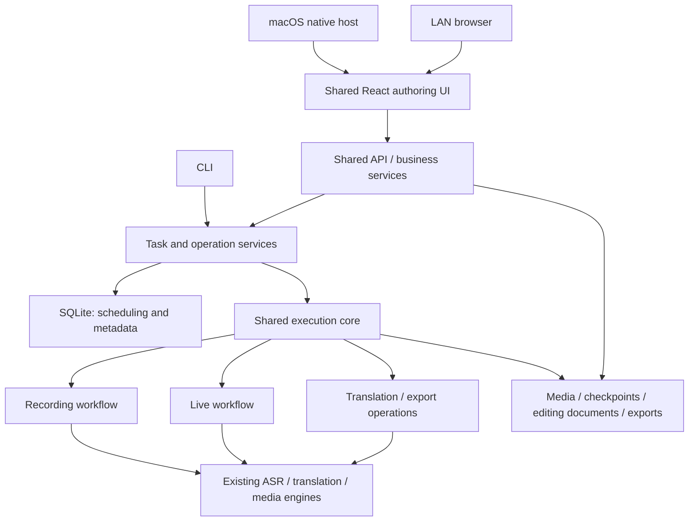

# Unified Architecture Design: Option B

Prepared: 2026-10-22 (Asia/Shanghai); source observation: 2026-10-21. Status: **direction confirmed; design awaiting review; implementation, migration and acceptance are planned**.

The user confirmed desktop authoring plus Linux/WSL GPU batch processing and a sortable queue. This request authorizes documentation only, without implementation, production migration, installation, business startup, external AI requests, commits, pushes, merges or removal of old implementations.

Chinese counterpart: [Architecture design](2026-10-22-unified-architecture-design.zh-CN.md). Delivery sequence: [Implementation plan](../plans/2026-10-22-unified-architecture.md).

## Review revision index (2026-10-22)

The table tracks completed document revisions, not implemented or accepted behavior. Both languages use identical U IDs and anchors; execution remains planned.

| Finding | Revised design location | Revised implementation location |
| --- | --- | --- |
| U1 Revalidate source before takeover | [6.1 Takeover](#rev-u1) | [U1 execution](../plans/2026-10-22-unified-architecture.md#rev-u1) |
| U2 Complete output sets and prepared receipts | [5.1 Publication](#rev-u2) | [U2 execution](../plans/2026-10-22-unified-architecture.md#rev-u2) |
| U3 Independent rollback entry | [7.1 Recovery entry](#rev-u3) | [U3 execution](../plans/2026-10-22-unified-architecture.md#rev-u3) |
| U4 Global state and field preservation | [6.2 Global package](#rev-u4) | [U4 execution](../plans/2026-10-22-unified-architecture.md#rev-u4) |
| U5 Live child steps and execution slot | [4.1 Slot rules](#rev-u5) | [U5 execution](../plans/2026-10-22-unified-architecture.md#rev-u5) |
| U6 Source instances and conflicts | [6.3 Source identity](#rev-u6) | [U6 execution](../plans/2026-10-22-unified-architecture.md#rev-u6) |
| U7 Repeatable acceptance gates | [8.1 Execution matrix](#rev-u7) | [U7 execution](../plans/2026-10-22-unified-architecture.md#rev-u7) |

## Second review revision map (Rv1-Rv5, 2026-10-22)

| Residual | Revised design | Revised plan |
| --- | --- | --- |
| Rv1 Cross-batch rollback | [7.2 Root dependency group](#rev-rv1) | [Rv1 tasks](../plans/2026-10-22-unified-architecture.md#rev-rv1) |
| Rv2 Lock lifetime/crash protection | [6.4 Supervisor and persistent seal](#rev-rv2) | [Rv2 tasks](../plans/2026-10-22-unified-architecture.md#rev-rv2) |
| Rv3 Multi-root recovery | [7.3 Recovery set](#rev-rv3) | [Rv3 tasks](../plans/2026-10-22-unified-architecture.md#rev-rv3) |
| Rv4 Exclusive recovery decisions | [5.1 Decision table](#rev-rv4) | [Rv4 tasks](../plans/2026-10-22-unified-architecture.md#rev-rv4) |
| Rv5 Actual product export | [8.2 Export acceptance](#rev-rv5) | [Rv5 tasks](../plans/2026-10-22-unified-architecture.md#rev-rv5) |

Rv identifies this document revision, without replacing U1-U7, R0-R2 or acceptance status. Every new mechanism/case remains planned.

## 1. Decision and scope

Choose Option B: make the Companion authoring experience the product baseline, progressively unify task contracts, business services, scheduling and artifact access, and reuse Workstation library, queue, execution history and GPU capabilities. The final product has one business core with separate desktop and LAN launch hosts.

- Keep daily authoring, per-cue editing, templates, settings, live capture, recordings, batches, queue ordering/pause, archive/tags, recovery, ASS, burned clips and ArcTime ZIP.
- Keep whisper.cpp, WhisperX, existing translation/proofreading paths and CPU/existing platform encoding paths. Engine differences do not create separate task systems.
- Exclude generic workflow frameworks, plugin markets, distributed scheduling, Redis/Celery/Prefect, public or multi-user hosting, native Windows GPU support, ArcTime paid/cloud restoration and DeepSeek Pro.
- Remote desktop-to-GPU connections and cross-host file synchronization are outside this scope. Shared code/contracts do not imply those transport capabilities.

Option A, sharing utilities while retaining both systems, is transitional. Option C, retaining only Companion, conflicts with the confirmed GPU workstation requirement.

## 2. Observed source baseline

These are static observations from 2026-10-21. Historical test totals and installed-App state are not acceptance evidence for this design.

| Current boundary | Source | Consequence |
| --- | --- | --- |
| Two frontend entries | [Vite](../../../web/vite.config.ts), [Companion](../../../web/src/companion/Companion.tsx), [Workstation routes](../../../web/src/workstation/routes/WorkstationRouter.tsx) | Consolidate pages, queries and clients progressively |
| Companion local service | [gui.py](../../../backend/app/arctime/gui.py), [macos.py](../../../backend/app/arctime/macos.py) | Preserve same-origin restrictions, dynamic loopback port and native lifecycle |
| Companion single active job and JSON state | [manager](../../../backend/app/arctime/companion_manager.py), [projection](../../../backend/app/arctime/companion_projection.py) | Adding SQLite scheduling while memory/JSON remain independent state owners is insufficient |
| Fixed Workstation stages and projections | [creation](../../../backend/app/api/routes/workstation_tasks.py), [models](../../../backend/app/models.py), [runs](../../../backend/app/services/workstation_runs.py) | Seven stages cannot directly represent live capture and independent exports |
| Editor/export expects Companion manifests | [inputs](../../../backend/app/arctime/subtitle_inputs.py), [document](../../../backend/app/arctime/subtitle_document.py), [exports](../../../backend/app/arctime/subtitle_exports.py) | Decouple input resolution without synthesizing job.json |
| Two ASR engines and live behavior | [LocalASR](../../../backend/app/arctime/local_asr.py), [WhisperX](../../../backend/app/services/asr_whisperx.py), [live](../../../backend/app/arctime/saozi_live.py) | Preserve engine cache isolation, tail handling and discontinuities |
| Independent Workstation worker | [worker](../../../backend/app/worker.py), [queue](../../../backend/app/services/workstation_queue.py), [runner](../../../backend/app/services/task_runner.py) | Reuse scheduling invariants while removing legacy-stage coupling |

See the historical [handoff](../../project-handoff.md). Before execution, refresh checkout identity, dirty paths, processes, roots, dependencies and hardware. This design makes no current branch, service, task-count or GPU availability claim.

## 3. Target structure

Each data root has one heavy-work executor. Desktop hosts it in the helper; Workstation hosts the same core in an independent worker. Claiming, execution tokens, heartbeats, cancellation and recovery are shared. APIs submit operations and read state without bypassing scheduling. Live capture reserves the slot; its internal capture thread and media processes are not additional schedulers.

During transition, old and new systems also share a single heavy-work allowance on the same host/GPU. Separate roots do not authorize concurrent hardware use. Pause the old executor before exercising the candidate; do not build a second resource scheduler for this transition.

Desktop retains loopback-only binding and Host/Origin checks. LAN mode retains the trusted-LAN boundary and restricted origins. It cannot silently widen desktop exposure or expose credentials or server absolute paths.

## 4. Minimum shared contracts

These are proposed contracts, not existing APIs or Python types. Introduce files only when their implementation phase needs them.

| Contract | Required fields and behavior |
| --- | --- |
| Task identity | Opaque IDs for new tasks; unique `(source_instance_id, legacy_id)` mapping per section 6.3; no directory/export renaming caused by ID changes |
| Media/subtitle input | Task and controlled artifact IDs, hashes, source/target languages, duration, absolute source time, clip bounds/local origin; preserve word data, never infer language/time origin from filenames |
| Editing document | Reuse stable cue IDs, source_fingerprint, revision, styles and emphasis in SubtitleDocument; retain original engine results separately |
| Operation | Four explicit kinds: `process_recording`, `process_live`, `translate`, `export`; fixed existing workflows per kind, without arbitrary DAGs |
| Execution identity | Operation ID, attempt, execution token, worker owner/heartbeat; reject both state and artifact publication from stale tokens |
| Configuration snapshot | Engine, model/model hash, languages, provider, parameters, template version and export policy; credential references only |
| Events | Ordered cursor, task/operation IDs, public-safe payload; commit events with state; events trigger refresh rather than owning task truth |
| Export identity | Input hashes, editing revision/document hash, bounds, style, format and encoding settings identify a request; reuse verified results for identical requests |

Do not hardcode Companion Japanese-to-Chinese or Workstation Chinese-to-Japanese behavior. Reject unsupported engine/language combinations and preserve the original direction/provider/model of old tasks. No silent engine or translation-path switch.

Operation states are `queued -> running -> succeeded / failed / cancelled / interrupted`. A stop request is recorded before the terminal state; processes and execution ownership must actually be released. Show operation outcomes separately: successful video processing with failed translation keeps the video and exposes the translation failure. `accepted` belongs to verification records, not an automatically assigned pipeline success state.

Stopping live capture drains the tail. Recovery consumes recorded material only; reconnecting requires a new task. Workstation highlight exports retain user confirmation; Companion selected ranges and Saozi retain their existing automatic export policies. Unification does not expand automatic actions.

### 4.1 U5: Top-level operations and live child steps

Only top-level operations claim the heavy-work slot. Recognition, selection, translation and styled export inside `process_live` are sequential child steps recording parent_operation_id, chunk/clip identity and outcomes. They share the parent's attempt/token and never enqueue themselves or wait for another slot. Child outputs use section 5.1 without another scheduler.

User-submitted translate/export requests are separate queued top-level operations and wait for live work to release the slot. Identical snapshot requests for the same task/kind return the existing operation identity. Translation/style child failures preserve original media and expose that result's failure while capture may continue. Unsafe state/source corruption stops the parent. Stop capture first, process closed chunks/tail next, then release the slot. Failed tail draining makes the parent failed/interrupted, not successful; completed child results remain readable, and another top-level operation starts only after process release.

## 5. Storage authority and publication

| Information | Final authority | Transition rule |
| --- | --- | --- |
| Tasks, operations, queue, execution ownership/history, artifact index | SQLite | Migrated tasks never derive authoritative running state from gui.json or memory |
| Source media, original recognition, caches, engine checkpoints | Files | Preserve original information and engine cache separation; checkpoints grant no execution ownership |
| Editing documents, templates, export document snapshots | Versioned files | Keep revision conflict checks; DB indexes/expected versions are not a second editable document body |
| Credentials | Existing protected storage | Preserve permissions/location; exclude from tasks, events, manifests and documents |
| Old JSON/databases | Historical sources for old tasks | Read-only compatibility, without bidirectional synchronization |

SQLite and file publication cannot form one ordinary transaction. Use this bounded protocol:

1. Register the operation with attempt/token and isolate staging by operation ID and attempt; retries never share writable staging.
2. Persist the complete required output set and hashes in a prepared receipt per section 5.1 before publishing any final output.
3. Recheck the token in the same short per-task critical section used for claiming/revocation, publish all required outputs, then commit the set and event; record top-level success only when its workflow finishes. Never overwrite old results or hold DB transactions during inference.
4. Restart reconciliation uses only the durable receipt and valid execution identity per section 5.1. Incomplete sets cannot succeed; missing/corrupt output explicitly fails with evidence retained.
5. External AI requests have an uncertain window between provider acceptance and local checkpointing. Use supported request identities and valid checkpoints where available. Unknown outcomes become interrupted, with a possible repeat-charge warning on retry, without blind automatic resubmission. Do not promise exactly-once billing.

### 5.1 U2: Prepared receipt and whole-set commit

Use canonical versioned JSON containing publication_id, operation_id, child-step ID, attempt, execution_token, input/configuration/editing-document hashes, every required output's role/relative target/size/SHA256, and a set digest. publication_id stably identifies a set by operation, attempt, child-step/clip and input snapshot. Derive receipt_digest from content and register it in SQLite. Required sets: MP4+SRT for a clip; product+document snapshot for styled exports; validate every manifest member inside ArcTime ZIP; recognition/translation sets include subtitles, structured output and checkpoints required by consumers. Diagnostic files such as encoder.log do not determine success.

Set commit completes only that publication/child result; publishing the first live clip never makes its still-capturing parent successful. A top-level operation succeeds only after workflow/draining completion and registration of every required set. Ready is a publication state, not an addition to the top-level state machine. Each publication has independent ready/reconciliation records; later clips cannot overwrite earlier receipts.

Fixed order: write/fsync every staged output; write/fsync temporary receipt; atomically publish the immutable receipt on the same filesystem and fsync its parent; commit publication `ready` and receipt_digest; publish each target and fsync target parents; commit the complete set, publication success and event in one DB transaction. Verify SQLite durability settings and record journal_mode/synchronous. Claim no untested hardware power-loss guarantee.

Targets include attempt or content identity and cannot overwrite existing files. Recheck ownership before each rename and keep set publication/final commit within one publication critical section. Restart acquires exclusive recovery ownership before any new claim:

#### Rv4: Exclusive recovery decisions and execution identity

Recovery first acquires an exclusive recovery lock, proves the original worker/process groups have exited and reads a consistent snapshot. No new claim before reconciliation finishes. D is publication DB state N(not ready), R(ready), C(committed); E is receipt state missing, corrupt or valid. P is final-file set zero, partial, fully valid or corrupt; T means every required unpublished staging file is valid. Unknown DB/schema states stay blocked without guessing.

For pending sets, F requires no cancellation/revocation/new attempt and released original processes; existing receipts must also match DB current attempt/token. With missing receipts, DB eligibility determines F for isolation only, never output adoption. An expired heartbeat alone does not revoke reconciliation. An independent audited recovery identity may finish original-attempt files/registration only, never engines/AI. Do not run attempt-incrementing/token-revoking stale-job logic first. Effective cancellation/new attempts invalidate F. For committed C sets, verify immutable historical receipt/registration proof; later attempts never invalidate old success.

| Decision | Mutually exclusive condition | Sole action |
| --- | --- | --- |
| J00 | E corrupt; any D/F/P | blocked/corrupt; preserve files, no success |
| J01 | E not corrupt, F invalid, D=N or R | Isolate pending output/interrupted; never mix into a new attempt |
| J14 | E not corrupt, F invalid, D=C | Historical commit proof mismatch: blocked/corrupt; retain old output rather than treating it as new-attempt debris |
| J02 | E missing, F valid, D=N, P=0 | interrupted; retain staging without inferring completion |
| J03 | E missing, F valid, D=N, P nonzero | Isolate orphan final files/interrupted |
| J04 | E missing, F valid, D=R or C; any P | Broken registration chain: blocked/corrupt; no automatic receipt reconstruction |
| J05 | E valid, F valid, D=N, P=0, T valid | Commit ready first, then J08; never immediate success |
| J06 | E valid, F valid, D=N, P=0, T invalid | interrupted; preserve receipt/report missing staging |
| J07 | E valid, F valid, D=N, P nonzero | Publication-order violation: blocked/corrupt, no adoption |
| J08 | E valid, F valid, D=R, P zero or partial, T valid | Verify published hashes, finish original set, then J10 |
| J09 | E valid, F valid, D=R, P zero or partial, T invalid | interrupted; preserve subset without AI/model rerun |
| J10 | E valid, F valid, D=R, P fully valid | Register complete set/event transactionally; update parent only under workflow completion rules |
| J11 | E valid, F valid, D=R, P corrupt | blocked/corrupt; preserve evidence |
| J12 | E valid, F valid, D=C, P fully valid | Return registered result; additional files/records=0 |
| J13 | E valid, F valid, D=C, P not fully valid | Expose unavailable/failed result; do not rewrite old files or invent success |

For zero/partial P, T evaluates unpublished members only; corrupt files make P corrupt rather than partial. Disk-full/commit failure is not another overlapping state: map the next observed D/E/P/T to one J row and retain the original error reason. Tests prove exactly one match per input; unsupported schemas never enter this table.

Editing saves must also avoid drift between file revision and DB expectation: durably write an immutable revision body, then compare-and-swap the current revision in DB. Only registered revisions are visible; a failed save never overwrites registered content. Update legacy pointers under lock and repair from the registered revision on restart, without deriving DB state from an orphan file. Templates follow the same principle.

## 6. Migration and ownership boundaries

The migration unit is one terminal task from an explicit source and its artifacts. Exclude running/queued tasks and tasks with unreleased process groups. Existing queues remain with the old system; taking over queued tasks requires explicit withdrawal of old eligibility and a recorded order/priority mapping. The new queue initially stays paused.

Migration records contain batch/schema ID, source_instance_id/legacy ID, hashes, mappings, old/new owner, migration state and rollback category. Equal legacy IDs across instances import independently; duplicates/changes within one instance follow section 6.3. Missing subtitles, corrupt manifests or mismatched source fingerprints are rejected or isolated read-only per task without changing originals; other tasks can prepare independently.

Use `discovered -> prepared -> verified -> activated` per task within a batch:

- prepared: metadata, documents and snapshots are written into a separate destination root; no in-place legacy upgrade.
- verified: hashes, mappings, subtitle counts/timing, document revisions and export hashes pass; scheduling is still prohibited.
- activated: complete section 6.1 post-shutdown revalidation before transferring ownership transactionally; old software cannot write those directories again.
- Old binaries do not understand new fencing columns. Enforce root separation, process exclusion and existing directory locks; if the old writer cannot be excluded, do not activate.

Media may remain a controlled, hash-checked read-only reference; metadata and new outputs are always separate. Revalidate references on use. If old writers or source stability cannot be controlled, copy and verify media within authorized space; insufficient space blocks migration. No writable hard links. A production rollback batch must verify that restoring the old reader cannot overwrite referenced media during task recovery.

Migration performs no ASR rerun, AI request, live recording, old-export regeneration or restoration of previously deleted data. Orphan exports may be indexed read-only. Missing-source tasks explicitly remain read-only/incomplete, without invented recovery eligibility. Preserve legacy source_fingerprint compatibility proofs; changing hashes is not proof of editing compatibility.

### 6.1 U1: Freeze, final revalidation and takeover

Preparation computes source_generation covering task records, editing revision/body hash, translation/export indexes, tags/archive/template bindings and the section 6.2 global-package generation, not just video hashes. Verified means candidate validation, not timeless activation eligibility.

Activation order: pause old admissions/queue; flush saved drafts and stop old API/worker/CLI/helper; confirm process release; the same section 6.4 Supervisor acquires old-root .gui.lock/task locks and installs/verifies a persistent write seal; recompute source_generation under lock; compare with preparation; only on equality commit mappings, global-package generation and activated state. Acquire locks in stable root/task-ID order and fail rather than waiting while holding locks for business work.

Changes return to prepared for recopy/reverification without mixed generations. Shutdown crashes, failed locks/activation grant no new execution ownership. The section 6.4 Supervisor continuously owns locks without host handoff. During batch takeover the whole old root remains frozen and unmigrated tasks read-only. Resuming old-root writes requires section 7.2's cross-batch thaw gate; cancelling an unactivated batch grants neither R0 nor old-root write access.

### 6.2 U4: Global migration package and preserved fields

Separate root roles: task_root for new tasks/outputs, settings_root for new defaults/templates, credential_root referencing the existing protected authorization location, and independent model/tool paths. Current LLMConfig/CredentialStore derive paths from root; P4 must decouple wiring instead of changing task_root and reporting unconfigured. Credential references are same-host server bindings, never symlinks, browser parameters or shareable manifests. Retain existing cross-process credential locking.

| Domain | Preservation/conflict rule | Verification |
| --- | --- | --- |
| Defaults/host settings | Languages, processing/export defaults, model/tool paths, provider/model; unchanged software -> template -> task precedence; no host paths in LAN payloads | Equal default snapshot fields; missing tools explicitly reported without changing defaults |
| Authorization | Preserve original location/permissions and inject server-side reference; DeepSeek secrets still read from old private config, never copied into new settings JSON | Offline redacted configured status/permissions; byte-identical credential fixtures, zero network/login |
| Templates/ArcTime projects | IDs/revisions/workflow/series, project hashes/bindings and default-template mapping; namespace source conflicts without overwrite | Equal counts/content hashes and resolvable bindings; old task snapshots remain independent |
| Task/library metadata | Title, creation/update time, tags, archived_at, source reference/copy and highlight option | Exact field equality; separately recompute derived storage_bytes, without treating zero as absence |
| History/queue | Stage outcomes, failure codes/log references, historical runs, priority/position/paused | Read-only historical links to new IDs; separate old-eligibility withdrawal before new paused queue admission |

Prepare/verify the global package first. Task activation references that exact generation and makes it visible in the same unified DB transaction. Missing package/unresolved binding blocks dependent tasks. Default/template changes before activation trigger U1 failure. New defaults/template writes put the whole rollback group into R2; an untouched task cannot independently qualify for R1. Never restore revoked/expired/refreshed credentials from an old snapshot.

### 6.3 U6: Source instances and conflicts

source_instance_id is a persistent registered UUID for one historical task collection; origin_kind only labels companion/workstation. Keep UUIDs in a separate migration registry, without writing legacy roots or deriving new identities from paths/hostnames. Renaming a root retains its registered identity. Restoring a clone/backup as the same collection reuses identity; importing a divergent branch explicitly registers another instance. Scan order cannot change results.

| Input | Outcome |
| --- | --- |
| Different source_instance_id, same legacy_id | Two independent mappings; both import, without merge or rejection |
| Same instance/ID/source_generation | Idempotent existing mapping; zero duplicated tasks/artifacts |
| Changed content before activation | Preserve prior candidate, return to prepared and reverify |
| Changed content after activation | Conflict; stop update and preserve unified task; explicitly choose a new source branch or rollback |
| Unverifiable instance/root identity | No guessing/activation; await explicit matching without duplicate tasks |

### 6.4 Rv2: One lock-owning Supervisor and persistent sealing

Choose one continuously lock-owning Supervisor, without cross-process lock handoff. It opens/holds old-root/task locks before final validation, performs the migration transaction and hosts unified API/worker children. Children acquire new-root execution ownership, not those old-root locks again. Child restarts leave Supervisor locks intact. Serialize Supervisors through a control lock in independent guard_root; privately record old lock inodes, allowed roots, original permissions and dependency group.

File locks cannot survive Supervisor death, so activation additionally requires a persistent OS write seal: reject old task/media/DB/lock writes/creation/replacement and disable old GUI/CLI/worker entries. Markers/DB owner columns are insufficient. P0 chooses/records verifiable read-only permission/ACL or mount profiles; P4 implements and probes actual old-entry startup/editing/creation/DB rejection. Mount protection must precede every old entry during system boot or cannot qualify for activation. Preserve credential_root access without recursive authorization sealing. Incompatible co-location requires protection-domain separation or blocked, never reliance on users avoiding old software.

Order: hold locks; fsync a guard preparing record; install/probe the seal; persist guard sealed with original permissions/profile/hashes; final generation comparison; DB activation. The seal survives Supervisor death and never automatically clears on abnormal exit. On Supervisor/system restart, acquire the guard control lock, verify sealed record/actual OS protections/DB dependency group, reacquire old locks with read-only descriptors (platform capability must be tested), then start recovery/new workers. Changed lock inode, missing seal, live residual processes or changed generation blocks; never create replacement locks to hide mismatch. Interruption between guard-record and OS actions means potentially sealed: retain evidence until checked, without automatically granting old writes.

Only after a section 7.2 thaw receipt may Supervisor restore the minimum recorded permissions and verify old entries. Failed restoration remains sealed. This does not defend against a user deliberately bypassing OS permissions or modifying archived programs; it prevents accidental normal old-entry writes after crashes.

## 7. Rollback categories

Classify the whole section 7.2 root dependency group, never just the current batch/task before thawing a shared old root.

| Category | Condition | Allowed response |
| --- | --- | --- |
| R0: not activated | Entire current group has no activation history/new writes and matching originals | Cancel all preparation and remove the seal only through section 7.2 before old-root use |
| R1: activated without new writes | Unified executor stopped; no new editing/export/config/queue changes | Verify original snapshot/ownership, deactivate unified mapping, then restore old-root ownership; never grant both writers ownership |
| R2: new-format writes exist | New tasks, edits, exports or runtime state | Retain unified DB/files as a read-only recovery bundle; old software uses a separate pre-migration snapshot, never the new DB; expose verified SRT/ASS/MP4 results and retain complete JSON/source artifacts in the bundle |

R2 does not promise that an old editor can edit new-only data. If lossless writeback is unavailable, stop writes, preserve the candidate and fix forward. Starting the old App is not complete data rollback. Record counts, hashes, revisions and ownership before/after. No destructive schema downgrade or bulk restore over newer data.

Production rollback sequence: pause admissions/queue; stop live capture normally and drain its tail; flush editing documents; stop worker/helper and verify process-group release; save a consistent current snapshot/checklist; select versions/roots using R0/R1/R2; verify single ownership and accessibility of new results. Forced termination is reserved for authorized recovery after normal shutdown fails; unfinished operations become interrupted.

### 7.1 U3: Recovery independent of the broken candidate

Choose an independent Recovery Launcher plus archived legacy helper plus local browser. This temporarily restores the old browser interface, without pretending the old native App can select a snapshot root. App.swift currently hardcodes Application Support; do not double-click that old App during rollback. Freeze Launcher/read-only reader in P4 and pass P5 drills before production activation; these commands do not exist yet.

The launcher manifest pins helper/dependencies/models/Web resources, reader/supported schemas and all section 7.3 root roles/DB/generations, separate port/ready/log locations and hashes. Launch the archived helper with its existing --data, --ready and --parent-pid arguments, using the live launcher as parent. Never replace default Application Support or use directory symlinks. Verify no writers across the recovery set and matching helper/schema; grant writes only to an independent old-snapshot working copy. Preserve the original snapshot and every new data root read-only. Exclude credentials and private-configuration secrets from the working copy for local editing only; never restore old authorization or call AI. Normal provider functionality awaits forward repair or separately verified credential wiring. Local recovery is not complete online-feature rollback.

The read-only reader uses a frozen independent runtime/schema parser, without candidate-package imports, schema upgrades, credential access, network or models. It enumerates registered output and section 5.1 receipts, emits a verification manifest, and exports the last registered revision as SRT/ASS/full JSON into a third recovery-output root. Existing MP4 is verified/copied without reburning. Missing translations are not invented and interrupted work is not success. Unknown schema/corruption blocks that item while preserving bytes; failure to read any promised format fails A10.

Normal rollback drains work per section 7. If the candidate cannot boot, stop residual processes/acquire exclusive locks, then take a consistent SQLite snapshot using backup API or a fully stopped copy without omitting WAL, plus a file manifest. Read only snapshot copies. Isolate unregistered document bodies as candidate drafts instead of overwriting committed revisions. Unsaved browser input is not promised after a crash; normal exit must flush, and tests distinguish saved data from unsaved input.

### 7.2 Rv1: Cross-batch root dependency groups and thawing

root_group_id covers all batches/tasks in the current takeover epoch sharing an old root/global package/active media references, including preparation, activation and cancellation/rollback records. Persist membership/edges and register dependencies before use. Pause group admissions/queue, take its control lock and recheck members/writes since activation baselines before thaw. Closed, formally thawed epochs remain read-only history; new takeovers create new groups, never closing a still-dependent group to evade sealing.

Use the strictest category: any new task/global-setting write makes R2; without new writes, any activation history this epoch, including withdrawn records, requires the full R1 thaw audit rather than R0. R0 requires never-activated members and no new writes. Cancelling an unactivated batch removes only its preparation eligibility, never another batch's ownership/references/seal/R2 classification.

| Group state | Thaw original root? | Required action |
| --- | --- | --- |
| Whole group R0 | May request | Cancel all preparation, verify originals/zero activation/zero references, commit thaw receipt, then remove seal |
| Whole group R1 | Not before withdrawal | Stop unified executor, verify all members have no new writes, transactionally withdraw all activation/queue eligibility/active references; verify originals and commit thaw receipt |
| Any R2 member | No original-root write recovery | Seal complete new set; run old work on an independent snapshot working copy; protect original-root references despite other batch cancellation |
| Unknown dependencies/incomplete registry/live old processes | No | Block until inventory/process issues resolve, then reclassify |

Thaw receipts list group/all batches/members/generations, withdrawn mappings/references, rollback category and restored permission profile. Any outside dependency rejects thaw. Later removal of R2 original-root protection requires separately proving independent copies of every referenced medium, matching hashes and zero active dependencies, plus explicit disposition authorization; cancellation never implies this action. Batch A activated/edited plus cancelled batch B must retain A's data and original-root seal under mandatory M23.

### 7.3 Rv3: Multi-root recovery set and one write barrier

The manifest extends beyond task_root. Put all non-secret domains below in one root_group_id/recovery_epoch. Also pause out-of-group writers sharing the DB or prove DB/file isolation; online DB backup alone is not a cross-file consistent snapshot.

| Root/record role | Recovery contents/verification |
| --- | --- |
| unified_db | Consistent SQLite copy/schema/committed revisions/operation-publication indexes; backup API or fully stopped DB set with recorded WAL handling |
| task_root/referenced media roots | Media/subtitles/checkpoints/immutable bodies/receipts/exports with actual location/size/hash; explicit available read-only external references, otherwise block affected promises |
| settings_root | New defaults/template bodies/revisions/ArcTime projects/bindings/default-template mapping; native JSON/project bytes plus readable index |
| global_package_root | Generation/member hashes/task bindings; members already in settings_root register the same physical file without duplicate authorities |
| migration_registry/guard_root | Source instance/root/batch/member/group mappings, sealing profile/original permissions/rollback category; redacted exported summaries, full private records local only |
| credential_root | Protected local reference/permission status only; no secret-body packaging/writeback or restoration of old tokens/revocation state |

Pause task/settings/template/registry/compatibility-pointer writers, stop processes and acquire group locks in canonical-path order plus a recovery control lock. Independent tooling records recovery_epoch/DB watermark/global generation/file revisions-hashes, copies roots and rechecks source hashes. Changes/missing roots prevent complete. Freeze persistent guard records under the barrier; descriptors/PIDs/transient logs are not snapshot bodies. Write complete receipts/runtime logs outside the set. Recovery output cannot overlap any source/snapshot root, including ancestor/descendant relationships. Seal originals read-only; advertise only complete bundles with resolvable references. Insufficient space preserves originals/blocked, never deletes files to make room.

If the candidate cannot boot, frozen tooling performs this barrier/backup/verification without candidate APIs. The offline reader must export latest task documents and readable indexes/new templates/defaults/project bindings/global packages/source registrations, without automatically writing them into old software. A template/default-only change is R2 and must remain readable. Completeness covers registered/durable data only; isolate orphan bodies per 5.1 and promise no unsaved browser input.

## 8. Acceptance contracts

A1-A12 are shared with the implementation plan. All remain **planned and unexecuted**.

| ID | Required observed result |
| --- | --- |
| A1 | Deterministic handling of both sources, colliding legacy IDs, repeated import, missing source and corrupt manifests; zero duplicate imports; unchanged original hashes |
| A2 | Both ASR outputs reach the same editor/export path, preserving languages, absolute timing and original word data; translation directions do not cross-contaminate |
| A3 | Two clients saving one revision produce one success; the rejected client keeps its draft; source change requires explicit rebuild/backup; editing one of 5000 cues leaves 4999 unchanged |
| A4 | PNG preview, ASS coordinates and burned frames share one document/style snapshot; clip timing error stays within output precision, SRT 1ms and ASS 10ms; fix burn tolerances and encoding conditions before measurement |
| A5 | Sort, pause and resume three tasks; competing claims run one heavy task; stale tokens publish neither state nor artifacts; cancellation releases processes before the next task starts |
| A6 | Interrupt after temporary output, atomic publication and DB commit, then reopen: no false success, old-output overwrite or duplicate registration; unknown external outcomes are not silently resubmitted |
| A7 | Live discontinuities retain recorded content and gaps; stop exports a short tail; recovery never reconnects; translation/style failures preserve original videos/subtitles |
| A8 | Desktop/browser read one task truth; SSE loss/cursor recovery/polling preserve final state; native save/quit/reopen preserves drafts and selection |
| A9 | Actual engine-to-editor/export evidence separately on macOS, Linux CUDA and WSL ROCm; stubs, CPU runs, builds or inventories do not replace GPU acceptance |
| A10 | Isolated R0/R1/R2 drills show no overwritten new data or dual writers, with readable new results; incompatible formats are explicitly read-only |
| A11 | No secrets in logs/events/migration summaries; preserve local access restrictions, containment and symlink checks; no new plaintext credential interface on LAN |
| A12 | All callers migrate from old UI/routes/schedulers; startup, generated contracts, build/smoke and bilingual guides use the shared core; retain necessary compatibility readers and protected evidence |

### 8.1 U7: Frozen fixtures and acceptance execution matrix

All M cases are planned. This is the minimum execution set for A1-A12, not replaceable by one successful short video. P0 generates/freezes fixture manifests and SHA256 before tests; never change samples/thresholds to make a failing candidate pass:

- F-media: reproducible 4501-frame, 30fps, 1280x720 video of duration 4501/30 seconds, with rights-cleared, hash-pinned recognizable speech and verified transcript; explicit clip boundaries/fixed Japanese/Chinese source/translation; pin encoding/fonts/FFmpeg. Silent substitutes cannot pass M17/M18.
- F-edit: 5000 uniquely identified cues within that duration, start=i*0.03s/end=start+0.02s for i=0..4999, with legacy fingerprint proof, local styles and tracked revision. Preserve original word results separately with zero-loss comparisons.
- F-live: seven closed 20s chunks plus a 7s tail, deterministic selector at 120s, discontinuity/fault variants, no external AI. Actual capture is separate in M19.
- F-state: two instances sharing a legacy ID, metadata/tags/archive, defaults/templates/ArcTime bindings, sanitized authorization fixtures, failed/missing-source/orphan/queued samples; no real credentials.
- V: freeze hardware, engine/model hash, language direction, tool/font versions and encoding parameters per platform. Label CPU substitutes as logic-only. Version changes require a separate candidate, not reused receipts.

Every row saves command/action sequence, candidate/fixture/version hashes, before/after counts/hashes, observed assertions, exit state and uncovered cases. Fault cases cover process termination; actual power loss remains uncertified.

| M / A / phase | Preconditions/actions | Fixed pass assertion | Evidence/blocker |
| --- | --- | --- | --- |
| M01 / A1 / P0,P5 | Import same legacy ID from two F-state instances twice | Two mappings after first and second import; original hashes equal | Mapping/count manifests; unknown identity blocks |
| M02 / A1 / P2,P5 | Change same-instance source before/after activation, reimport | Reprepare before activation; conflict after activation; unified document unchanged | Generation diff/mapping; zero silent overwrite |
| M03 / A1,A10 / P5 | Save old revision r+1 after verified; freeze/activate; crash before lock/after comparison/before and after transaction | Reject old generation; reverify then activate exactly once; no dual writers, queue paused | Lock/generation/transaction receipts; no exclusion means blocked |
| M04 / A2 / P1 | Frozen outputs from both engines and both language directions enter shared editing input | Exact cues/text/language/time and unchanged original word hashes | Input/output mapping, not GPU acceptance |
| M05 / A3 / P1,P2 | Two F-edit clients save different single-cue edits at one revision, reopen | One commit; rejected draft retained; other 4999 cues/styles equal | Responses/revision/per-cue diff |
| M06 / A3,A6 / P2 | Crash after durable revision/before DB CAS and after CAS/before pointer update | Only registered revision visible; orphan cannot overwrite; conflict does not advance current revision | Bodies/index/recovery receipt |
| M07 / A4 / P1 | Reference only: same F-media document to SRT/ASS/PNG/independent lossless FFV1 under section 8.2 fixed ROI | SRT<=1ms, ASS<=10ms; bounds<=1px; 8-bit ROI RMSE<=3.0; reference pass only | Original reference frames/metrics; never replaces M28 actual API burn |
| M08 / A6 / P2 | Exit/reopen before receipt durability, before ready commit, after each set member publishes, before/after terminal DB commit | Section 5.1 recovery; success only for a complete verified set; repeated request adds no result | Per-point receipt/file-set/DB/old-result hashes |
| M09 / A6 / P2 | Inject ENOSPC, DB commit failure, bad hash and stale-attempt output | No false success/overwrite; visible error; new attempt never adopts stale attempt | Fault/recovered state; no injection means no pass |
| M10 / A5 / P3 | Three tasks with ordering/priority/pause/resume; two competing executors; stale writes/publication | Peak heavy concurrency=1; snapshot order; stale-token writes=0 | Claim/process/event timeline; no next task before release |
| M11 / A7 / P3 | Translation/export children while F-live parent runs; queue another top-level task | First clip readable before parent terminal; child slot claims=0; external task waits | Parent/child/token/first-clip timeline |
| M12 / A7 / P3 | Stop/disconnect/fail translation or style, then recover F-live | 120s first clip+27s tail; gap preserved; recovery reconnect calls=0; original outputs readable | Chunks/bounds/call counts/partial-failure state |
| M13 / A8 / P4 | Actual API/browser/native; lose SSE/recover cursor/poll; save/quit/reopen | Same final states/artifact IDs; committed revision/selection retained; rejected drafts remain client-side | API/events/windows; mocks insufficient |
| M14 / A1,A11 / P4,P5 | Change task_root, separate settings_root, unchanged credential_root, migrate global package | Equal defaults/template/project hashes/bindings, unchanged redacted configured status and fixture bytes, network calls=0; retained tags/archive/history | Root roles/generation/field diff; unresolved binding blocks |
| M15 / A10 / P4,P5 | Graceful R0/R1/R2; R2 has new task/saved edit/export | Old helper writes only snapshot working copy; new root unchanged/read-only; SRT/ASS reflect latest saved revision; MP4 not reencoded | Helper/root/port/output hashes/revision |
| M16 / A10 / P4,P5 | Disable candidate boot/import, run R2 reader and old helper | Independent entry runs; new documents readable; candidate network/model/upgrade calls=0; reject unknown schema and preserve | Disabled-candidate recording/process/schema receipt |
| M17 / A9 / P5 | Actual macOS whisper.cpp F-media recognition/edit/export under V | Genuine model output, valid timing/readable results, edit survives reopen | Hardware/engine/original output/export; not full semantic acceptance |
| M18 / A9 / P5 | Actual WhisperX flow separately on Linux CUDA and WSL ROCm under V | GPU execution evidence on each plus relevant M04/M05/M07 assertions | Two platform receipts; missing either blocks |
| M19 / A7 / P5 | Authorized controlled real live capture through a first clip and stop/tail; disconnect then recover recording | Actual capture/encoding, no recovery reconnect, verifiable ranges/gaps; AI outcome separately scoped | Actual entry/stop/artifacts; no authorization/source blocks |
| M20 / A11 / P1-P5 | Path escape/symlink/bad Origin/Host and secret canaries in logs/events/manifests | Reject all invalid access; public canary matches=0; no LAN credential retrieval | Responses/redacted scans using fixture credentials only |
| M21 / A12 / P6 | Caller search; clean isolated installation and historical upgrade through one core | Old-writer callers=0; required readers retained; four operation kinds/templates/CLI reachable | Caller inventory/install/upgrade workflows/bilingual docs |
| M22 / A9 / P5 | Under V exercise CPU/existing windows-amf export and inject unavailable hardware | Decodable correct range; explicit missing AMF and existing CPU fallback policy; unchanged subtitles/source | Encoder/platform/fallback receipts; untested supported path blocks |
| M23 / A1,A10 / P5 | Same old root: activate/edit batch A, cancel B, request thaw; also whole-group R0/R1 | A retains R2/seal, rejected old writes/unchanged new document; only whole-group R0/R1 gates restore permissions | All group members/thaw receipt/references/permission evidence |
| M24 / A1,A10 / P4,P5 | Kill Supervisor pre/post-seal/activation/before worker; probe old GUI/CLI/DB writes; authorized isolated controlled reboot | Sealed writes rejected; protection precedes old entries after reboot; zero pre-seal activation; changed inode blocks | Guard/DB/OS probes/reboot timeline; missing authorization/profile verification blocks |
| M25 / A1,A10 / P4,P5 | Change templates/defaults/project bindings/registry only, disable candidate and recover | Settings/global/registry/tasks readable under one epoch; remove a root/change generation prevents complete | Full-root manifest/epoch/field and hash comparisons |
| M26 / A6 / P2 | Enumerate valid D/E/P/T/F plus unsupported schema; inject member interruptions/cancellation/new attempt/expired worker | Exactly one J match per valid input, unsupported schema blocked; dead-worker attempt reconciles without engines; revoked attempts adopted=0 | Decision coverage/J IDs/DB/receipts, not success-only testing |
| M27 / A10 / P4,P5 | Exit/ENOSPC/change settings generation mid-snapshot, then offline retry | No incomplete complete marker; originals unchanged; only full same-epoch bundle readable; no secrets packaged | Incomplete/complete receipts/space/original hashes |
| M28 / A4 / P1,P5 | Real product API kind=burn, download returned MP4 and compare same document under 8.2; no mocked encoder | Actual libx264 fast CRF20/AAC/MP4; product layout/time assertions pass, source/old outputs unchanged | Operation/artifact IDs/HTTP/actual argv/hash/product frames/metrics; FFV1 cannot substitute |

Record gates separately: logic/frozen cases may pass P1-P4; M17/M18/M19/M22/M28 and cumulative P5 require actual matching surfaces. Unauthorized AI remains unexecuted/unknown, never equivalent to frozen translations. M23-M27 are hard takeover/rollback gates; any mandatory unknown/blocked case prevents P6 without relabeling missing environments optional.

### 8.2 Rv5: Separate reference rendering and actual product export

M07 is a rendering reference only and requires no product FFV1 option. M28 starts the actual isolated API, saves the same editing document, submits kind=burn through the subtitle-export entry, waits for registration and downloads MP4 through the returned artifact path. Record real URLs before/after route migration. No alternate hand-built FFmpeg command, parameter substitution or stub output counts as product evidence.

V pins current CPU burn settings `libx264 / preset=fast / crf=20 / audio=aac / movflags=+faststart / MP4` from subtitle_encoding.py. Parameter changes require separately reviewed candidate/new V, not silently reused thresholds. Reference/product use identical frames/document/FFmpeg/fonts; P0 freezes sample frame numbers/font hashes/ROI/color conversion/expected bundle. M28 uses predetermined F-media cues lasting at least three frames, sampling after start/middle/before end/outside boundaries. F-edit's 20ms stress cues test editing/quantization, without demanding three distinct visible frames.

Product assertions: PTS resets to clip zero; clip duration/visible subtitle boundary error<=one output video frame; cue/document quantization remains SRT1ms/ASS10ms; same-frame text bounds<=2px; fixed text-ROI 8-bit RGB RMSE<=8.0 on a 0-255 scale; the cue is absent outside its boundaries; video/audio decode; source/old exports/unedited cues retain hashes. M07 remains <=1px/RMSE<=3.0 without demanding lossless equality from lossy product output. Missing expected frames/ROI or exceeded metrics fail; no post-result ROI enlargement/threshold increase. These are proposed gates, not measured passes. M22 covers existing AMF/CPU clip encoding separately and never replaces CPU subtitle burn M28.

## 9. Completion boundary

Completion requires actual supported workflows, one owner per task, passed rollback drills, retirement of old write cores and no deferred mandatory platform acceptance. Missing CUDA/ROCm environments leave that platform blocked/unknown and prohibit an all-platform accepted claim.

This delivery consists only of design, plan and index updates. It does not change the historical 44-finding acceptance ledger. Preserve prior plans, worktrees, dirty paths, data, credentials, models, exports and private backups. Implementation and production switching require separately explicit scope.
