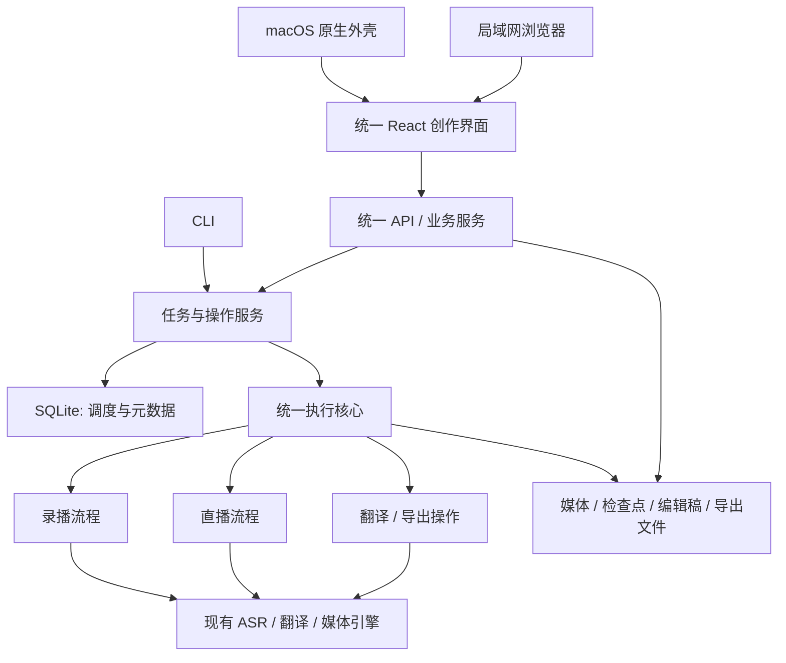

# 统一架构设计：方案 B

整理日期：2026-10-22（Asia/Shanghai）；基线源码观察日期：2026-10-21。状态：**已获完整实现授权，本机统一运行时／迁移恢复候选已验证；跨平台与生产资格未 accepted**。当前实现与 M01—M28 状态见[执行记录第 8 节](../../unified-architecture-execution-2026-10-22.zh-CN.md#8-完整候选实现与当前验收账)，操作入口见[指南](../../unified-runtime-guide.zh-CN.md)。

用户已确认保留桌面创作与 Linux／WSL GPU 批处理、可排序队列。初次设计轮仅授权文档；后续已授权完整实现和隔离验证。正式数据切换、替换安装、外部计费 AI、提交／推送／合并和旧核心删除仍不从候选验证推导授权。

对应英文：[Architecture design](2026-10-22-unified-architecture-design.md)。执行拆分：[分阶段实施计划](../plans/2026-10-22-unified-architecture.zh-CN.md)。

## 审阅修订索引（2026-10-22）

下表保留设计审阅时补齐的约束，不作为实现或验收证据。中英使用相同 U 编号和锚点；当前状态以执行记录为准。

| 审阅项 | 本设计修订位置 | 实施计划修订位置 |
| --- | --- | --- |
| U1 接管前源版本复核 | [6.1 接管协议](#rev-u1) | [U1执行补充](../plans/2026-10-22-unified-architecture.zh-CN.md#rev-u1) |
| U2 完整产物与准备收据 | [5.1 发布协议](#rev-u2) | [U2执行补充](../plans/2026-10-22-unified-architecture.zh-CN.md#rev-u2) |
| U3 独立回退入口 | [7.1 恢复入口](#rev-u3) | [U3执行补充](../plans/2026-10-22-unified-architecture.zh-CN.md#rev-u3) |
| U4 全局状态与字段保留 | [6.2 全局迁移包](#rev-u4) | [U4执行补充](../plans/2026-10-22-unified-architecture.zh-CN.md#rev-u4) |
| U5 直播子步骤与执行槽 | [4.1 执行槽规则](#rev-u5) | [U5执行补充](../plans/2026-10-22-unified-architecture.zh-CN.md#rev-u5) |
| U6 来源实例及冲突规则 | [6.3 来源身份](#rev-u6) | [U6执行补充](../plans/2026-10-22-unified-architecture.zh-CN.md#rev-u6) |
| U7 可重复验收门槛 | [8.1 验收执行矩阵](#rev-u7) | [U7执行补充](../plans/2026-10-22-unified-architecture.zh-CN.md#rev-u7) |

## 第二轮修订定位（Rv1—Rv5，2026-10-22）

| 残余项 | 设计修订位置 | 计划修订位置 |
| --- | --- | --- |
| Rv1 跨批次回退 | [7.2 根依赖组](#rev-rv1) | [Rv1任务](../plans/2026-10-22-unified-architecture.zh-CN.md#rev-rv1) |
| Rv2 锁交接／崩溃保护 | [6.4 持锁监督与持久封锁](#rev-rv2) | [Rv2任务](../plans/2026-10-22-unified-architecture.zh-CN.md#rev-rv2) |
| Rv3 多根恢复 | [7.3 恢复集合](#rev-rv3) | [Rv3任务](../plans/2026-10-22-unified-architecture.zh-CN.md#rev-rv3) |
| Rv4 互斥恢复判定 | [5.1 判定表](#rev-rv4) | [Rv4任务](../plans/2026-10-22-unified-architecture.zh-CN.md#rev-rv4) |
| Rv5 真实产品导出 | [8.2 导出验收](#rev-rv5) | [Rv5任务](../plans/2026-10-22-unified-architecture.zh-CN.md#rev-rv5) |

Rv 为设计审阅时的文档修订编号，不替代 U1—U7、R0—R2 或验收状态；实际实现与验证进度以执行记录为准。

## 1. 决策与目标

采用方案 B：以 Companion 的创作体验为产品主线，逐步统一任务契约、业务服务、调度与产物访问；复用 Workstation 的任务库、队列、执行历史和 GPU 处理能力。最终只维护一套业务核心，桌面与局域网部署保留不同启动外壳。

- 保留：日常创作、字幕逐条编辑、模板、设置、直播、录播、批处理、队列排序与暂停、归档与标签、恢复、ASS／烧录／ArcTime ZIP。
- 保留引擎差异：whisper.cpp、WhisperX、现有翻译／校对路径、CPU／现有平台编码路径。引擎差异不再产生独立任务系统。
- 不做：通用工作流框架、插件市场、分布式调度、Redis／Celery／Prefect、公网或多用户、原生 Windows GPU 支持、恢复 ArcTime 付费／云调用、DeepSeek Pro。
- 桌面远程连接 GPU 服务器、跨主机文件同步不是本轮目标。统一代码与契约不自动带来跨主机访问能力。

方案 A（仅共享工具）只作为迁移过渡；方案 C（仅保留 Companion）不符合已确认的 GPU 工作站范围。

## 2. 已核对的源码事实

以下来自 2026-10-21 的静态阅读；没有把历史测试计数或已安装 App 状态当作统一架构的验收。

| 当前边界 | 源码证据 | 迁移含义 |
| --- | --- | --- |
| 两个前端入口 | [Vite 配置](../../../web/vite.config.ts)、[Companion](../../../web/src/companion/Companion.tsx)、[工作站路由](../../../web/src/workstation/routes/WorkstationRouter.tsx) | 页面、查询与 API 客户端需要逐步收敛 |
| Companion 本地服务 | [gui.py](../../../backend/app/arctime/gui.py)、[macos.py](../../../backend/app/arctime/macos.py) | 同源限制、回环动态端口、原生生命周期继续保留 |
| Companion 单任务与 JSON 状态 | [manager](../../../backend/app/arctime/companion_manager.py)、[projection](../../../backend/app/arctime/companion_projection.py) | 不能只接一个 SQLite 队列后继续让内存／JSON独立决定运行状态 |
| 工作站固定阶段与多层投影 | [任务创建](../../../backend/app/api/routes/workstation_tasks.py)、[models](../../../backend/app/models.py)、[runs](../../../backend/app/services/workstation_runs.py) | 当前七阶段模型不能原样包住直播与独立导出 |
| 编辑／导出读取 Companion 格式 | [subtitle_inputs](../../../backend/app/arctime/subtitle_inputs.py)、[document](../../../backend/app/arctime/subtitle_document.py)、[exports](../../../backend/app/arctime/subtitle_exports.py) | 先解开输入格式耦合，不伪造 job.json |
| 两种处理引擎与直播语义 | [LocalASR](../../../backend/app/arctime/local_asr.py)、[WhisperX](../../../backend/app/services/asr_whisperx.py)、[直播](../../../backend/app/arctime/saozi_live.py) | 保留引擎缓存隔离与直播尾段／断流语义 |
| 工作站独立 worker | [worker](../../../backend/app/worker.py)、[queue](../../../backend/app/services/workstation_queue.py)、[runner](../../../backend/app/services/task_runner.py) | 复用有效调度规则，解除对旧阶段投影的耦合 |

历史状态入口为[项目交接](../../project-handoff.zh-CN.md)。执行前仍须重新核验 checkout、未提交内容、运行进程、数据根、依赖与目标硬件；本设计不声明当前分支、服务、任务数或 GPU 可用性。

## 3. 目标结构

一个数据根只有一个重处理执行者。桌面由 helper 承载执行者，工作站由独立 worker 承载同一执行核心；二者使用相同 claim、执行 token、心跳、取消与恢复规则。API 可读状态并提交操作，不能绕过调度直接执行重任务。直播占用该执行槽，内部采集线程与媒体子进程不等于另一个调度者。

旧、新系统过渡期在同一主机／同一GPU上也只允许一个重任务执行；分数据根不能作为并发占用硬件的许可。先暂停旧执行者再验证新候选，不为过渡期另建资源调度器。

桌面仍只监听回环地址并保留 Host／Origin 校验；局域网模式沿用可信 LAN 边界与受限来源。模式不会自动放宽桌面的访问限制，也不会将授权文件或服务器绝对路径暴露给浏览器。

## 4. 最小统一契约

以下是拟实施的数据契约，不是现有 API 或已经存在的 Python 类型。具体文件按实施计划逐阶段引入，不预先搭建空框架。

| 契约 | 必须表达的信息与约束 |
| --- | --- |
| 任务身份 | 新任务使用不透明 ID；旧 ID 通过 `(source_instance_id, legacy_id)` 唯一映射，来源定义见6.3；原目录与导出文件名不因 ID 更换被重写 |
| 媒体与字幕输入 | 任务 ID、受控产物 ID、摘要、源／目标语种、源时长、源绝对时间、片段起止与局部时间原点；保留词级信息，不用文件名猜语种或时间原点 |
| 编辑文档 | 复用 SubtitleDocument 的稳定 cue ID、source_fingerprint、revision、样式与强调；引擎原始产物独立保存 |
| 操作 | `process_recording`、`process_live`、`translate`、`export` 四类明确操作；阶段按这四类既有流程定义，不实现任意 DAG |
| 执行身份 | operation ID、attempt、execution token、worker owner／心跳；旧 token 的状态写入与产物发布均拒绝 |
| 配置快照 | 引擎、模型／模型摘要、源／目标语种、供应商、处理参数、模板版本与导出策略；授权只保存引用，不嵌入快照 |
| 事件 | 有序游标、任务／操作 ID、公开安全载荷；状态与事件同事务提交，事件只通知刷新，不成为另一份任务事实 |
| 导出身份 | 输入产物摘要、编辑 revision／文档摘要、范围、样式、格式与编码参数共同标识一次请求；重复请求复用已验证结果 |

语言方向不能固定为 Companion 的日译中或工作站的中译日。引擎能力检查须拒绝不支持的组合；旧任务保持原方向、供应商及模型，不自动切换引擎或翻译路线。

操作状态统一为 `queued → running → succeeded / failed / cancelled / interrupted`；停止先记录请求，真正释放子进程／执行权后才到终态。任务结果展示各操作状态：视频完成而翻译失败时保留视频结果并明确显示翻译失败。`accepted` 是验收记录，不是流水线自动赋予的成功状态。

停止直播表示停止采集并处理尾段；恢复仅消费已录制内容，重连直播必须创建新任务。工作站高光仍需用户确认后导出；Companion 已选择的范围和臊子流程保留现有自动导出策略，不因统一而扩大自动操作范围。

### 4.1 U5：顶层操作与直播子步骤

只有顶层操作领取唯一重处理槽。`process_live`内部的识别、切点、翻译和样式导出是顺序子步骤，记录 `parent_operation_id`、分块／切片ID及结果；它们共享父操作attempt和token，不能再次入队或等待另一个槽。子步骤仍使用5.1的产物发布规则，不额外实现一套调度。

用户另行请求translate／export属于顶层排队操作，等直播释放槽；同一任务同类相同快照的重复请求返回既有操作身份。翻译／样式子步骤失败只标记该结果失败并保留原文视频，采集可继续；状态校验或源损坏等无法安全继续的错误停止父流程。停止先停止采集，再完成已关闭块和尾段，最后释放槽；若收尾失败，父操作明确失败／中断，不伪装完成，已完成子结果可读，释放进程后才运行下一顶层操作。

## 5. 数据权威与发布一致性

| 信息 | 最终权威 | 迁移规则 |
| --- | --- | --- |
| 任务、操作状态、队列、执行权、历史、产物索引 | SQLite | 已迁入任务不能再从 gui.json／内存反推并覆盖运行状态 |
| 源媒体、原始识别、缓存、引擎检查点 | 文件 | 原始信息保留；不同引擎的缓存不交叉使用；检查点不能授予执行权 |
| 编辑稿、模板、导出文档快照 | 带版本的文件 | 保持 revision 冲突校验；数据库只存索引／期望版本，不能成为第二份可编辑正文 |
| 授权与密钥 | 原受保护的专用存储 | 保持原权限和位置；不复制到任务、事件、迁移清单或文档 |
| 旧 JSON／旧数据库 | 旧任务的历史来源 | 只读兼容，不与统一库双向同步 |

数据库和文件系统不能形成一个普通事务。采用以下有界协议：

1. 建立带attempt／token的操作；按操作ID与attempt隔离暂存，不让重试复用可写临时目录。
2. 按5.1将整组必需输出及摘要写入持久准备收据；收据持久化前不发布任何正式输出。
3. 使用与claim／撤销相同的任务短临界区，复核token后发布所有必需输出，最后登记整组结果与事件；仅流程结束时登记顶层操作成功。不覆盖旧结果，不在模型推理期间持有DB长事务。
4. 重启仅依据5.1的准备收据与有效执行身份对账；整组不完整不能成功，缺失／损坏结果明确失败并保留证据。
5. 外部 AI 请求在“供应商已接受但本地未记账”窗口不能承诺恰好一次。优先使用现有可用的请求身份与有效检查点；不确定结果标记 interrupted，明确提示重试可能再次计费，不盲目自动重发。

### 5.1 U2：准备收据与整组提交

收据为规范化、带schema版本的JSON，至少含 `publication_id`、`operation_id`、子步骤ID、`attempt`、`execution_token`、输入／配置／编辑文档摘要、每项必需输出的角色／相对目标／大小／SHA256，以及整组摘要。publication_id按操作、attempt、子步骤／切片及输入快照稳定标识一次发布组；由收据内容计算receipt_digest并登记到DB。默认必需组：切片为MP4＋SRT；样式导出为产品文件＋所用文档快照；ArcTime ZIP还须验证包内manifest列出的全部成员；识别／翻译按消费者实际读取的字幕、结构化结果与检查点定义组，不将encoder.log等诊断文件当作成功条件。

整组提交只完成该publication／子步骤结果；直播首片发布不能把仍采集的父操作标为成功。顶层操作仅在流程完成／收尾及其必需发布组全部登记后进入succeeded。ready属于发布组状态，不扩展顶层操作状态机；每个publication独立ready／对账，不能让后一个片段覆盖前一个片段的收据。

顺序固定为：写齐暂存输出并逐个fsync → 写收据临时文件并fsync → 在同盘原子发布不可变收据并fsync父目录 → DB提交发布组 `ready` 与receipt_digest → 发布各目标并fsync目标父目录 → DB单事务登记整组、发布组成功和事件。SQLite提交须使用已核验的持久化设置，记录journal_mode／synchronous；不宣称未演练的硬件掉电保证。

目标含attempt或内容摘要且禁止覆盖。每次更名之前复核所有权；同一发布临界区内完成整组发布与终态提交。重启先排他进入恢复，禁止同时claim：

#### Rv4：互斥恢复判定与执行身份

恢复器先取得排他恢复锁并证实原worker及进程组已退出，再读取一致快照；恢复结束前不做新claim。D为发布组DB状态：N（未ready）、R（ready）、C（已提交）；E为收据：缺失、损坏或有效。P为正式文件集合：0、部分、全组有效或损坏；T表示尚未发布的必需暂存全部有效。未知DB／schema状态一律blocked，不猜测。

待提交组的执行资格F要求操作未取消／撤销、无新attempt、原进程已释放；收据存在时还必须与DB当前attempt／token匹配。收据缺失时F仅由DB登记资格判断，只用于隔离决策，不能据此接纳输出。worker心跳过期本身不使对账资格失效。恢复器只能以独立审计身份完成原attempt文件发布／登记，不能运行引擎或AI；对账前不调用会递增attempt或撤销token的旧stale-job逻辑。若取消／新attempt已生效，F无效。已提交C组只验证不可变历史收据／登记证明，不因后续attempt变化撤销旧成功结果。

| 判定ID | 互斥条件 | 唯一动作 |
| --- | --- | --- |
| J00 | E损坏，D／F／P任意 | blocked／corrupt，保留所有文件，不报告成功 |
| J01 | E非损坏、F无效、D=N或R | 隔离待提交结果并interrupted，不混入新attempt |
| J14 | E非损坏、F无效、D=C | 历史提交证明不匹配，blocked／corrupt；保留旧结果，不当作新attempt孤件清理 |
| J02 | E缺失、F有效、D=N、P=0 | interrupted，保留暂存，不推断完成 |
| J03 | E缺失、F有效、D=N、P非0 | 孤立正式文件隔离，interrupted |
| J04 | E缺失、F有效、D=R或C，P任意 | 登记链断裂，blocked／corrupt，不自动重建收据 |
| J05 | E有效、F有效、D=N、P=0、T有效 | 先提交ready，再进入J08；不能直接成功 |
| J06 | E有效、F有效、D=N、P=0、T无效 | interrupted，保留收据并报告缺失暂存 |
| J07 | E有效、F有效、D=N、P非0 | 发布顺序违规，blocked／corrupt，不接纳 |
| J08 | E有效、F有效、D=R、P为0或部分、T有效 | 复核已有文件摘要，完成原组，再进入J10 |
| J09 | E有效、F有效、D=R、P为0或部分、T无效 | interrupted，不补跑AI／模型，保留子集 |
| J10 | E有效、F有效、D=R、P全组有效 | 单事务登记整组与事件；仅按父流程完成条件更新父操作 |
| J11 | E有效、F有效、D=R、P损坏 | blocked／corrupt，保留现场 |
| J12 | E有效、F有效、D=C、P全组有效 | 返回既有登记，新增文件／记录数=0 |
| J13 | E有效、F有效、D=C、P非全组有效 | 标记结果不可用并公开失败；不改写旧文件或伪造成功 |

P=0或部分时，T只评价尚未发布的成员；P损坏优先归为损坏而非“部分”。磁盘满／DB提交失败不另设重叠状态，按下一次观察到的D／E／P／T归入唯一J行，保留原异常作为原因。测试须证明每个输入恰好匹配一行；非法schema不进入本表。

编辑文档保存也须防止文件revision与DB期望版本漂移：先持久化不可变revision正文，再用DB比较并交换登记当前revision；只有成功登记的revision对外可见。失败保存不能覆盖已登记稿；原有兼容指针在锁内更新，重启由登记revision修复，不反推覆盖DB。模板发布复用同样原则。

## 6. 迁移与所有权边界

迁移单位是**一个明确来源的终止任务及其相关产物**；运行中、排队中、未释放进程组的任务不迁移。旧队列先保持在旧系统；接管排队任务必须显式撤销旧执行资格，并在迁移清单中记录新顺序与优先级。新队列默认暂停，不能因启动新版而自动执行。

迁移清单保存 batch ID、schema版本、source_instance_id／旧ID、摘要、映射、旧／新所有者、迁移状态和回退分类。跨来源同ID允许分别导入；同来源重复／变更按6.3处理。缺失字幕、损坏清单与不匹配源指纹逐项拒绝或只读隔离，不改原件；其他任务可独立准备。

采用 `discovered → prepared → verified → activated` 的批次内任务状态：

- prepared：元数据、编辑稿与快照写入独立的新数据根；不原地升级旧任务目录。
- verified：源摘要、任务映射、字幕数量／时间、编辑 revision、导出摘要均通过；仍不能调度。
- activated：完成6.1停写后的最终复核，再由统一库事务接管所有权；旧目录不得再交给旧版本写入。
- 旧版本不认识新 fencing 字段，不能只靠新库一列阻止它。试运行必须使用独立数据根、进程排他与既有目录锁；无法阻止旧写入者时不激活。

媒体可使用校验后的受控只读引用，元数据和新增输出必须分根存放。引用源需在每次使用时校验；不能保证旧写入者退出或源稳定时，先在获准空间内完整复制并校验媒体，空间不足则阻塞，不用可写硬链接。正式可回退批次须确认旧读取端也不会在恢复旧任务时覆盖被引用媒体。

迁移不重跑识别、不调用 AI、不补录直播、不重新生成旧导出、不恢复历史已清理数据。历史孤立导出允许只读登记；缺源任务明确显示只读／缺源，不伪造可恢复状态。旧 source_fingerprint 的兼容证据继续保存，不直接重算替换后声称旧编辑稿兼容。

### 6.1 U1：停写、最终复核与接管

准备时生成source_generation：覆盖任务记录、编辑revision／正文摘要、翻译／导出索引、标签／归档／模板绑定，以及6.2全局迁移包generation；不能只比较原视频。verified是候选快照校验，不授予可随时激活的资格。

激活顺序：暂停旧接单／队列 → 刷新已保存稿并停止旧API、worker、CLI／helper → 确认子进程释放 → 6.4的同一监督进程取得旧根`.gui.lock`及所选任务锁、安装并验证持久写封锁 → 在锁内重新计算source_generation → 与prepared快照逐字段比较 → 一致才事务提交映射、全局包generation与activated状态。锁按根／任务ID固定顺序获取，失败不持锁等待业务完成。

任意变化返回prepared并重新复制／verify，不拼接旧新版本；停写后崩溃、锁获取失败、激活事务失败均不得授予新执行权。监督进程依6.4持续持锁，不向另一个宿主移交锁。分批接管期间原根整体停写，未迁任务暂为只读。恢复旧根写入必须通过7.2的跨批次解冻门槛；取消未激活批次本身不授予R0或旧根写权。

### 6.2 U4：全局迁移包与保留字段

根的角色明确分离：`task_root`存新任务与输出；`settings_root`存独立的新默认值／模板库；`credential_root`继续引用原受保护授权位置；模型目录与主机工具路径单独引用。当前LLMConfig／CredentialStore都随root定位，P4必须接线解耦，不能仅换task_root后以“未配置”兜底。授权引用是同主机服务端路径绑定，不通过符号链接、浏览器参数或共享清单传递；同一受保护存储的访问沿用现有进程锁。

| 迁移域 | 精确保留／冲突规则 | 验证 |
| --- | --- | --- |
| 用户默认与主机设置 | 语言、处理／导出默认、模型／工具位置、provider/model；软件→模板→本次优先级不变；主机路径不出现在LAN载荷 | 默认快照字段等值，临时不可用工具明确报缺失，不改默认 |
| 授权 | 原位置／权限保留，仅服务端注入引用；DeepSeek秘密仍从原私有配置读取，不复制到新设置JSON | 离线读取脱敏configured状态与权限；凭据夹具前后字节相同，无网络／重新登录 |
| 模板与ArcTime工程 | 模板ID／revision／workflow／主播系列、工程文件摘要及绑定、默认模板映射；不同来源冲突分命名空间，不覆盖 | 全库数量、正文摘要、绑定可解析；老任务快照仍独立 |
| 任务与库元数据 | 标题、创建／更新时间、标签集合、archived_at、来源reference/copy与高光开关 | 字段等值；派生storage_bytes单独核算，不能把0当丢失信息 |
| 执行历史与队列 | 原阶段结果、失败码／日志引用、历史run、priority／position／paused | 历史只读保留并关联新ID；入新队列需另行撤销旧资格，初始暂停 |

全局包先prepare／verify；任务激活引用同一已验证包generation，在统一库同事务设为可见；包不存在或任一模板绑定不可解析则不激活依赖任务。准备期间默认／模板变化也触发U1复核失败。新默认与模板写入使整个回退组进入R2，不能按某个未修改任务单独判成R1；授权撤销／到期／刷新不通过旧快照倒退恢复。

### 6.3 U6：来源实例与冲突判定

source_instance_id是持久登记的UUID，表示一个确定的历史任务集合，origin_kind仅为companion／workstation类型标签。UUID存于独立迁移登记册，不写入旧根、不由路径字符串或机器名临时生成；根改名仍使用原登记身份。克隆／备份作为同一集合恢复时复用身份，作为独立分支导入时显式登记新身份，不能因扫描顺序改变结果。

| 输入 | 结果 |
| --- | --- |
| 不同source_instance_id、相同legacy_id | 两条独立映射，均可导入，绝不合并或拒绝其中一条 |
| 同实例／同ID／同source_generation | 幂等返回原映射，零重复任务／产物 |
| 同实例／同ID内容变化，尚未激活 | 保留旧候选，回到prepared并重新verify |
| 同实例／同ID内容变化，已经激活 | conflict并停止更新；原统一任务不覆盖，人工决定新来源分支或先回退 |
| 缺少可验证的实例身份或根身份不符 | 不猜测、不激活；登记待人工匹配，不创建重复任务 |

### 6.4 Rv2：同一监督进程持锁与持久封锁

选定**同一Supervisor持续持锁**，不采用进程间锁交接。Supervisor在最终复核前打开／持有旧根及任务锁，执行迁移事务，并托管统一API／worker子进程；子进程不重复取得这些旧根锁，只取得新根执行权。子进程退出或重启不释放Supervisor锁。Supervisor唯一实例由独立guard_root内的控制锁序列化；旧锁inode、允许根、原权限及依赖组写入本机私有guard记录。

文件锁不能跨Supervisor崩溃持久化，故activated前还必须安装**操作系统持久写封锁**：旧任务／媒体／旧DB及旧锁的写、创建、替换操作被拒绝，旧GUI／CLI／worker入口已停用；单纯guard标记或DB owner字段不算封锁。P0选定并记录可验证的只读权限／ACL或只读挂载profile，P4实现；测试实际旧入口的启动、编辑／创建与DB写入均被拒绝。挂载profile必须保证系统启动时保护先于所有旧入口生效，否则不得用于激活。credential_root保持原权限，禁止递归封锁授权；共址布局不能满足时先拆分保护域，否则blocked，不以“用户不会启动旧版”放行。

顺序为持锁 → 写guard preparing记录并fsync → 安装封锁并逐项探测 → 持久化guard sealed记录（含原权限／profile／摘要）→ 最终generation复核 → DB激活。封锁在监督进程死亡后仍存在；任何异常退出都不得自动解除它。监督进程／系统重启时先取得guard控制锁，再核对sealed记录、OS实际保护和DB依赖组，使用只读描述符重获旧锁（该平台能力须实测），最后启动恢复／新worker。旧锁inode变化、封锁缺失、进程残留或generation变化均blocked；不通过新建锁文件掩盖问题。原子写记录与OS动作间中断按“已可能封锁”处理，保留现场直至核对，不自动授予旧写权。

解除封锁只能在7.2解冻收据提交后，由Supervisor按记录恢复最小必要权限并验证旧入口；失败继续封锁。此机制不防御用户主动绕过系统权限或修改归档程序；本计划要求防止正常旧入口在崩溃后的意外重启写入。

## 7. 回退分级

下表按7.2的整个根依赖组分类；不能只按当前批次或单个任务分类后解冻共享旧根。

| 分类 | 条件 | 允许的回退 |
| --- | --- | --- |
| R0：尚未接管 | 整个当前依赖组历史零activated、无新版写入，原件一致 | 取消全部未激活准备，按7.2解除封锁；旧系统才能继续使用原根 |
| R1：已接管但无新版写入 | 已停止统一执行者，验证没有新编辑／导出／配置／队列变化 | 核对原始快照与所有权，停用统一映射后恢复旧根；禁止新旧同时获得执行权 |
| R2：已有新版写入 | 包含新任务、新编辑、新导出或新状态 | 保留统一库与文件为只读恢复包；旧版只使用独立的迁移前快照，不读取新库；新结果通过已验证的SRT／ASS／MP4继续访问，完整JSON与源产物保留在恢复包中 |

R2 不承诺旧版能继续编辑新版专属数据。无法无损回写时停止写入并保留候选，修复后前滚；不能把“启动旧 App”称为完整数据回退。回退前后均记录任务／文件计数、摘要、编辑 revision 和所有权，不做破坏性 schema downgrade，不用整份旧备份覆盖升级后的数据。

正式批次回退顺序：暂停接单与队列 → 正常停止直播并收尾 → 刷新编辑稿 → 退出 worker／helper并核对进程组 → 保存当前一致快照与校验清单 → 按 R0／R1／R2 选择根与版本 → 核验无双写和新结果可访问。强杀只用于已授权且正常退出失败的受控恢复，并将未完成操作标为 interrupted。

### 7.1 U3：不依赖故障新版的恢复入口

选定回退入口为**独立Recovery Launcher＋归档旧helper＋本机浏览器**，临时使用旧浏览器界面恢复业务；不承诺原生旧App能选择快照根。当前App.swift硬编码Application Support根，回退期间禁止双击该旧App。Launcher与只读恢复读取器须在P4制作并冻结，P5演练通过后才能正式激活；它们不是当前已存在命令。

Launcher清单包含已校验旧helper／依赖／模型与Web资源、恢复读取器及支持schema版本，以及7.3列出的全部根角色、DB／generation、端口／ready／日志独立目录和摘要。执行归档helper时显式传其既有 `--data`、`--ready`、`--parent-pid`，parent为保持运行的Launcher；不替换默认Application Support目录，不使用目录符号链接。启动前核对整个恢复集合无写入者且schema与helper匹配，只对独立的旧快照工作副本授予写权。原快照只读保留，全部新版数据根只读封存。旧工作副本排除凭据、清空私有配置中的秘密，仅作本地编辑恢复；不恢复旧授权快照或调用外部AI。日常供应商能力等待前滚或另经验证的凭据接线，不把旧helper的本地恢复承诺为完整在线功能回退。

只读恢复读取器使用冻结的独立运行环境／已验证schema解析器，不导入候选应用包、不运行schema升级、不读授权、不调用网络／模型。它枚举新库登记结果与5.1收据，输出校验清单；以已登记revision为准，将最后保存稿导出SRT／ASS及完整JSON到第三个恢复输出根，已存在MP4只校验／复制，不要求重新烧录。缺译文不伪造双语，未完成操作不标成功。未知schema或损坏文件明确阻塞该项，保留原字节；不能读取全部已承诺格式时不得通过A10。

正常回退按第7节收尾；新版无法启动时直接停止残余进程、取得排他锁，再做SQLite一致快照（使用备份API或完整停机副本，不能只拷主文件遗漏WAL）和文件清单。读取器在快照副本工作；未登记稿作为候选草稿隔离，不覆盖最后提交版本。浏览器尚未落盘的输入不承诺崩溃后恢复，正常退出路径须先flush；验收明确区分已保存数据与未保存输入。

### 7.2 Rv1：跨批次根依赖组与解冻

root_group_id覆盖当前接管epoch内共享旧根、全局迁移包或仍依赖该根媒体引用的全部批次／任务，并包含准备中、已激活、取消／回退记录。成员与依赖关系持久化在统一库及恢复清单；新增引用必须先登记，不允许清单外依赖。解冻时暂停整个组接单／队列并取得组控制锁，重查全部成员及其自激活基线后的写入。已正式解冻关闭的历史epoch只读留档，新接管创建新组，不能把尚有依赖的组关闭后另起组绕过封锁。

分类取整个组最严格级别：任一任务／全局设置有新版写入即R2；无新版写入但本epoch曾有activated（含已撤销记录）按R1完成解冻审计，不降为R0；仅从未激活且无新版写入才可能R0。取消当前未激活批次只取消其准备资格，不清除其他批次的所有权、引用、封锁或R2分类。

| 组状态 | 原根能否解冻 | 必需处置 |
| --- | --- | --- |
| 全组R0 | 可申请 | 取消全部准备、验证原件一致、确认零激活／零引用、提交解冻收据后解除封锁 |
| 全组R1 | 撤销前不可 | 停统一执行者、核对所有成员无新版写入、同事务撤销全部激活／队列资格与活跃引用，原件匹配后提交解冻收据 |
| 任一成员R2 | 不可用原根恢复写入 | 新集合完整封存，旧业务只在独立快照工作副本运行；原根继续保护其引用，不能因另一批次取消而解冻 |
| 依赖未知／登记不全／旧进程仍活跃 | 不可 | blocked；补齐清单或停止进程后重新分类 |

解冻收据包含root_group_id、全部批次／成员、generation、解除的映射／引用、回退级别及恢复权限profile；组外依赖存在即拒绝。R2日后解除原根保护必须另行证明恢复包已独立复制全部引用媒体并核对摘要、零活跃依赖，获得明确处置授权；不属于“取消本批”的隐式动作。第一批激活并编辑、第二批取消时必须保持第一批数据和原根封锁，这一场景是M23硬门槛。

### 7.3 Rv3：多根恢复集合与同一停写点

恢复清单不再只记录task_root。以下非秘密数据必须归入同一root_group_id和recovery_epoch；同库存在组外写入者时也须暂停它们，或先证明其文件与DB隔离，不能把在线DB备份当作跨文件一致快照。

| 根／记录角色 | 恢复包内容与校验 |
| --- | --- |
| unified_db | SQLite一致副本／schema／提交revision／operation与publication索引；使用备份API或完整停机DB集合，记录WAL处置 |
| task_root及引用媒体根 | 原媒体／字幕／检查点／不可变正文／收据／导出，以及每项实际位置、大小、摘要；包外引用须明确只读且可用，缺失即阻塞相应承诺 |
| settings_root | 新默认值、模板正文与revision、ArcTime工程及绑定／默认模板映射；保留原生JSON／工程文件并生成可读索引 |
| global_package_root | 包generation、每个包成员的摘要、任务与包的绑定；已复制在settings_root内的成员只登记同一物理文件，不重复制造权威 |
| migration_registry及guard_root | source_instance_id登记、根／批次／成员映射、root_group_id、封锁profile、原权限与恢复级别；恢复导出仅提供脱敏摘要，完整私有记录留本机 |
| credential_root | 只保留本机受保护引用及权限状态；不打包／回写秘密正文，不恢复旧token或撤销状态 |

先暂停所有任务、设置／模板、迁移登记册及兼容指针写入，停止进程并取得按规范路径排序的全组锁；只读读取器也须取得独立恢复控制锁。由独立恢复工具创建recovery_epoch，记录DB提交水位、全局包generation及所有文件revision／摘要，复制到新快照根后重查源摘要；差异或缺根则不签发complete收据。guard的持久记录在屏障内固定，锁描述符／PID／临时日志等不作为正文快照；complete收据与运行日志写到集合外。恢复输出根与所有源／快照根不得重叠，包含祖先／后代关系。原集合只读封存，只有标记complete且全部引用可解析的快照可作为“已完成恢复包”展示。空间不足时保留原集合并blocked，不删除旧文件凑空间。

新版不可启动时上述停写／备份／校验由冻结工具完成，不调用候选API。读取器须能离线输出最新任务稿，同时列出／导出新模板、新默认值、工程绑定、全局包与来源登记的可读清单；不把它们自动回写旧版。仅变更新模板／默认值但没有任务修改，也属于R2且必须可读。恢复包的完整性只覆盖已登记／已持久数据；孤立稿仍按5.1隔离，未落盘浏览器输入不承诺恢复。

## 8. 验收契约

以下 A1—A12 是实施计划共同引用的验收 ID；当前本机证据与未完成门槛见执行记录第 8 节，定义表不代表累计 accepted。

| ID | 必须观察到的结果 |
| --- | --- |
| A1 | 两种来源、重复旧 ID、重复导入、缺源及损坏清单均有确定结果；二次导入零重复、原件摘要不变 |
| A2 | whisper.cpp 与 WhisperX 结果均进入同一编辑／导出路径；保留语种、绝对时间和原始词级信息；中译日与日译中不串用 |
| A3 | 双客户端保存同 revision 时仅一个成功；失败端保留草稿；源改变须显式重建并备份旧稿；5000 条字幕单条编辑其余4999条不变 |
| A4 | PNG预览、ASS坐标与烧录帧使用同一文档／样式快照；片段边界误差不超过对应输出精度（SRT 1ms、ASS 10ms），烧录容差预先固定并记录编码条件 |
| A5 | 3 个任务可排序、暂停／恢复；并发 claim 只有一个重任务运行；旧 token 不能发布状态或结果；取消后子进程释放才能运行下一项 |
| A6 | 在临时文件完成、原子发布、DB提交三个边界分别中断并重开；没有假成功、旧导出覆盖或重复登记；未知外部请求结果不静默自动重发 |
| A7 | 直播断流保留已录内容与缺失区间；停止后导出短尾段；恢复不重新连接；翻译／样式失败不丢原文视频 |
| A8 | 桌面与浏览器读同一任务事实；SSE断线、游标重连及轮询兜底不丢最终状态；原生保存／退出／同构建重开保留草稿与任务选择 |
| A9 | macOS 本地、Linux CUDA、WSL ROCm分别有实际引擎与完整编辑导出证据；替身、CPU、构建或清单不能替代目标 GPU 通过 |
| A10 | R0／R1／R2各做一次隔离回退演练；无新数据被覆盖、无双写、回退后新结果仍可读取；格式不兼容明确只读 |
| A11 | 日志／事件／迁移摘要无秘密；本地模式访问限制、目录包含与符号链接校验保持；局域网无新增授权明文接口 |
| A12 | 旧前端、旧路由与旧调度的调用方已迁完；运行入口、生成契约、安装／smoke及双语说明指向统一链路，兼容读取与受保护证据仍保留 |

### 8.1 U7：固定夹具与验收执行矩阵

本表保留 A1—A12 的最低执行集合；当前 M 项状态见执行记录第 8.3 节，不能用单个成功短视频替代。P0 先生成／冻结夹具 manifest 并记录 SHA256，之后禁止为通过测试改样本或阈值：

- F-media：4501帧／30fps、1280×720、时长4501/30秒的可再生测试视频；附权利明确且摘要固定的可识别语音音轨，原文经核对；含明确片段边界及固定日文／中文原文与译文，编码／字体／FFmpeg版本写入manifest。无语音替身不能用于M17／M18。
- F-edit：同一时长的5000条唯一cue，start=i×0.03秒、end=start+0.02秒（i=0…4999）；含旧指纹证明、局部样式与可追踪revision。原始词级结果另存，零丢弃比较。
- F-live：7个20秒已关闭块＋7秒尾块，固定选择器在120秒切片；另有断流变体与逐步故障点，不接外部AI。实际采集另用M19。
- F-state：两个来源实例包含相同旧ID，含标题／标签／归档、默认值、模板与ArcTime绑定、脱敏授权夹具、失败／缺源／孤立导出与排队样本；无真实凭据。
- V：版本封存表固定每个平台的硬件、引擎／模型摘要、语言方向、工具／字体及编码参数；CPU替身标明只覆盖逻辑。版本变更须重建独立验收候选，不能沿用旧收据。

每行产物至少保存命令／操作序列、候选／夹具／版本摘要、前后计数与哈希、实际断言、退出状态和未覆盖项。故障测试覆盖进程退出；真实掉电不在本轮可认证范围。

| M / A / 阶段 | 前置与操作 | 固定通过断言 | 必需证据／阻塞条件 |
| --- | --- | --- | --- |
| M01 / A1 / P0,P5 | F-state跨实例同ID导入两次 | 首次2映射，二次仍2；旧原件哈希全等 | 映射与前后清单；身份未知则blocked |
| M02 / A1 / P2,P5 | 同实例未激活／已激活后分别改源；重新导入 | 前者重新prepare；后者conflict且统一稿不变 | generation差异及映射，零静默覆盖 |
| M03 / A1,A10 / P5 | verified后保存旧稿r+1；停写再activate；在锁前／复核后／事务前后中断 | 旧generation拒绝；重新verify后仅一次激活；恢复无双写、队列暂停 | 锁／generation／事务收据；不能排他则blocked |
| M04 / A2 / P1 | 两种ASR冻结产物、两个翻译方向进入同一编辑输入 | cue数量／文本／语种／时间精确匹配，词级原件哈希全等 | 输入输出映射；不代表实际GPU通过 |
| M05 / A3 / P1,P2 | F-edit两客户端同revision保存不同单条修改并重开 | 仅一次提交成功；失败端草稿保留；4999条正文／样式全等 | 两端响应、提交revision、逐cue差异 |
| M06 / A3,A6 / P2 | 编辑正文持久化后、DB CAS前及CAS后指针更新前中断 | 只暴露登记revision；孤稿不覆盖；冲突不增长当前revision | 新旧正文／索引／恢复收据 |
| M07 / A4 / P1 | 仅无损参考：F-media同文档生成SRT／ASS／透明PNG及独立FFV1参考，按8.2固定ROI | SRT≤1ms、ASS≤10ms；排版边界≤1px；8位RGB ROI RMSE≤3.0；只能标参考通过 | 原始参考帧／指标；不能替代M28真实API烧录 |
| M08 / A6 / P2 | 依次在收据持久化前、ready提交前、组内每次发布后、DB终态前后退出重开 | 按5.1表恢复；只有整组可验证才成功；重复请求零新增结果 | 每故障点收据、文件集合、数据库与旧结果摘要 |
| M09 / A6 / P2 | 发布时注入ENOSPC／DB提交失败／坏摘要／旧attempt残留 | 零假成功／覆盖；错误可见；旧attempt不能被新attempt接纳 | 故障代码与恢复后状态；未注入不可标通过 |
| M10 / A5 / P3 | 3任务排序／优先级／暂停恢复，2执行者竞争；旧token尝试写入与发布 | 最大重任务并发=1；顺序符合快照；旧token写入数=0 | claim时间线、进程组与事件；进程未释放不启下一项 |
| M11 / A7 / P3 | F-live父操作运行中做翻译／导出子步骤；另排顶层任务 | 首片在父终态前可读，子步骤领取槽次数=0；外排任务等待 | parent／child／token与首片时间线 |
| M12 / A7 / P3 | F-live停止、断流、翻译／样式失败后重开恢复 | 120秒首片＋27秒尾片；断流变体保留缺口；恢复网络重连次数=0，原文产物仍可读 | 分块、范围、调用计数、部分失败状态 |
| M13 / A8 / P4 | 实际API＋浏览器／原生，断SSE、恢复游标并触发轮询；保存退出重开 | 两客户端最终操作状态／产物ID一致；已保存revision与选择保留；失败草稿仍在失败端 | API／事件与实际窗口证据；mock不能替代 |
| M14 / A1,A11 / P4,P5 | 切换task_root，settings_root独立，credential_root不变；迁全局包 | 默认字段与模板／工程摘要及绑定全等；脱敏configured状态不变，凭据夹具字节不变且网络调用=0；标签／归档／历史不丢 | 根角色／generation与字段对照；不可解析绑定阻塞激活 |
| M15 / A10 / P4,P5 | R0,R1,R2正常停机回退；R2含新任务、新已保存稿和新导出 | 旧helper只写独立快照工作副本；新根全等只读；SRT／ASS反映最后已保存稿，MP4不重编码 | 旧helper身份、根／端口、恢复输出哈希和revision |
| M16 / A10 / P4,P5 | 禁止启动候选App／导入候选包，再执行R2读取和旧helper启动 | 独立入口可运行；新稿可读；候选网络／模型／升级调用=0；未知schema拒绝并保留 | 禁用候选后的操作录屏／进程与schema收据 |
| M17 / A9 / P5 | macOS按V实际whisper.cpp识别F-media并编辑／导出 | 实际模型输出非替身、时间有效、产物全可读，编辑后重开一致 | 硬件／引擎日志、原始模型输出和导出；非语义质量全验收 |
| M18 / A9 / P5 | Linux CUDA、WSL ROCm分别按V实际WhisperX执行同链路 | 两个平台各有GPU执行证据且满足M04／M05／M07相关断言 | 两份独立平台收据；缺任一环境为blocked |
| M19 / A7 / P5 | 获准的受控真实直播，至少实际完成一首片及停止尾段；切断网络再恢复已有录制 | 采集／编码真实，恢复不重连，片段和缺口可核验；外部AI依授权单独标结果 | 真实入口／停止／产物证据；未获准或无直播源则blocked |
| M20 / A11 / P1—P5 | 路径越界、符号链接、错误Origin／Host、日志／事件／清单秘密诱饵 | 非法访问均拒绝；公开输出秘密诱饵命中=0；LAN不得取授权值 | 响应与脱敏扫描；授权仅使用夹具 |
| M21 / A12 / P6 | 搜索旧调用方；全新隔离安装与历史升级执行唯一入口 | 旧写入入口调用数=0；必要读取器保留；四类顶层操作／模板／CLI可达 | 调用清单、安装／升级实际流程和双语说明 |
| M22 / A9 / P5 | V中记录CPU及已有windows-amf路径，分别导出同源片段并注入硬件不可用 | 结果可解码／范围正确；AMF能力缺失明确且按既有策略回退CPU，不改变字幕／源 | 编码器／平台／fallback收据；未测支持路径为blocked |
| M23 / A1,A10 / P5 | 同旧根批次A激活并保存新稿，B取消；再请求原根解冻；另做全组R0／R1 | A场景维持R2和封锁、旧写入拒绝、新稿不变；只有全组满足R0／R1解冻门槛才恢复权限 | root_group全成员、解冻收据、引用与权限前后证据 |
| M24 / A1,A10 / P4,P5 | 在封锁前／后、激活前／后、worker启动前杀Supervisor；尝试旧GUI／CLI／DB写入；在获准隔离平台受控重启 | sealed后写入均拒绝，保护先于重启后的旧入口生效；未sealed零激活；inode变化blocked | guard／DB／OS探针与重启时间线；未获准重启或未验证profile则blocked |
| M25 / A1,A10 / P4,P5 | 只改新模板／默认／工程绑定和来源登记，不改任务；禁候选启动后恢复 | settings／global包／registry及任务根同epoch完整可读；撤销任何一根或改generation必须不签complete | 全根manifest、epoch、逐字段与摘要对照 |
| M26 / A6 / P2 | 枚举合法D／E／P／T／F组合及非法schema；注入每文件发布中断、取消、新attempt、worker过期 | 每个合法输入只匹配一个J行；非法schema blocked；死worker原attempt可对账但不跑引擎；已撤销attempt零接纳 | 判定覆盖表、J编号、DB及收据；不能只测最终成功 |
| M27 / A10 / P4,P5 | 多根快照复制中退出／ENOSPC／设置版本变化，随后离线重试 | 不完整包不标complete，原集合不变；仅完整同epoch包可读，新秘密不进入包 | 不完整／完整收据、剩余空间及原集合摘要 |
| M28 / A4 / P1,P5 | 按8.2用真实产品API请求kind=burn，下载其返回MP4并同文档对照；无mock编码命令 | 实际libx264 fast CRF20／AAC／MP4参数；文字位置与时间通过产品断言，源／旧结果不变 | operation／artifact ID、HTTP／实际argv、文件哈希、产品帧和测值；FFV1不得代替 |

门槛分开记录：逻辑／冻结样本可在P1—P4通过；M17、M18、M19、M22、M28及P5累计必须有实际匹配表面，未授权外部AI不执行且保留该子能力unknown，不能把冻结翻译称作供应商通过。M23—M27为接管／回退硬门槛；任何必需行blocked／unknown时不批准P6，不能把“等待环境”改成“非必需”。

### 8.2 Rv5：无损参考与真实产品导出分开验收

M07仅为渲染参考，不要求产品增加FFV1选项。M28必须启动实际隔离API、保存同一编辑文档、通过现有字幕导出入口提交kind=burn、等待登记完成，再经该API返回的artifact下载路径取得MP4；路由迁移前后均记录真实URL。禁止直接构造另一个FFmpeg命令、替换编码参数或用测试桩文件冒充产品输出。

V固定当前产品CPU烧录参数 `libx264 / preset=fast / crf=20 / audio=aac / movflags=+faststart / MP4`，它们来自现有subtitle_encoding.py；若实现确需调整参数，先形成独立审阅的候选与新V，不悄悄沿用阈值。参考与产品都从同一源视频帧／文档快照、同一FFmpeg与字体生成；P0封存采样帧号、字体摘要、固定ROI坐标、色彩转换命令及expected包。M28使用F-media内持续至少3帧的预定字幕，取开始后／中间／结束前及边界外帧；F-edit的20ms压力cue仅测编辑／量化，不强求三个不同可见帧。

产品断言：媒体PTS重置至片段零点，切片总时长与字幕可见边界误差≤1个输出视频帧；对白cue／文档时间仍满足SRT1ms／ASS10ms量化；同帧文字外接边界差≤2px，固定文字ROI的8位RGB RMSE≤8.0（0—255刻度），无字幕边界外帧不能出现该条文字；视频与音频可解码，源、旧导出及未编辑cue哈希不变。参考M07仍用≤1px／RMSE≤3.0，不对有损产品强求无损像素全等。缺任一expected帧／ROI或测值超界均失败，不允许事后扩大ROI或提高阈值；这些为拟验收门槛，不是已测通过结果。M22另覆盖既有AMF／CPU切片编码路径，不能替代CPU字幕烧录M28。

## 9. 完成条件与边界

统一架构完成必须同时满足：支持范围内真实工作流通过、每任务单一所有者、回退演练通过、旧写入核心退出使用、无延期的必需平台验收。没有 CUDA 或 ROCm 目标环境时，该平台为 blocked／unknown，整体不能标为全平台 accepted。

本轮交付仅是本设计与计划及文档索引；不改变历史44项验收总账。原始方案、工作树、未提交内容、数据、授权、模型、旧导出和私有备份均受保护。后续实现和正式切换必须另有明确授权范围。
